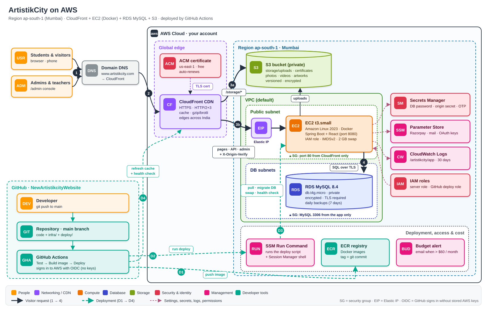
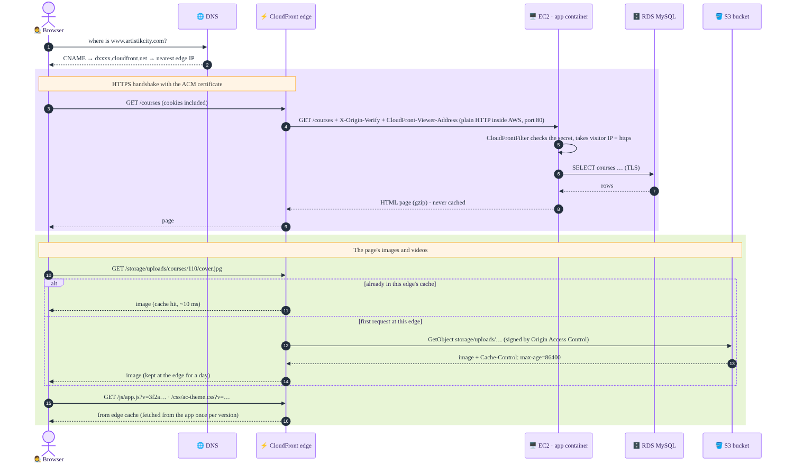
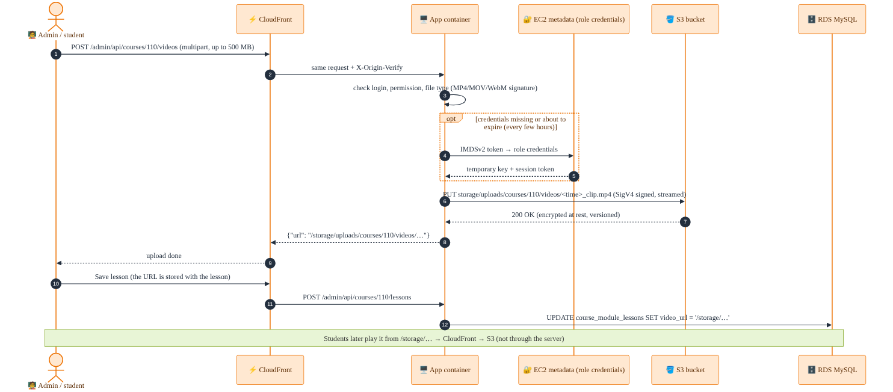
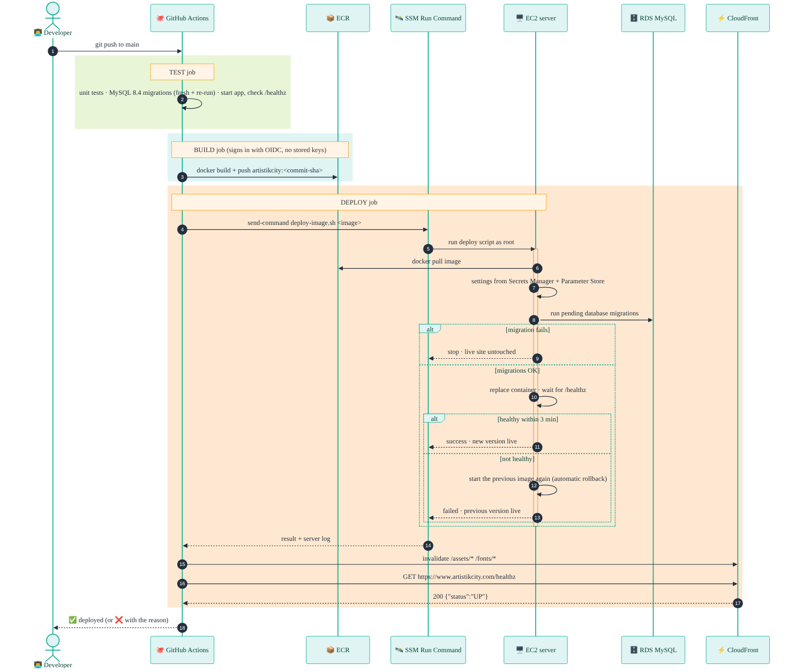

# ArtistikCity – AWS architecture

This document explains **what will be created on AWS for ArtistikCity, what each piece does, and how requests,
uploads, deployments, secrets, logs and backups flow between them**. Everything here is created by the two
CloudFormation templates in `infra/`; the step-by-step setup is in [AWS-DEPLOY.md](AWS-DEPLOY.md).



*Colours follow the AWS service categories: **orange** = compute, **blue** = database, **green** = storage,
**purple** = networking / CDN, **red** = security & identity, **pink** = management, **teal** = developer tools.
Dark numbered arrows (1 → 4) are a visitor's request; teal dashed arrows (D1 → D4) are a deployment.*

**Contents**

1. [The big picture in one minute](#1-the-big-picture-in-one-minute)
2. [How the flows work](#2-how-the-flows-work)
   - [2.1 A visitor opens a page](#21-a-visitor-opens-a-page)
   - [2.2 Images and videos](#22-images-and-videos)
   - [2.3 Someone uploads a file](#23-someone-uploads-a-file)
   - [2.4 Signing in and sessions](#24-signing-in-and-sessions)
   - [2.5 Payments: Razorpay and PayPal](#25-payments-razorpay-and-paypal)
   - [2.6 E-mails and SMS](#26-e-mails-and-sms)
   - [2.7 Deploying a new version](#27-deploying-a-new-version)
   - [2.8 Rolling back](#28-rolling-back)
   - [2.9 How secrets and settings reach the app](#29-how-secrets-and-settings-reach-the-app)
   - [2.10 The server's first boot](#210-the-servers-first-boot)
   - [2.11 Logs and monitoring](#211-logs-and-monitoring)
   - [2.12 Backups and recovery](#212-backups-and-recovery)
3. [Every component in detail](#3-every-component-in-detail)
4. [Security, layer by layer](#4-security-layer-by-layer)
5. [Where everything lives](#5-where-everything-lives)
6. [Costs](#6-costs)
7. [Limits of this design and what to add later](#7-limits-of-this-design-and-what-to-add-later)
8. [Template map and glossary](#8-template-map-and-glossary)

---

## 1. The big picture in one minute

- Your domain **www.artistikcity.com** points to **Amazon CloudFront**, a global network of servers ("edge locations")
  that sits in front of everything. It handles HTTPS and keeps copies of images, videos, scripts and styles close to
  your students in India.
- **Pictures and videos** live in a private **S3 bucket**. CloudFront fetches them from there directly, so they never
  load the web server.
- **Everything else** (pages, logins, the admin console, checkout, the API) goes to one **EC2 server** in Mumbai that
  runs the ArtistikCity app in a **Docker** container. Only CloudFront can talk to this server.
- The app keeps its data (courses, users, orders, studio, marketplace…) in a managed **RDS MySQL 8.4** database that is
  not reachable from the internet at all.
- Passwords and keys are kept in **Secrets Manager** and **Parameter Store**; logs go to **CloudWatch**.
- When you **push code to GitHub**, **GitHub Actions** tests it, packs it into a Docker image (**ECR**) and tells the
  server (through **SSM Run Command**) to switch to the new version, with a health check and automatic rollback.

All of it runs in **ap-south-1 (Mumbai)**. The only exception is the free HTTPS certificate, which CloudFront requires to
be created in **us-east-1**.

---

## 2. How the flows work

### 2.1 A visitor opens a page



1. **DNS lookup.** The browser asks DNS for `www.artistikcity.com`. Your domain provider answers with a CNAME pointing
   to the CloudFront distribution (`dxxxx.cloudfront.net`), and CloudFront's DNS returns the IP of the **nearest edge
   location** (Mumbai, Delhi, Chennai, Bengaluru, Hyderabad, Kolkata… whichever is fastest for that visitor).
2. **HTTPS.** The browser opens an encrypted connection to that edge using the **ACM certificate**. Plain `http://`
   requests are redirected to `https://`. Only TLS 1.2 or newer is accepted; HTTP/2 and HTTP/3 are on.
3. **Routing at the edge.** CloudFront looks at the path:
   - `/storage/*` → the S3 bucket (section 2.2);
   - `/js/*`, `/css/*`, `/assets/*`, `/fonts/*` → the app, but cached at the edge;
   - **everything else** → the app, **never cached** (pages differ per person).
4. **Forwarding to the server.** CloudFront forwards the request to the EC2 server's fixed address (the Elastic IP)
   on **port 80**. Inside AWS this hop is plain HTTP; the visitor's connection is still HTTPS end to end as far as the
   browser is concerned. CloudFront passes along all cookies, query strings and headers, and adds three of its own:
   - `X-Origin-Verify: <secret>` – proof that the request came through *your* CloudFront;
   - `CloudFront-Viewer-Address` – the visitor's real IP address and port;
   - `CloudFront-Forwarded-Proto` – `https`.
5. **Security group check.** Before the request even reaches Linux, the server's **security group** (AWS firewall)
   checks the source: only CloudFront's published IP ranges may connect to port 80. Anything else is dropped.
6. **Docker.** Port 80 on the server is mapped to port 8080 of the **app container**.
7. **CloudFrontFilter (inside the app).** The first thing the app runs:
   - no or wrong `X-Origin-Verify` → **403 Forbidden** (someone found the server's address and tried to bypass CloudFront);
   - otherwise it tells the rest of the app the visitor's real IP (used by the sign-in rate limits and the audit log)
     and that the connection is HTTPS (so cookies are marked `Secure`).
8. **The app does its work.** Spring Boot handles the request, reads/writes **RDS MySQL** over an encrypted
   connection (TLS is required by the database), and renders the page or JSON.
9. **Response.** The app compresses text responses (gzip – the 4.5 MB script bundle travels as ~0.9 MB) and sends them
   back through CloudFront to the browser.

Typical timing for a visitor in India: a few milliseconds to the edge, ~10–30 ms edge → Mumbai server, plus the app's own
processing time.

### 2.2 Images and videos

Everything that users upload is stored in S3 under `storage/…` and is addressed by the same URL as on your PC, e.g.
`/storage/uploads/courses/110/cover.jpg`. Nothing in the database had to change.

1. The browser asks CloudFront for `/storage/uploads/courses/110/cover.jpg`.
2. **Cache hit:** if this edge location already has the file, it answers immediately (no AWS charges beyond data transfer,
   no load on the server).
3. **Cache miss:** CloudFront signs a request to the private bucket with **Origin Access Control (OAC)** and fetches
   the object `storage/uploads/courses/110/cover.jpg`. The bucket policy allows exactly this: *CloudFront distribution X
   may read `storage/*`* – nobody else can read the bucket, not even with the direct S3 URL.
4. The file is stored with `Cache-Control: public, max-age=86400`, so the edge (and the browser) keep it for a day.
5. **Videos** support byte ranges, so the player can start immediately and jump to any point without downloading the
   whole file.

Script and style files (`/js/app.js?v=3f2a…`, `/css/ac-theme.css?v=…`) are cached at the edge too. The `?v=` value is a
fingerprint of the file's content and is part of the cache key, so a new version is fetched automatically after every
deploy; each edge asks the app for a given version only once.

If a `/storage/…` request ever reaches the app instead (for example while testing without CloudFront), the app streams
the file from S3 itself (`StorageController`), including byte ranges.

### 2.3 Someone uploads a file



This covers course photos, lesson videos (up to 500 MB), lesson PDFs, blog images, teacher and student photos, student
submissions, commission reference photos, marketplace artwork and generated certificates.

1. The browser sends the file (multipart form) to CloudFront, which forwards it to the app like any other request.
2. The app checks who is uploading and whether they may, and checks the file itself (size limits; real image/PDF/video
   signatures, not just the file name).
3. The app needs AWS credentials to write to S3. It **never has stored keys**: it asks the EC2 server's
   **instance metadata service (IMDSv2)** for the temporary credentials of the server's **IAM role**. They are cached and
   renewed automatically a few minutes before they expire (every few hours).
4. The app **streams** the file to S3 (`PUT storage/uploads/…`), signed with AWS Signature V4. Big videos are never held
   in memory. S3 encrypts the object and keeps the previous version if a file with the same name is replaced.
5. The app returns the file's URL (`/storage/uploads/…`) and stores it in the database with the course, lesson, post…
6. From then on, everyone loads that file through **CloudFront → S3** (section 2.2), not through the server.

The server's disk holds no user files, so the server can be replaced at any time without losing uploads.

### 2.4 Signing in and sessions

1. The sign-in form posts to the app through CloudFront (never cached).
2. The app checks the password / OTP code / magic link / passkey exactly as on your PC. Sign-in **rate limits** count
   per real visitor IP (from `CloudFront-Viewer-Address`), so one person trying many passwords can't lock out others.
3. On success the app stores the session in the database (`auth_sessions`) and sets the `ac_session` / `ac_refresh`
   cookies. Because the app knows the visit is HTTPS, the cookies are `Secure` and `HttpOnly`; the admin session and
   CSRF cookies are `Secure` too.
4. Every later request carries the cookies; CloudFront forwards them to the app because pages are never cached.
5. Passkeys (WebAuthn) work because the browser sees your real domain; the app reads it from the forwarded `Host` header.

### 2.5 Payments: Razorpay and PayPal

1. The checkout page is served by the app; the payment itself happens in Razorpay's / PayPal's window in the browser.
2. The browser reports the result to the app, which **verifies it with the gateway** (signature check / API call) before
   marking the order paid – exactly as locally.
3. **Webhooks:** Razorpay also calls `https://www.artistikcity.com/api/v1/courses/razorpay-webhook` from its servers.
   That request enters through CloudFront like any other (CloudFront adds the origin secret), and the app verifies the
   webhook signature with `RAZORPAY_WEBHOOK_SECRET` before changing anything.
4. The server talks **out** to Razorpay/PayPal over the internet (outbound traffic is allowed; nothing new is opened
   inbound). Keys come from Parameter Store (section 2.9).

### 2.6 E-mails and SMS

- E-mails (sign-in links, receipts, newsletters, contact form) are sent by the app over SMTP to the mail service you
  configure in Parameter Store (`MAIL_HOST`, …) – for example **Amazon SES** in ap-south-1 or your current provider.
  Without a mail host, e-mails are only written to the log.
- SMS codes go out through Twilio if `SMS_PROVIDER=twilio` and its keys are set.

### 2.7 Deploying a new version



What happens after `git push` to `main` (`.github/workflows/deploy.yml`):

**Test job** (on GitHub's machines, ~5 minutes)
1. Runs the unit tests (`mvn test`).
2. Starts a throw-away **MySQL 8.4**, builds the database from scratch with `deploy/db-migrate.sh` (schema, sample and
   demo data), then runs the migrations again – the second run must change nothing.
3. Starts the app against that database and checks that `/healthz`, `/`, `/courses`, `/login`, `/admin/login` and `/faq`
   answer 200. Any failure stops everything; nothing is built or deployed.

**Build job** (~3–6 minutes)
4. Signs in to AWS with **OpenID Connect**: GitHub proves "I am a workflow of `amitgoswami1027/NewArtistikcityWebsite`
   on `main`" and receives a one-hour session of the **GitHub deploy role**. No AWS keys are stored in GitHub.
5. Builds the Docker image (Maven compiles the app inside the build; layers are cached between runs) and pushes it to
   **ECR** as `artistikcity:<commit sha>`. Tags can't be overwritten, so a tag always means exactly one commit.

**Deploy job** (~3–5 minutes; can require your approval if you protect the `production` environment)
6. Asks **SSM Run Command** to run `/opt/artistikcity/deploy-image.sh <image>` on the server. (No SSH, no open port: the
   SSM agent on the server fetches the command from AWS.)
7. On the server, `deploy-image.sh` pulls the image and takes the real deploy script (`deploy/ec2-deploy.sh`) **out of the
   image**, so the deploy logic always matches the code being deployed. That script then:
   1. **Settings:** builds the app's settings file from Secrets Manager and Parameter Store (section 2.9). If a required
      secret is missing it stops here and keeps the old file.
   2. **Database migrations:** copies `database/` out of the image and runs `db-migrate.sh` in a temporary
      `mysql:8.4` container against RDS. Empty database → create all tables; otherwise → run only the migrations not
      yet listed in `schema_migrations`. **If a migration fails the deploy stops here and the live site is untouched.**
   3. **Swap:** stops the old container and starts the new one (`--restart unless-stopped`, 1.4 GB memory limit, logs to
      CloudWatch). The site is unavailable for the ~30–40 seconds Spring Boot needs to start.
   4. **Health check:** polls `http://127.0.0.1/healthz` (app up **and** database reachable) every 3 seconds for up to
      3 minutes.
   5. **Healthy:** records the new image as current, keeps the previous one for rollback, deletes older images.
      **Not healthy:** prints the app's last log lines, **starts the previous image again**, and reports failure.
8. GitHub shows the server's output in the workflow log.
9. Refreshes CloudFront's cache for `/assets/*` and `/fonts/*` (scripts and styles don't need it thanks to `?v=`).
10. Calls `https://www.artistikcity.com/healthz` from the internet – the full path visitor → CloudFront → server →
    database – and only then marks the deploy green.

Only one deploy runs at a time; a second push waits for the first to finish.

### 2.8 Rolling back

| Situation | What to do | What happens |
|---|---|---|
| New version doesn't start | nothing | automatic: the previous image is started again (2.7, step 7.5) |
| New version starts but has a bug | GitHub → Actions → *Deploy to AWS* → **Run workflow** → tick **rollback** | the server switches back to the image that ran before; run it again to undo the rollback |
| Go back further | Run workflow → `image_tag` = the commit SHA of a good version | that exact image is deployed (it is still in ECR – the last 30 are kept) |
| On the server | Session Manager → `sudo /opt/artistikcity/ec2-deploy.sh --rollback` / `--status` | same as above, without GitHub |

Rollback changes the **app only**; database migrations are never undone. That is why migrations must be written so the
previous version still works with them (add new columns/tables first; remove old ones in a later release).

### 2.9 How secrets and settings reach the app

```
Secrets Manager                    Parameter Store (/artistikcity/prod/…)        CloudFormation outputs
 ├─ RDS master password (by RDS)    ├─ RAZORPAY_KEY / _SECRET / _WEBHOOK_SECRET    (written to /opt/artistikcity/deploy.conf
 ├─ origin-verify (generated)       ├─ MAIL_HOST / _USERNAME / _PASSWORD …         at first boot: bucket, DB host, region,
 └─ otp-secret (generated)          └─ GOOGLE_/FACEBOOK_ client ids, TWILIO_…      secret ARNs, log group, domain)
                \                              |                                       /
                 \_____________ ec2-deploy.sh, on every deploy ______________________/
                                               |
                         /opt/artistikcity/app.env  (root only, chmod 600)
                                               |
                         docker run --env-file app.env  →  environment of the app container
```

- Secrets are read **on every deploy**, so changing one means re-running the last deploy (or a rollback + forward).
- The CloudFront origin secret and the OTP key are generated by AWS and always win over anything in Parameter Store, so
  the server's secret can never drift from the one CloudFront sends.
- The settings file is validated before it replaces the old one; a missing required secret aborts the deploy safely.
- Nothing secret is in the code, in GitHub, in the Docker image or in CloudFormation parameters.

### 2.10 The server's first boot

When CloudFormation creates the EC2 instance, its *user data* script runs once:

1. installs the CloudFormation helper and arranges to report failure if anything below fails;
2. installs all security updates (`dnf update`) and Docker; limits local Docker log files to 3 × 10 MB;
3. creates a **2 GB swap file** (headroom for Java on a 2 GB machine);
4. writes `/opt/artistikcity/deploy.conf` (bucket, database host, secret ARNs, region, log group, site URL);
5. installs `/opt/artistikcity/deploy-image.sh`, the entry point GitHub calls;
6. signals CloudFormation "ready". If this doesn't happen within 20 minutes, the stack rolls back.

The server has no app yet at this point – the first GitHub deploy installs it.

### 2.11 Logs and monitoring

- The app's console output (requests, errors, sign-in events, payment verification…) is sent by Docker straight to
  **CloudWatch Logs**, group `/artistikcity/app`, one stream per deployed version; kept 30 days.
  View: CloudWatch → Log groups, or `aws logs tail /artistikcity/app --follow`.
- `/healthz` is used by deploys and can be used by any uptime monitor.
- The server's own boot log: `/var/log/cloud-init-output.log` (via Session Manager).
- Costs: a **budget alert** (created by you in Billing → Budgets) e-mails you when the month exceeds your limit.
- Image security: ECR scans each pushed image for known vulnerabilities (results in the ECR console).

### 2.12 Backups and recovery

| What | How it is protected | How to restore |
|---|---|---|
| Database | Automatic daily backups kept 7 days, point-in-time restore to any moment in that window (up to about the last 5 minutes); encrypted; deletion protection; a final snapshot is taken if the stack is ever deleted | RDS console → *Restore to point in time* (creates a new database; point the stack at it or copy data back) |
| Uploaded files | S3 keeps every previous version for 30 days after a file is overwritten or deleted; S3 itself stores data across several data centres | S3 console → show versions → restore the old version |
| App versions | Last 30 images in ECR | Rollback (2.8) |
| Server | Holds nothing that isn't recreated automatically | Replace it (re-run the stack update), then re-run the last deploy |
| Code and infrastructure | GitHub | Git history |

---

## 3. Every component in detail

Each entry: **what it is**, **why ArtistikCity uses it**, **how it is set up here**, **what it connects to**, and
**where to find it in the AWS console**.

### 3.1 Domain DNS (your domain provider)

- **What:** the "phone book" entry for `artistikcity.com`, kept at the company where you bought the domain.
- **Why:** sends visitors to CloudFront and proves to AWS that you own the domain (for the certificate).
- **Set-up:** two kinds of records that **you** add by hand:
  - certificate validation **CNAME** records (shown by ACM) – leave them in place, they let the certificate renew;
  - `www` **CNAME → `dxxxx.cloudfront.net`**; and for the bare `artistikcity.com` a redirect to `https://www.…`
    (or an ALIAS/ANAME record if your provider supports it).
- **Not managed by AWS** unless you move the domain's DNS to Route 53.

### 3.2 ACM certificate (AWS Certificate Manager) – `infra/certificate.yml`

- **What:** the HTTPS certificate (the padlock) for `www.artistikcity.com` and `artistikcity.com`.
- **Why:** browsers require HTTPS; passkeys, secure cookies and payment pages depend on it.
- **Set-up:** DNS-validated, **free**, renews automatically as long as the validation CNAME stays in DNS.
  Created in **us-east-1** because CloudFront only uses certificates from that region.
- **Connects to:** CloudFront (attached to the distribution).
- **Console:** Certificate Manager, region *N. Virginia*.

### 3.3 Amazon CloudFront – the front door

- **What:** AWS's content delivery network: hundreds of edge locations worldwide (many in India) that receive visitors'
  requests, keep cached copies of files and forward the rest to your server.
- **Why:** one HTTPS endpoint for the whole site; images and videos load fast from a nearby edge; the server is hidden
  and protected; free DDoS protection (AWS Shield Standard).
- **Set-up** (resource `Distribution`):
  - aliases `www.artistikcity.com` (+ `artistikcity.com`), the ACM certificate, TLS 1.2+ (`TLSv1.2_2021`),
    HTTP/2 + HTTP/3, IPv6, **price class 200** (all edges except the most expensive regions; includes India);
  - **two origins:**
    - `app` – the EC2 server's public DNS name (from its Elastic IP), HTTP port 80, 60-second response timeout, and the
      custom header `X-Origin-Verify` with the generated secret;
    - `uploads` – the S3 bucket through **Origin Access Control** (CloudFront signs every request to S3);
  - **behaviours (routing rules):**

    | Path | Goes to | Caching |
    |---|---|---|
    | `/storage/*` | S3 bucket | AWS *CachingOptimized* (honours the files' 1-day `Cache-Control`; gzip/brotli) |
    | `/js/*`, `/css/*`, `/assets/*`, `/fonts/*` | app | custom *static* policy: 1 day by default, query string (`?v=`) in the key |
    | everything else (default) | app | **no caching**; all headers, cookies and query strings forwarded (*AllViewerAndCloudFrontHeaders*) |

  - every `http://` request is redirected to `https://`; the default behaviour allows GET, POST, PUT, PATCH, DELETE.
- **Connects to:** DNS (in), S3 and EC2 (out), ACM (certificate).
- **Console:** CloudFront → Distributions.

### 3.4 Origin Access Control and the bucket policy

- **What:** the mechanism that lets **only your CloudFront distribution** read the private bucket.
- **Set-up:** `UploadsOriginAccessControl` (always sign, SigV4) + `UploadsBucketPolicy`:
  1. allow `cloudfront.amazonaws.com` to `GetObject` on `storage/*` **only if** the request comes from this
     distribution (`AWS:SourceArn` condition);
  2. deny any request to the bucket that doesn't use TLS.

### 3.5 Amazon S3 – uploads bucket

- **What:** object storage for every user-uploaded file.
- **Why:** unlimited space, 99.999999999 % durability, no disk to fill up on the server, files survive server
  replacement, and CloudFront can serve them directly.
- **Set-up** (resource `UploadsBucket`, name `artistikcity-uploads-<account id>`):
  - **all public access blocked**; object ownership enforced (no ACLs);
  - **encryption at rest** (SSE-S3, AES-256, bucket key on);
  - **versioning on**; previous versions deleted after **30 days**; unfinished multipart uploads cleaned after 7 days;
  - CORS: `GET`/`HEAD` allowed from `https://www.artistikcity.com` (and the bare domain);
  - **kept if the stack is deleted** (`DeletionPolicy: Retain`) so files are never lost by accident.
- **Layout:** `storage/uploads/courses/<id>/…`, `storage/uploads/courses/<id>/videos/…`, `storage/uploads/blog/…`,
  `storage/uploads/teachers/<id>/…`, `storage/uploads/students/<id>/…`, `storage/uploads/marketplace/…`,
  `storage/uploads/commissions/…`, `storage/uploads/submissions/…`, `storage/certificates/…` – the same paths as the
  `storage/` folder on your PC.
- **Who may do what:** CloudFront reads `storage/*`; the server role reads, writes and deletes `storage/*`; nobody else.
- **Console:** S3 → Buckets.

### 3.6 VPC, subnets and security groups – the network

- **What:** the **VPC** is your private network in Mumbai (the account's default VPC is used). **Subnets** are slices of it
  in different availability zones (separate data centres). **Security groups** are stateful firewalls attached to the
  server and the database.
- **Set-up:**
  - **App security group** (`AppSecurityGroup`): inbound **TCP 80 only from the AWS-managed list of CloudFront IPs**
    (`com.amazonaws.global.cloudfront.origin-facing`). No 443 (HTTPS ends at CloudFront), no 8080 (only inside the server),
    **no 22** unless you explicitly pass `SshCidr` (Session Manager replaces SSH). Outbound: open (updates, S3, payment
    gateways, e-mail).
  - **Database security group** (`DbSecurityGroup`): inbound **TCP 3306 only from the app security group** – not from
    the internet, not from other machines.
  - **DB subnet group:** the 2–3 subnets you choose in different zones, so RDS can place (and, with Multi-AZ, fail over)
    the database across data centres.
- **Console:** VPC → Security groups / Subnets.

### 3.7 Elastic IP

- **What:** a fixed public IPv4 address attached to the server.
- **Why:** CloudFront needs a stable address for the `app` origin. Without it the server's address would change on every
  stop/start. The origin name is the AWS DNS name of this IP (`ec2-<ip>.ap-south-1.compute.amazonaws.com`).
- **Cost:** AWS charges for public IPv4 addresses (≈ $3.65/month).

### 3.8 Amazon EC2 – the web server

- **What:** a virtual machine in Mumbai.
- **Why:** runs the ArtistikCity app (Java/Spring Boot + the React bundle) in Docker, the same image that is tested in CI.
- **Set-up** (`AppLaunchTemplate` + `AppInstance`):
  - **t3.small** (2 vCPU burstable, 2 GB RAM) + 2 GB swap; resize later to t3.medium (4 GB) by changing one parameter;
  - **Amazon Linux 2023**, latest image looked up automatically at creation; security updates installed at first boot;
  - **30 GB gp3 disk, encrypted**; holds the OS, Docker and images only – no user data;
  - **IMDSv2 required** (protects the instance credentials from SSRF-style attacks) with hop limit 2 so the container can
    reach them;
  - **IAM instance profile** with the server role (3.14);
  - SSM agent (pre-installed) so GitHub and you can reach it without SSH.
- **On the disk:** `/opt/artistikcity/` – `deploy.conf`, `deploy-image.sh`, `ec2-deploy.sh` (copied from the image),
  `app.env` (settings, root only), `state/` (current and previous image).
- **Console:** EC2 → Instances → `artistikcity-app`.

### 3.9 The app container (inside EC2)

- **What:** the Docker image built from the repository's `Dockerfile`: Eclipse Temurin **Java 17** runtime, the Spring
  Boot jar (which contains the compiled React bundle), `database/` (schema + migrations) and `deploy/` (server scripts).
- **Runs as:** a **non-root user**, `docker run -d --restart unless-stopped -p 80:8080 --memory 1400m --env-file app.env
  --log-driver awslogs …`; Java uses up to 75 % of the container memory and exits (and is restarted) on out-of-memory.
- **AWS-specific behaviour switched on by the settings file:**

  | Setting | Effect |
  |---|---|
  | `STORAGE_DRIVER=s3`, `S3_BUCKET`, `AWS_REGION` | uploads go to S3 (`support/Storage` → `support/s3/S3Client`, credentials from the instance role) |
  | `TRUST_CLOUDFRONT=true`, `ORIGIN_VERIFY_SECRET` | `CloudFrontFilter`: reject requests without the secret, real visitor IP, HTTPS detection |
  | `DB_URL=…sslMode=REQUIRED`, `DB_USERNAME`, `DB_PASSWORD` | encrypted connection to RDS |
  | `SESSION_COOKIE_SECURE=true`, `AUTH_COOKIE_SECURE=true` | cookies only sent over HTTPS |
  | `APP_URL=https://www.artistikcity.com` | correct links in e-mails and OAuth callbacks |
  | `PAYMENT_TEST_MODE=false`, `TZ=Asia/Kolkata` | real payments only; Indian time for dates |
- **Endpoints used by the infrastructure:** `GET /healthz` → `{"status":"UP","db":"UP"}` (200) or 503.

### 3.10 Amazon RDS for MySQL 8.4 – the database

- **What:** a MySQL server run by AWS: AWS handles the hardware, OS, MySQL patches, backups and monitoring.
- **Why:** the same MySQL 8.4 as on your PC, so the schema, migrations and queries are unchanged; managed backups and
  encryption without effort.
- **Set-up** (`Database`, `DbParameterGroup`, `DbSubnetGroup`):
  - **db.t4g.micro** (2 vCPU burstable, 1 GB RAM, ARM/Graviton) – enough to start; one parameter to grow;
  - **20 GB gp3** storage that grows automatically up to **200 GB**; **encrypted**;
  - **not publicly accessible**; reachable only from the app security group;
  - **TLS required** for every connection (`require_secure_transport`);
  - `utf8mb4` / `utf8mb4_unicode_ci` (₹, é, emoji…), **time zone Asia/Calcutta** (same clock as your PC);
  - database `artistikcity`, admin user `artistik_admin`, **password created and stored by RDS in Secrets Manager**
    (never typed by anyone; can be rotated);
  - **backups:** daily, kept 7 days, window 02:00–03:00 IST; point-in-time restore;
  - **maintenance:** minor version upgrades automatically, Monday 03:15–04:15 IST;
  - **deletion protection on**; a final snapshot is taken if the stack is deleted;
  - **Multi-AZ off** by default (one parameter switches on a standby copy in another zone).
- **Console:** RDS → Databases → `artistikcity-db`.

### 3.11 Amazon ECR – image registry

- **What:** a private Docker registry.
- **Why:** every deploy is an image tagged with its git commit, so you always know exactly what is running and can go
  back to any recent version instantly.
- **Set-up:** repository `artistikcity`, **immutable tags**, **scan on push** (known vulnerabilities), encrypted, keeps
  the **last 30 images**, kept if the stack is deleted.
- **Who may do what:** GitHub's role pushes; the server role pulls.
- **Console:** ECR → Repositories.

### 3.12 AWS Secrets Manager

- **What:** encrypted storage for secrets, with access control and audit.
- **Holds:**
  - the **database password** (created and managed by RDS, rotatable);
  - `artistikcity/origin-verify` – 48 random characters, shared by CloudFront (as the header value) and the app;
  - `artistikcity/otp-secret` – 48 random characters, the key that protects one-time sign-in codes.
- **Who may read:** only the server role (at deploy time). Nobody else, not GitHub.
- **Console:** Secrets Manager → Secrets.

### 3.13 AWS Systems Manager (SSM) – Parameter Store, Run Command, Session Manager

- **Parameter Store:** your optional settings as encrypted `SecureString` values under `/artistikcity/prod/` – Razorpay,
  PayPal, mail, Google/Facebook sign-in, Twilio, WebAuthn… The parameter name is the environment variable name.
  Free. Read by the server at every deploy.
- **Run Command:** how GitHub starts a deploy on the server. GitHub may run commands **only on this one instance** and only
  with the standard shell document. The SSM agent on the server polls AWS for commands – no inbound port is needed.
- **Session Manager:** a browser-based or CLI shell on the server (EC2 → Connect → Session Manager), logged and
  permission-controlled, without SSH keys or an open port 22. Also used to tunnel to the database when copying data.
- **Console:** Systems Manager → Parameter Store / Run Command / Session Manager.

### 3.14 IAM – roles and permissions

- **What:** who (or what) may do which AWS actions. Roles give **temporary** credentials; nothing uses long-term keys.
- **Server role** (`AppRole`, attached via `AppInstanceProfile`):
  - S3: read/write/delete `storage/*` in the uploads bucket, list that bucket;
  - ECR: pull images from the `artistikcity` repository;
  - Secrets Manager: read the three secrets above, nothing else;
  - Parameter Store: read `/artistikcity/prod/*` only;
  - CloudWatch Logs: write to `/artistikcity/app` only;
  - the AWS-managed `AmazonSSMManagedInstanceCore` policy (Run Command, Session Manager).
- **GitHub deploy role** (`GitHubDeployRole`) – can only be assumed by GitHub Actions runs of
  `amitgoswami1027/NewArtistikcityWebsite` on branch `main` (or its `production` environment), via the
  **GitHub OIDC provider**:
  - push images to the `artistikcity` repository;
  - run the shell document on **this one instance** and read the result;
  - refresh the cache of **this one distribution**.
- **Your own user** (`amit-admin`, AdministratorAccess, MFA) is for you and the CLI only; the system never uses it.
- **Console:** IAM → Roles.

### 3.15 Amazon CloudWatch Logs

- **What:** central log storage and search.
- **Set-up:** log group `/artistikcity/app`, **30 days** retention, one stream per deployed version
  (`app-<commit>-<time>`). Docker sends the container's output directly; nothing is kept on the server's disk long-term.
- **Console:** CloudWatch → Log groups (use *Logs Insights* to search, e.g. all `ERROR` lines in the last hour).

### 3.16 GitHub repository and GitHub Actions

- **Repository:** the single source of truth – application code, `infra/` (CloudFormation), `deploy/` (server scripts),
  `.github/workflows/deploy.yml` (the pipeline).
- **GitHub Actions:** runs the pipeline on GitHub's machines (section 2.7). Configuration lives in five repository
  **variables** (role ARN, ECR repository, instance id, distribution id, site domain) – no secrets.
- **Safety features:** one deploy at a time; builds only after tests pass; nothing deploys until the AWS variables exist;
  optional manual approval via the `production` environment; manual *rollback* and *image_tag* inputs.

### 3.17 CloudFormation – how it is all created

- **What:** AWS's "infrastructure as code": the YAML templates describe every resource above; CloudFormation creates them
  in the right order, wires them together and can update or delete them as a unit.
- **Stacks:** `artistikcity-cert` (us-east-1: the certificate) and `artistikcity` (ap-south-1: everything else).
- **Why:** repeatable (a test copy is one command), reviewable (changes are diffs in Git), and complete (nothing forgotten
  in the console). Kept on purpose when the stack is deleted: the S3 bucket, the ECR repository and a final database
  snapshot.

### 3.18 Budget alert (created by you)

- **What:** AWS Budgets e-mails you when the month's cost passes a limit (e.g. $60). Not part of the templates – set it
  up once in Billing → Budgets.

---

## 4. Security, layer by layer

| Layer | What protects it |
|---|---|
| **Visitor ↔ CloudFront** | HTTPS only (HTTP redirected), TLS 1.2+, AWS Shield Standard against DDoS |
| **CloudFront → server** | Security group allows port 80 **only from CloudFront's IP ranges**; secret `X-Origin-Verify` header checked by the app (403 otherwise); the traffic stays on AWS's network |
| **Server** | No SSH port; access only through Session Manager (logged); IMDSv2 only; encrypted disk; security updates at first boot; app runs as a non-root user with a memory limit |
| **App** | Real visitor IP for rate limits; `Secure`/`HttpOnly` cookies; CSRF protection; uploads checked by content; payment results verified with the gateway; rich text cleaned |
| **Database** | No public IP; reachable only from the server's security group; TLS required; encrypted at rest; password generated and held by AWS |
| **Files** | Bucket fully private; only CloudFront can read and only the server role can write; TLS required; encrypted; versioned |
| **Secrets** | Secrets Manager / Parameter Store, encrypted; read only by the server role at deploy time; root-only file on the server; never in code, GitHub or the image |
| **Identities** | Roles with least privilege and temporary credentials; GitHub can only deploy this repo's `main` to this one server; your admin user has MFA |
| **Supply chain** | Every image is tested before it is built, tagged with its commit, immutable and vulnerability-scanned |

---

## 5. Where everything lives

| Data | Where | Backed up |
|---|---|---|
| Courses, users, orders, studio, marketplace, settings, sessions | RDS MySQL `artistikcity` | daily backups, 7 days, point-in-time restore; final snapshot on deletion |
| Uploaded files and certificates | S3 `artistikcity-uploads-<account>/storage/…` | versions kept 30 days; S3 durability |
| App versions | ECR `artistikcity` (last 30) | – |
| Secrets | Secrets Manager (3 secrets) | managed by AWS |
| Optional settings | Parameter Store `/artistikcity/prod/…` | managed by AWS |
| Logs | CloudWatch `/artistikcity/app` (30 days) | – |
| Server configuration | EC2 `/opt/artistikcity/` (recreated automatically) | not needed |
| Code, templates, pipeline | GitHub | Git history |

---

## 6. Costs

Approximate on-demand prices in Mumbai at low traffic (check the [AWS Pricing Calculator](https://calculator.aws/)):

| Item | ≈ per month |
|---|---|
| EC2 t3.small (always on) | $16 |
| Public IPv4 address (Elastic IP) | $3.65 |
| RDS db.t4g.micro (single zone) | $15 |
| RDS storage 20 GB gp3 + backups within the free backup allowance | ≈ $3 |
| Secrets Manager (3 secrets) | $1.20 |
| S3 storage | ≈ $0.025 per GB stored |
| CloudFront data transfer to visitors in India | per GB (the main variable cost; images and videos dominate) |
| ECR, CloudWatch Logs, Parameter Store, SSM, ACM, IAM | cents or free |
| **Total at low traffic** | **≈ $40–45 + data transfer** |

New AWS accounts may have free-tier credits that cover part of the first months.

---

## 7. Limits of this design and what to add later

| Today | Consequence | Upgrade path | Rough extra cost |
|---|---|---|---|
| One server | ~30–40 s downtime per deploy; if the server fails, the site is down until it is replaced | second server + Application Load Balancer, rolling deploys | ≈ $16 server + ≈ $18 load balancer |
| Single-zone database | if that data centre fails, restore from backup | `DbMultiAZ=true` (automatic failover) | ≈ doubles the database cost |
| No web application firewall | bots and attacks are filtered only by the app | AWS WAF on CloudFront (managed rules, rate limits) | ≈ $5 + $1 per rule + per request |
| Mail via your current provider | – | Amazon SES in ap-south-1 | ≈ $0.10 per 1,000 e-mails |
| One environment | changes go straight to production after tests | a staging copy of the stack (same templates) | the stack again |
| t3.small / db.t4g.micro | fine for hundreds of concurrent visitors | change `InstanceType` / `DbInstanceClass` | per size |

The upgrade-path costs are rough estimates for planning; check current prices before deciding.

---

## 8. Template map and glossary

**Diagram box → CloudFormation resource**

| In the diagram | Resource(s) |
|---|---|
| ACM certificate | `Certificate` (`infra/certificate.yml`, us-east-1) |
| CloudFront CDN | `Distribution`, `StaticCachePolicy`, `UploadsOriginAccessControl` |
| S3 bucket | `UploadsBucket`, `UploadsBucketPolicy` |
| Elastic IP, EC2 | `AppElasticIp`, `AppInstance`, `AppLaunchTemplate`, `AppSecurityGroup` (+ `AppSshIngress` if SSH is enabled) |
| RDS MySQL | `Database`, `DbParameterGroup`, `DbSubnetGroup`, `DbSecurityGroup` |
| ECR | `Repository` |
| Secrets Manager | `OriginVerifySecret`, `OtpSecret` (+ the RDS-managed password secret) |
| CloudWatch Logs | `AppLogGroup` |
| IAM roles | `AppRole`, `AppInstanceProfile`, `GitHubDeployRole`, `GitHubOidcProvider` |
| Parameter Store | filled by you under `/artistikcity/prod/` |
| Budget alert | created by you in Billing → Budgets |

**Glossary**

| Term | Meaning |
|---|---|
| Edge location | A CloudFront data centre near the visitor that answers requests and caches files |
| Origin | Where CloudFront fetches content from: here the S3 bucket and the EC2 server |
| Cache hit / miss | The edge already has the file / has to fetch it from the origin |
| OAC (Origin Access Control) | Lets only your distribution read the private bucket |
| Availability zone | A separate data centre within the region; Mumbai has three |
| Security group | A firewall attached to a server or database, with rules by port and source |
| IAM role | A set of permissions that a service (EC2, GitHub) takes on temporarily – no stored passwords |
| IMDSv2 | The EC2 metadata service (version 2, token-based) where the server gets its role's temporary credentials |
| OIDC | OpenID Connect: GitHub proves the identity of a workflow run to AWS, so no AWS keys are stored in GitHub |
| SSM | AWS Systems Manager: Parameter Store, Run Command, Session Manager |
| ECR image tag | The name of a version of the app image; here always the git commit SHA |
| Migration | A dated SQL script in `database/migrations/` that changes the database structure; run once per database |
| Health check | `GET /healthz`; answers 200 only when the app runs and the database responds |
| Rollback | Switching the server back to the previous image |

Diagram sources: `diagrams/aws-architecture.svg` (generated by `diagrams/make_architecture_svg.py`),
`diagrams/aws-request-flow.mmd`, `diagrams/aws-upload-flow.mmd`, `diagrams/aws-cicd.mmd` (Mermaid; render with
`mmdc -i <file>.mmd -o <file>.png`).
