# My prompts: building ArtistikCity with Claude

This is the record of every request sent to Claude for the ArtistikCity project, from 23 October to 8 November 2026. For each one it gives:

- **the prompt** (word for word where the text survives);
- **what it produced**: features, files, database migrations, tests and reports;
- **screenshots of the result**, taken from the current code.

The site is an online art school with live courses, workshops, a student studio, an original-art marketplace, commissions and landing pages. It is a Java 17 / Spring Boot port of a Laravel + Inertia + React app on MySQL 8.4, deployed to AWS (CloudFront → EC2 + RDS + S3).

> **Where the text comes from**
>
> - **Long prompts** were sent as attachments, so their full text survives. They are reproduced word for word in the collapsible *Full prompt* blocks.
> - **Short prompts typed into the chat** before 7 November were not kept word for word (the chat history was condensed as the session grew). They are marked **Reconstructed**: the request is described from what was delivered (the git commit, its files and the backup folder made before the change). Nothing in those descriptions is invented beyond what the code shows.
> - **Logs and error screenshots** you pasted are shown as short excerpts. AWS account numbers and IP addresses are masked, because this repository is public.
> - **Reusable prompts**: after each prompt there is a project-agnostic version with `{{…}}` placeholders, for building the same kind of feature in another project (see [How to reuse these prompts](#how-to-reuse-these-prompts-in-another-project)).
> - **Screenshots** were taken on 8 November 2026 from the current code: the dev profile on a fresh database (`schema.sql` + `seed.sql` + every migration + the optional demo pack), at 1366×860 for desktop and 390×844 for phone. They therefore show each feature as it stands today, including later improvements.

## Contents

| # | When (IST) | Prompt | Type | Result in git |
|---|---|---|---|---|
| 1 | 23 Oct 2026, 15:57 | [Set the project up for Claude Code](#1-set-the-project-up-for-claude-code) | Reconstructed | `f24cb4e` |
| 2 | 23 Oct 2026, 18:46 | [Sign-in: OAuth, OTP, magic links and passkeys](#2-sign-in-oauth-otp-magic-links-and-passkeys) | Reconstructed | `5b6147a` |
| 3 | 24 Oct 2026, 00:25 | [My studio, my courses, wish list and checkout](#3-my-studio-my-courses-wish-list-and-checkout) | Reconstructed | `6df9214` |
| 4 | 24 Oct 2026, 10:03 | [The admin console (admin persona)](#4-the-admin-console-admin-persona) | Reconstructed | `17c0c52` |
| 5 | 24 Oct 2026, 15:45 | [Make it run on AWS](#5-make-it-run-on-aws) | Reconstructed | `0d40042` |
| 6 | 25 Oct 2026, 11:49 | [AWS architecture documentation](#6-aws-architecture-documentation) | Reconstructed | `bdceabe` |
| 7 | 25 Oct 2026, 12:48 | [CloudFormation stack failed (troubleshooting)](#7-cloudformation-stack-failed-troubleshooting) | Pasted log |  |
| 8 | 25 Oct 2026, 13:33 | [Marketplace purchase workflow](#8-marketplace-purchase-workflow) | Full prompt | `e11bb00` |
| 9 | 5 Nov 2026, 10:47 | [Portfolio PDFs, preview page and marketplace images in S3](#9-portfolio-pdfs-preview-page-and-marketplace-images-in-s3) | Full prompt | `5a4ccf7` |
| 10 | 5 Nov 2026, 13:28 | [GitHub deploy refused by AWS (troubleshooting)](#10-github-deploy-refused-by-aws-troubleshooting) | Pasted log |  |
| 11 | 5 Nov 2026, 14:34 – 15:09 | [Site-wide password lock and trimming the live data](#11-site-wide-password-lock-and-trimming-the-live-data) | Reconstructed | `d1a8873`, `c6fd43b` |
| 12 | 5 Nov 2026, 15:52 | [Age groups as a managed list](#12-age-groups-as-a-managed-list) | Reconstructed | `605d835` |
| 13 | 5 Nov 2026, 15:51 | [Production-readiness audit (QA, RBAC, UX)](#13-production-readiness-audit-qa-rbac-ux) | Full prompt | `2ddb68a`, `d8eb647` |
| 14 | 6 Nov 2026, 09:26 | [Courses menu, painting preview and Buy now](#14-courses-menu-painting-preview-and-buy-now) | Reconstructed | `549f6c0` |
| 15 | 6 Nov 2026, 17:44 | [Admin persona: configuration panel, site settings and Studio Stories CMS](#15-admin-persona-configuration-panel-site-settings-and-studio-stories-cms) | Full prompt | `2302de0`, `b9bf3db` |
| 16 | 6 Nov 2026, 18:57 | [How it works: add "Sell your art"](#16-how-it-works-add-sell-your-art) | Reconstructed | `c2fa684` |
| 17 | 6 Nov 2026, 19:30 | [My studio: Sell your art](#17-my-studio-sell-your-art) | Reconstructed | `16f60c7` |
| 18 | 6 Nov 2026, 20:06 – 20:26 | [Marketplace collections, commission banner](#18-marketplace-collections-commission-banner) | Reconstructed | `4f2ccf3`, `df125c4` |
| 19 | 6 Nov 2026, 23:19 | [End-to-end QA, fresh demo data and an admin-controlled site password](#19-end-to-end-qa-fresh-demo-data-and-an-admin-controlled-site-password) | Full prompt | `45fe1b8` |
| 20 | 7 Nov 2026, 16:50 | [Cart, Make an offer and a better step 2](#20-cart-make-an-offer-and-a-better-step-2) | Full prompt | `f3d4804` |
| 21 | 7 Nov 2026, 21:40 | [Landing Page Management module](#21-landing-page-management-module) | Full prompt | `383602b` |
| 22 | 7 Nov 2026, 23:34 | [Three showcase landing pages](#22-three-showcase-landing-pages) | Full prompt | `5c6e51e` |
| 23 | 8 Nov 2026, 00:02 | [Keep the original pages; give landing pages their own address; fix error QRCZ0J9](#23-keep-the-original-pages-give-landing-pages-their-own-address-fix-error-qrcz0j9) | Chat | `9c6b5b3` |
| 24 | 8 Nov 2026, 00:28 → 08:27 | [500 error on /admin/landing after the AWS deploy](#24-500-error-on-adminlanding-after-the-aws-deploy) | Chat + screenshots + log | `6e3a188` |
| 25 | 8 Nov 2026, 08:47 | [This document](#25-this-document) | Chat |  |

---

## How to reuse these prompts in another project

Every section below has a **Reusable prompt** block: the same request rewritten without ArtistikCity details, so it works for any web project.

1. Open Claude Code in the other project's folder.
2. Paste the **context block** below once, at the start of the session, and fill in the `{{…}}` placeholders.
3. Paste the reusable prompt you need, again filling in its placeholders. Delete any lines that don't apply.

The prompts assume the project has a `CLAUDE.md`. Prompt 1 creates one if it doesn't.

**Context block (paste first):**

```text
You are a senior full-stack engineer working on {{PROJECT_NAME}}, {{ONE_LINE_DESCRIPTION}}.
Stack: {{BACKEND e.g. Java 17 Spring Boot / Node Express / Laravel}}, {{DATABASE e.g. MySQL 8}}, {{FRONTEND e.g. React + Inertia}},
hosted on {{HOSTING e.g. AWS EC2 + RDS + S3}}.

Working rules:
- Read CLAUDE.md first and follow its conventions exactly; update it when you add routes, tables or settings.
- Look at the existing code before designing anything: reuse what is there, never build a second version of an existing feature.
- Schema changes: update the full schema file AND add a dated, re-runnable migration for databases that already hold data.
- Never delete or reset data, never touch the live database, never put secrets in code or logs.
- Validate on the server; the browser never decides prices, permissions or totals.
- Every page must work on a phone (390 px) as well as desktop.
- Ask me before assuming anything that is expensive to undo; otherwise make the sensible choice and say which one you made.
- Finish with tests (unit + an end-to-end check of the main flow), look at screenshots of new screens yourself, and give me a
  short report: what changed, files, migrations, how to run it, what you could not verify.
```

---

## 1. Set the project up for Claude Code

**When:** 23 Oct 2026, 15:57 · **Type:** Reconstructed · **Commit:** `f24cb4e` *claude code conversion*

**Prompt (reconstructed):** prepare the converted Java/MySQL project so Claude can work on it: explain the stack, commands and conventions, and add shortcuts for the routine jobs.

**Reusable prompt (for other projects):**

```text
Set this repository up so you can work on it efficiently in future sessions.
1. Read the code and write CLAUDE.md: what the product is, the stack, every command (run, build, test, migrate, deploy),
   the folder layout, conventions (naming, SQL style, how pages are rendered, auth guards, CSRF) and known gotchas.
   Keep it factual and short enough to read in two minutes.
2. Add project slash commands in .claude/commands/ for the routine jobs: rebuild the front end, make a schema change the
   house way (schema file + dated migration + seed), start the app locally and smoke-test the main pages.
3. Add .claude/settings.json with the permissions those commands need.
Do not change application code in this step.
```

**What it produced**
- `CLAUDE.md`, the project guide Claude reads at the start of every session. It covers the stack, every command, the layout, conventions and gotchas (MySQL quoting, `Db`/`Row`, Inertia rendering, CSRF, routes). It has been kept up to date after every later prompt.
- Three project slash commands in `.claude/commands/`: `build-frontend` (rebuild the React bundle), `db-change` (schema change the house way: `schema.sql` + dated migration + seed) and `run-dev` (start the app and smoke-test it).
- `.claude/settings.json` and a VS Code workspace (`ArtistikCity.code-workspace`, commit `38bd86f`).

---

## 2. Sign-in: OAuth, OTP, magic links and passkeys

**When:** 23 Oct 2026, 18:46 · **Type:** Reconstructed · **Commit:** `5b6147a` *Oauth Implementation -Claude code* (93 files)

**Prompt (reconstructed):** implement modern student sign-in (Google / Facebook, phone OTP, e-mail magic links, passwords and passkeys) with one account per person, and move the local setup from SQL Server to MySQL.

**Reusable prompt (for other projects):**

```text
Implement modern sign-in for {{USER_TYPE e.g. students}} with ONE account per person and several ways in:
Google and {{OTHER_PROVIDER}} (OpenID Connect, verify ID tokens against the provider's JWKS), phone number + one-time code
(SMS provider pluggable: {{SMS_PROVIDERS}}), e-mail magic link, password (bcrypt, compatible with {{EXISTING_HASH_FORMAT}}),
and passkeys (WebAuthn).
Rules:
- Users are unique by e-mail and by verified phone (normalise to E.164). Link a provider to an existing account only when
  the e-mail is verified on both sides; keep provider identities in their own table.
- Server-side sessions in the database with a refresh token (HttpOnly cookies), "remember me", sign out everywhere.
- Rate-limit codes and log-in attempts per IP and per account; one-time codes expire and are single use.
- Changing a sign-in method needs a log-in younger than 30 minutes (answer 403 {reauth}).
- JSON auth endpoints return {message, errors, retryAfter, reauth}.
Deliver: migration, services, API, the log-in/join UI, account security page, unit tests for tokens, password policy,
JWT/JWKS and WebAuthn.
```

**What it produced**
- Package `auth/`:
  - `SessionService` keeps database sessions with refresh tokens in the `ac_session` / `ac_refresh` cookies;
  - `AccountService` gives one user many providers, merging only on a verified e-mail;
  - `OtpService` plus `sms/` send phone codes;
  - `EmailTokenService` handles magic links, e-mail verification and password reset;
  - `JwtVerifier` checks Google / Facebook ID tokens against their JWKS;
  - `webauthn/` adds passkeys;
  - `PasswordPolicy`, `PhoneNumbers` (E.164) and `RateLimiter`.
- JSON auth API `/auth/**` that answers `{message, errors, retryAfter, reauth}`. Changing a sign-in method needs a login younger than 30 minutes.
- React: `Components/Auth/SignInMethods`, `webauthn.js`, `Pages/Auth/MagicLink`.
- Migration `2026-10-23_auth_system.sql`. The SQL Server launchers became `START-MySQL.bat` / `STOP-MySQL.bat`.
- Unit tests for tokens, password policy, JWT/JWKS and WebAuthn (`src/test/java/com/artistikcity/auth`).

<table><tr><td width="100%" valign="top">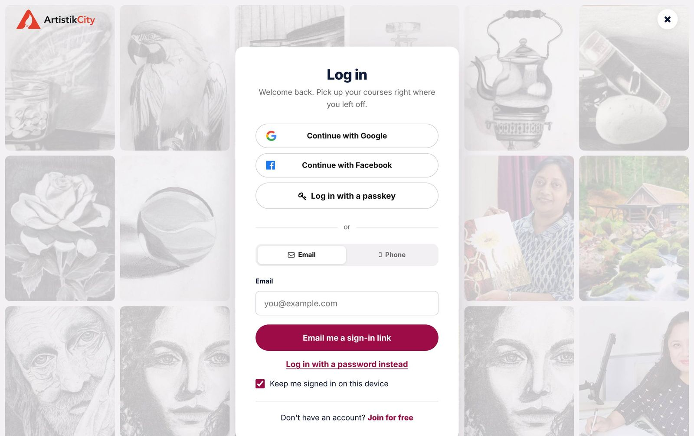<br><sub>The log-in page: Google, Facebook, passkey, e-mail magic link / phone code, or a password.</sub></td></tr></table>

---

## 3. My studio, my courses, wish list and checkout

**When:** 24 Oct 2026, 00:25 · **Type:** Reconstructed · **Commit:** `6df9214` *worked on features related to my studio functionality*

**Prompt (reconstructed):** rebuild the student area. The studio, the course player and the account pages each get their own layout; add a wish list, a proper course checkout and "Your orders".

**Reusable prompt (for other projects):**

```text
Rebuild the signed-in {{USER_TYPE}} area as three clear spaces, each with its own layout:
1. "My {{WORKSPACE e.g. studio}}": a home with the user's journey/progress ({{JOURNEY_STEPS}}) and tabs for their main objects.
2. A focused learning/consumption view for one {{ITEM e.g. course}}: overview, resume where I left off, a sidebar outline,
   previous / next across sections, mark complete. Every URL checks the user really owns a paid order for it.
3. "My account": profile, Your orders (every order type in one list), wish list (heart button on cards), addresses,
   log-in & security, notifications, help. Counts in the header avatar menu.
Also replace the old checkout pages with one modern checkout for {{ITEM}} (order summary, payment choice, result page).
Redirect every old URL to its new home. Migrations for wish list and checkout; tests for access rules.
```

**What it produced**
- **Account pages:** *My account* layout (`Components/Account/AccountLayout`, `nav.js`), *Your orders* (`Pages/Account/Orders`) and *Wish list* (`wishlist_items`, `SaveButton` heart button, `/user/wishlist`).
- **Course player:** focused *My course* view (`CourseLearningController`, `CourseShell`) with the overview `/user/course/{order}`, resume, and a learning view with a syllabus sidebar, previous / next and "mark complete".
- **Course checkout:** a React checkout (`Pages/Checkout/Course`, `Result`) replaced the old Mustache payment pages.
- Migrations `2026-10-23_wishlist.sql` and `2026-10-24_course_checkout.sql`.

<table><tr><td width="50%" valign="top">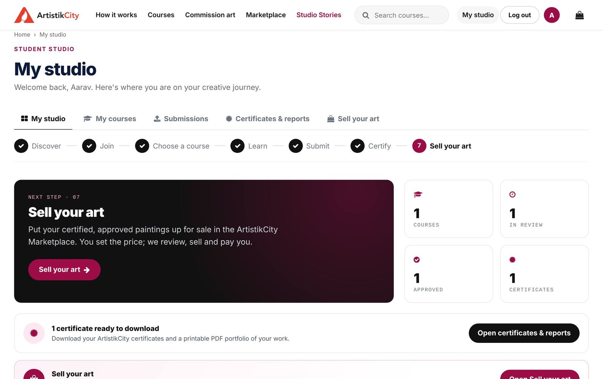<br><sub>My studio with the seven-step journey</sub></td><td width="50%" valign="top">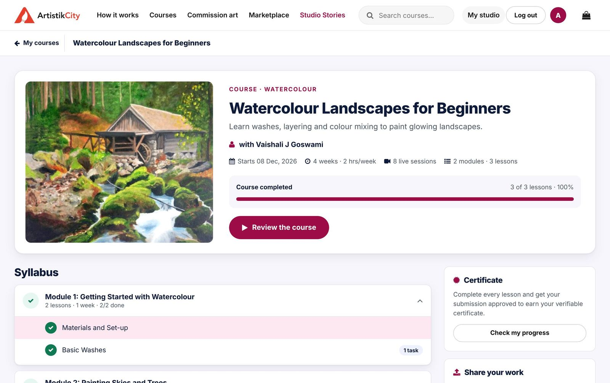<br><sub>My course: overview and syllabus</sub></td></tr></table>
<table><tr><td width="50%" valign="top">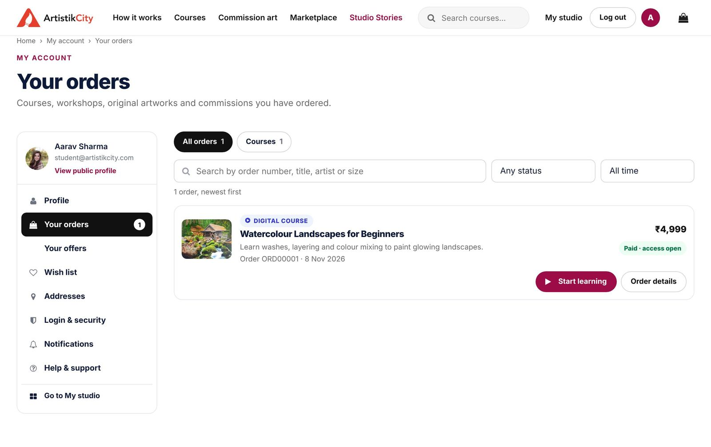<br><sub>Your orders (every order system in one list)</sub></td><td width="50%" valign="top">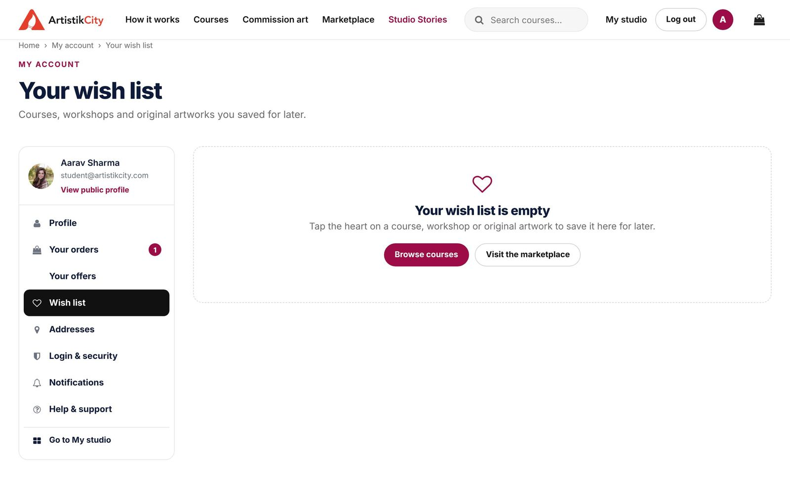<br><sub>Wish list</sub></td></tr></table>

---

## 4. The admin console (admin persona)

**When:** 24 Oct 2026, 10:03 · **Type:** Reconstructed · **Commit:** `17c0c52` *Changes make to the admin persona* (125 files)

**Prompt (reconstructed):** replace the old server-rendered admin with one modern React console that shows each staff role (admin, teacher, moderator) only what it may use.

**Reusable prompt (for other projects):**

```text
Replace the old admin screens with ONE modern admin console (single React shell) for these personas: {{PERSONAS e.g.
super admin, teacher, moderator}}.
- Layout: grouped, collapsible sidebar filtered by the persona's capabilities, breadcrumbs, account menu top right.
- A small UI kit (Card, Button, Badge, DataTable with server-side sort/filter/paging, SearchBox, Drawer, Confirm) and a form
  kit (useForm with inline rules + server 422 errors, sections, rich text, file drop, sticky save bar).
- Server: every list is a whitelisted grid query (q, sort, dir, page, per + named filters) returning {rows, meta};
  every action is a JSON API that checks the capability on the server; {{OWNER_SCOPE e.g. teachers only see their own
  courses}}; rich text through an allow-list HTML cleaner; uploads checked for type and size; important changes audited.
- Screens: {{SCREENS e.g. dashboard, courses + curriculum editor, orders, people, blog, FAQ, newsletter, settings}}.
Retire the old controllers/templates only after the new screens cover them; keep their URLs redirecting.
```

**What it produced**
- **One shell for every admin page:** `Components/Admin/AdminLayout`, with a grouped, collapsible sidebar filtered by the persona's capabilities, breadcrumbs and an account menu.
- **UI kit** `kit.js`: Card, Badge, DataTable + `useGrid`, Drawer, `useConfirm` and more.
- **Form kit** `form.js`: `useForm` with inline rules and server errors, RichText, DropZone, SaveBar and more.
- **Server side:**
  - `AdminKit` builds page props, JSON answers and upload checks;
  - `Grid` gives server-side tables with whitelisted sort keys and filters;
  - `Audit.log` records important changes;
  - `Personas` defines the capabilities; teachers only see their own courses.
- **Pages:** courses (editor with curriculum), blog, orders, people, FAQ, newsletter, free courses, instructors, taxonomies, contacts, tasks and settings. The old admin controllers were retired.
- Migration `2026-10-25_admin_console.sql`.

<table><tr><td width="50%" valign="top">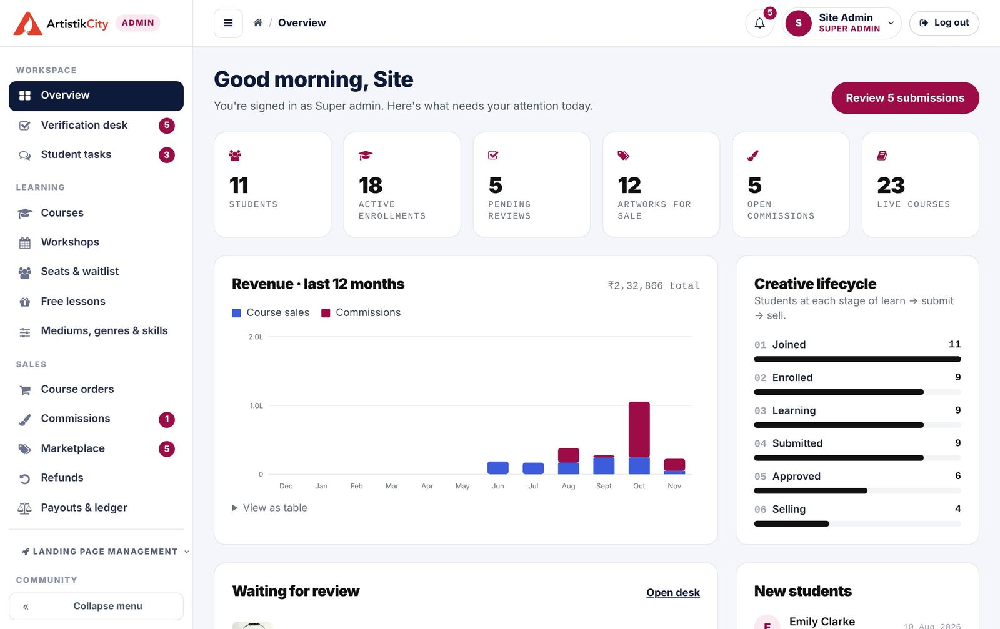<br><sub>Admin overview</sub></td><td width="50%" valign="top">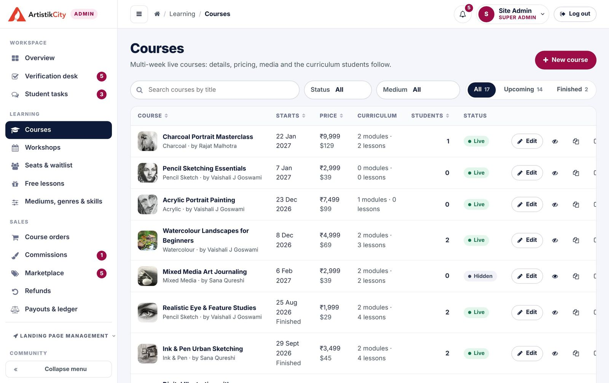<br><sub>Courses list (server-side grid)</sub></td></tr></table>

---

## 5. Make it run on AWS

**When:** 24 Oct 2026, 15:45 · **Type:** Reconstructed · **Commit:** `0d40042` *aws compatiable changes*

**Prompt (reconstructed):** make the application deployable on AWS (CloudFront, EC2 with Docker, RDS MySQL, S3 for files) with a GitHub Actions deploy.

**Reusable prompt (for other projects):**

```text
Make {{PROJECT_NAME}} deployable on AWS: CloudFront in front of EC2 (Docker), RDS {{DATABASE}}, S3 for uploaded files,
deployed by GitHub Actions with OIDC (no long-lived keys).
1. Storage abstraction with a local driver and an S3 driver (same public URLs either way; private files never public;
   presigned links for downloads). Credentials from env or the instance role (IMDSv2).
2. Behind CloudFront: trust the viewer IP / https headers only from CloudFront, reject requests without a secret origin
   header, add /healthz.
3. Infrastructure as code (CloudFormation or Terraform): VPC, instance + role, RDS, bucket, distribution, certificate,
   the GitHub deploy role.
4. Deploy script on the server: pull image, run pending migrations (load the schema on an empty DB), switch, health
   check, rollback. Migrations must stay compatible with the previous release.
5. docs/AWS-DEPLOY.md: first-time setup step by step, day-to-day deploy, troubleshooting table.
Unit-test the request signing against the provider's published examples.
```

**What it produced**
- **File storage in S3:** `support/s3/S3Client` uses plain `java.net.http` and **SigV4** signing (no AWS SDK). It takes credentials from the environment or from the EC2 role through IMDSv2, and `Storage` keeps the same `/storage/...` URLs.
- **Behind CloudFront:** `http/CloudFrontFilter` takes the real visitor IP and https from CloudFront headers and rejects requests without `X-Origin-Verify`. `GET /healthz` is the health check.
- **Infrastructure:** CloudFormation `infra/certificate.yml` (us-east-1) and `infra/artistikcity.yml` (ap-south-1).
- **Deploy scripts:** `deploy/ec2-deploy.sh` (deploy / rollback / status) and `deploy/db-migrate.sh` (load the schema into an empty DB, otherwise apply pending migrations).
- **Course videos:** `courses.intro_video_url` and per-lesson `video_url` (`2026-10-27_course_lesson_videos.sql`), with a 500 MB streamed upload.
- **Demo data:** the optional pack `database/demo/demo-data.sql` + `LOAD-DEMO-DATA.bat`.
- **Tests:** `SigV4Test` (against AWS's published examples), `CloudFrontFilterTest` and `VideoUploadCheckTest`.

---

## 6. AWS architecture documentation

**When:** 25 Oct 2026, 11:49 · **Type:** Reconstructed · **Commit:** `bdceabe` *aws cloud architecture documentation*

**Prompt (reconstructed):** document the AWS architecture with diagrams.

**Reusable prompt (for other projects):**

```text
Document the cloud architecture of {{PROJECT_NAME}} for a new engineer and for a non-technical owner.
Write docs/architecture.md with: one overview diagram (generated from code so it can be regenerated, e.g. a script that
writes SVG using official AWS icons), a request-flow diagram, a file-upload flow, the CI/CD pipeline (Mermaid), a table of
every resource with its purpose and monthly cost driver, security boundaries (what is public, what is private, where
secrets live) and the recovery story (backups, rollback). Export the diagrams as PNG next to their sources.
```

**What it produced**
- `docs/awsarchitecture.md`.
- Four diagrams in `docs/diagrams/`: architecture (SVG generated by `make_architecture_svg.py`), CI/CD, request flow and upload flow (Mermaid).
- The deploy workflow moved to `.github/workflows/deploy.yml`.

<table><tr><td width="100%" valign="top">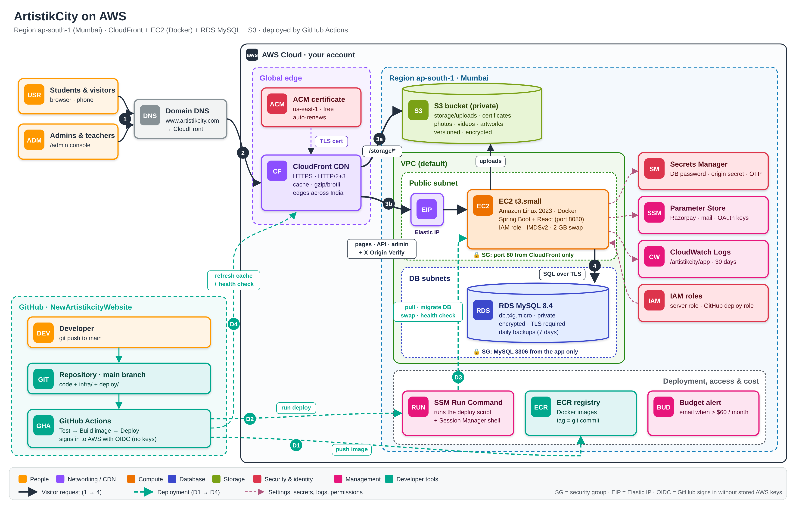<br><sub>AWS architecture (docs/diagrams/aws-architecture.png)</sub></td></tr></table>
<table><tr><td width="50%" valign="top">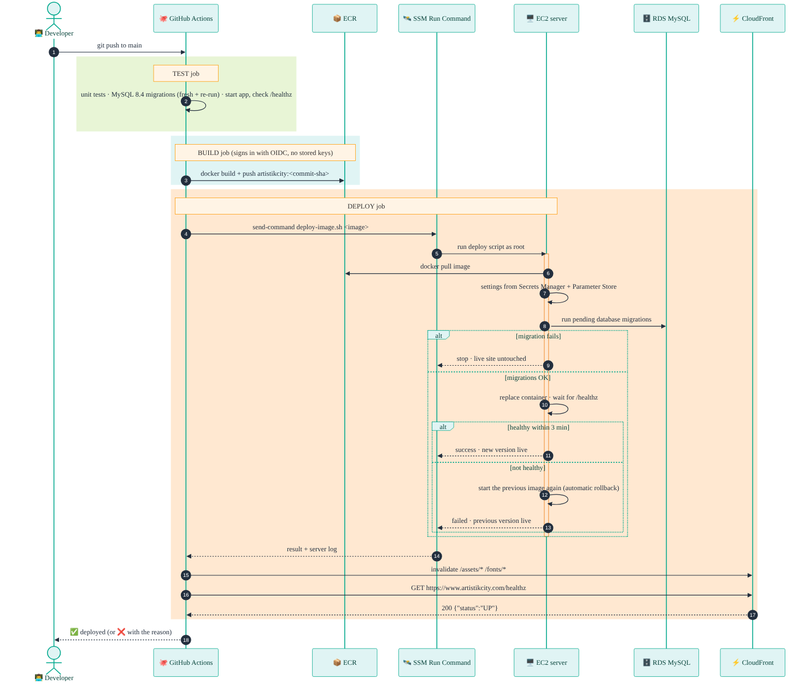<br><sub>CI/CD: GitHub Actions → ECR → EC2</sub></td><td width="50%" valign="top">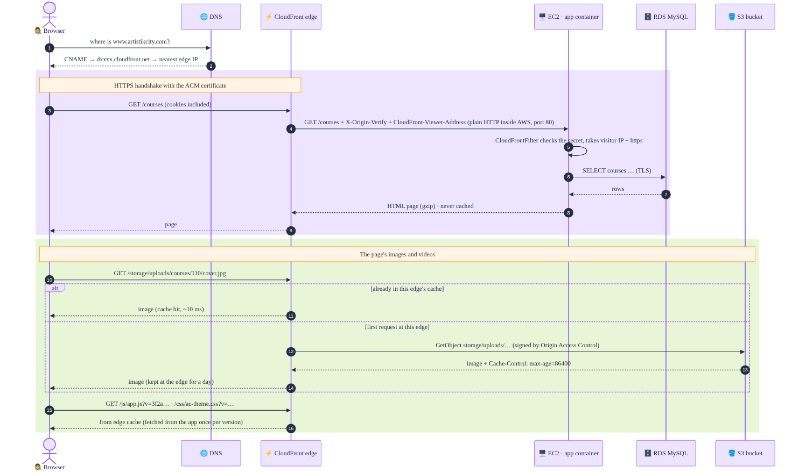<br><sub>Request flow through CloudFront</sub></td></tr></table>

---

## 7. CloudFormation stack failed (troubleshooting)

**When:** 25 Oct 2026, 12:48 · **Type:** Pasted log (attachment `a6ddfdd5`, 94 KB) · **Result:** fixes in `infra/` and the troubleshooting table of `docs/AWS-DEPLOY.md`

**Prompt:** the output of `aws cloudformation deploy …` and `describe-stack-events` after the stack failed. Excerpt:

```text
PS C:\Storage\AmitGoswami\NewArtistikcity\NewArtistikcityWebsite> aws cloudformation deploy --region ap-south-1 --stack-name artistikcity --template-file infra/artistikcity.yml --capabilities CAPABILITY_IAM --parameter-overrides $params

Waiting for changeset to be created..
Waiting for stack create/update to complete

aws: [ERROR]: Failed to create/update the stack. Run the following command
to fetch the list of events leading up to the failure
aws cloudformation describe-stack-events --stack-name artistikcity
PS C:\Storage\AmitGoswami\NewArtistikcity\NewArtistikcityWebsite> aws cloudformation describe-stack-events --stack-name artistikcity
{
    "StackEvents": [
        {
            "StackId": "arn:aws:cloudformation:ap-south-1:<account-id>:stack/artistikcity/d2b51350-d041-11f1-964c-06ffcee06d7d",
            "EventId": "ee20a8a0-d043-11f1-8ea2-02fff0834f6f",
```

The key events were *"The following resource(s) failed to create: [AppInstance]. Rollback requested by user."* and *"failed to delete: [Database]"*.

**Reusable prompt (for other projects):**

```text
My infrastructure deploy failed. Here is the full command output and the stack events: {{PASTE OUTPUT}}.
Find the first real failure (not the cascade of rollbacks), explain the cause in plain words, fix the template or script,
and tell me exactly how to recover: which resources to delete or retain, the command to retry, and how to read the
server's boot log if it happens again. Add the symptom and fix to the troubleshooting table in the deploy docs.
```

**What it produced:** Claude traced the failure to the server's start-up script (the `AppInstance` resource) and walked through the recovery. The AWS-DEPLOY troubleshooting table carries what was learned, for example *"Stack stuck on `AppInstance`: the server's set-up script failed: EC2 → instance → Monitor → Get system log, or `/var/log/cloud-init-output.log` via Session Manager"*.

---

## 8. Marketplace purchase workflow

**When:** 25 Oct 2026, 13:33 · **Type:** Full prompt (attachment `4ddbaf4d`) · **Commit:** `e11bb00` *Code changes related to the marketplace checkout* (55 files)

<details>
<summary><b>Full prompt: "implement a seamless purchase, visualization, and communication workflow for the marketplace"</b> (4,424 characters, click to open)</summary>

````text
You are an expert full-stack engineer and UI/UX designer. Your task is to implement a seamless purchase, visualization, and communication workflow for the marketplace in our existing project, **ArtistikCity**. 

Please read the following requirements, architectural goals, and workflow steps carefully, then generate the necessary code changes, new components, and routing structures.

---

### 1. Objective & Architecture Overview
We need to adapt our existing `/commission` multi-step workflow into a new, highly intuitive **Marketplace Purchase Workflow** integrated into every single artwork item page on `http://localhost:8080/marketplace`. 

When a user views an artwork and clicks **"Reserve This Original"** (or selects other purchase variants), they should enter a specialized purchase tunnel mimicking our current commission structure:
- `http://localhost:8080/purchase/step-1` (Variant & Size Selection)
- `http://localhost:8080/purchase/step-2` (Interactive Room Preview Visualization)
- `http://localhost:8080/purchase/preview` (Summary, Cost Estimate & Artist Connection Hub)
- `http://localhost:8080/purchase/checkout` (Secure Checkout & Order Placement)

Additionally, you must implement a persistent **User Cart System** tied to the logged-in session, which currently does not exist.

---

### 2. Core Feature Requirements

#### A. Comprehensive Product Variants (Step 1)
Allow users to buy art in multiple formats. Implement a clean selector UI for:
1. **Original Painting:** (Exclusive, 1 available, premium price, physical delivery).
2. **Limited Edition Canvas Prints:** (High-quality physical replicas, numbered, stretched/unstretched options).
3. **Fine Art Poster Prints:** (Matte/Glossy paper finishes, budget-friendly physical delivery).
4. **High-Resolution Digital Download:** (Instant access, personal use license, no shipping costs).

#### B. Interactive Room Visualizer (Step 2)
To build confidence before purchasing, create a spatial visualization engine:
- **Room Backgrounds:** Let users switch backgrounds (e.g., Modern Living Room, Minimalist Bedroom, Professional Office, Blank Gallery Wall).
- **Dynamic Resizing:** As the user changes sizes (e.g., 12x12", 24x24", 48x48"), the canvas asset scales accurately relative to the room furniture.
- **Drag & Drop / Positioning:** Allow users to drag the painting across the wall background to see how it catches shadows or sits over a sofa.
- **Live Framing Toggle:** Option to preview the artwork with *No Frame*, *Black Wood Frame*, *Oak Frame*, or *White Canvas Float*.

#### C. Personal Artist Connection & Estimate Hub (Preview Step)
Once the cost estimate is calculated, display a **"Meet the Artist" Connect Hub** right before checkout to prevent drop-offs and build community:
- **Direct Chat & Communication:** Integration links/buttons for WhatsApp API, Instagram DM redirect, Mailto email trigger, and an in-app Live Chat window.
- **Negotiation & Offers:** A micro-input field where users can input an "Artist Coupon Code" to live-update their cart totals.
- **Inquiry Form:** A simple "Ask the Artist a Question" text area that routes an automated inquiry email containing the specific artwork metadata.

#### D. Persistent User Cart System
Implement a global state-managed shopping cart linked to the backend database/auth session:
- **Database Schema:** Create a `Cart` and `CartItem` relationship schema linked to `userId`.
- **State Persistence:** Ensure cart items survive page refreshes for authenticated users.
- **Cart Drawer/Sidebar:** A delightful slide-out mini-cart accessible from the global navigation header showing thumbnails, selected variants, and subtotal.

---

### 3. Execution & Code Delivery Instructions
Please provide the implementation step-by-step:
1. **Database & API Routes:** Provide the backend models (e.g., Node/Express/Prisma/Sequelize or equivalents used in the project) for the Cart and Product Variant schemas.
2. **Frontend Routing changes:** Define the frontend router structure for the new `/purchase` pipeline.
3. **UI/UX Components:** Write clean, modular, and modern components (Tailwind CSS preferred) for the **Room Visualizer** and the **Artist Connection Hub**. Ensure the visual design is minimalist, premium, and distraction-free.
4. **State Management:** Provide the cart context/hook code to handle adding items, deleting items, updating quantities, and applying discount codes.
````

</details>

**Reusable prompt (for other projects):**

```text
Build a multi-step purchase flow for {{PRODUCT e.g. artworks}} on the existing product pages.
Formats: {{FORMATS e.g. one-of-a-kind original, numbered canvas print, poster, digital download}}, each with its own sizes,
finishes and price from ONE server-side price list (the browser only mirrors it for display).
Steps: 1. choose format/size on the product page  2. preview (product large, optional room view)  3. checkout (contact,
delivery, payment accordion with a sticky summary)  4. confirmation. Keep the choice in a server-side draft.
Also: a persistent cart (per user, API + client store + header drawer), "talk to the seller" enquiry with e-mails,
digital downloads served from private storage through expiring tokens.
Rules: a one-of-a-kind item is held for 15 minutes while in checkout; finalising a sale is idempotent; lines that can't be
supplied become REFUND_REQUIRED instead of failing silently; payments are marked paid only after a verified gateway
response. Write docs/{{feature}}.md and end-to-end tests for the full purchase.
```

**What it produced** (package `shop/`, write-up in `docs/marketplace-shop.md`)
- **Every listing can be sold four ways:** the original, a numbered canvas edition, a poster and a digital download (`paintings.shop_formats`). `ShopPricing` is the one source of prices, from the global list `shop_price_options`.
- **The purchase pipeline:**
  - the artwork page buy box, then preview and frame;
  - the checkout: an accordion for contact, delivery and payment, with a sticky summary;
  - the order page.
  - The choice is kept as the session draft `purchase.draft`.
- **Room visualiser** (later redesigned, see §9 and §20), and the **artist connection hub** ("Talk to the artist", with e-mails `artist-inquiry` / `artist-reply`).
- **Cart:**
  - one cart per owner key, with the API `/api/v1/cart/**`;
  - `CartStore` on the client and `CartDrawer`;
  - an original in the cart is a 15-minute hold.
- **Orders:**
  - `shop_orders` / `shop_order_items`, finalised idempotently by `ShopOrderService.finalizeSale`;
  - a line that can't be supplied becomes `REFUND_REQUIRED`;
  - downloads stream from private storage through `/shop/download/{token}`.
- An admin shop section and migration `2026-10-28_marketplace_shop.sql`.

<table><tr><td width="50%" valign="top">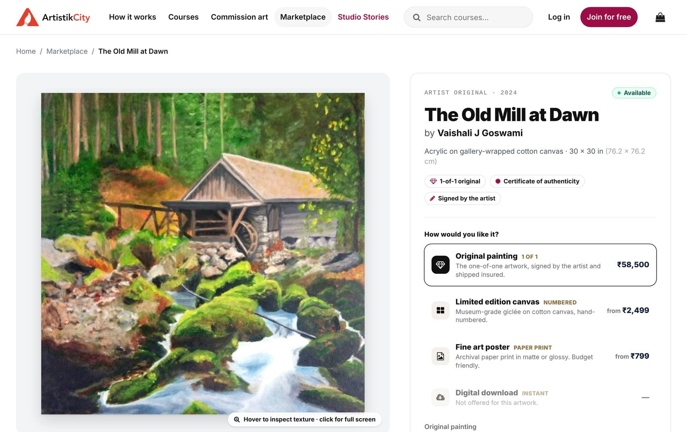<br><sub>Artwork page: the buy box with the four formats</sub></td><td width="50%" valign="top">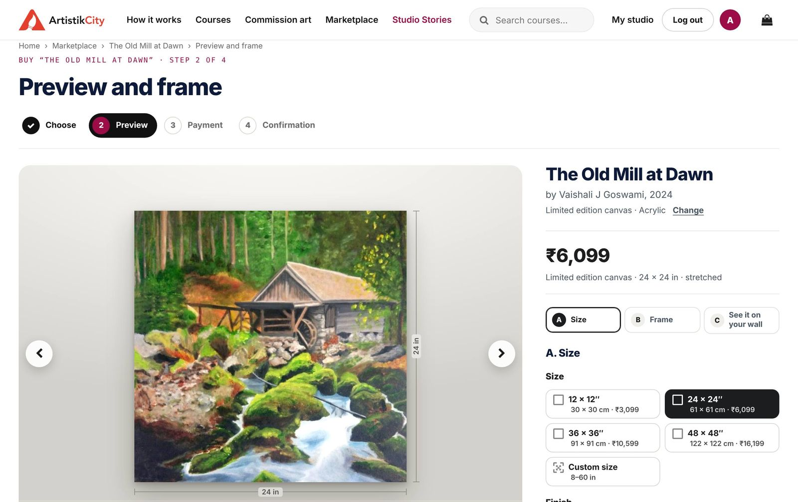<br><sub>Step 2: Preview and frame</sub></td></tr></table>
<table><tr><td width="100%" valign="top">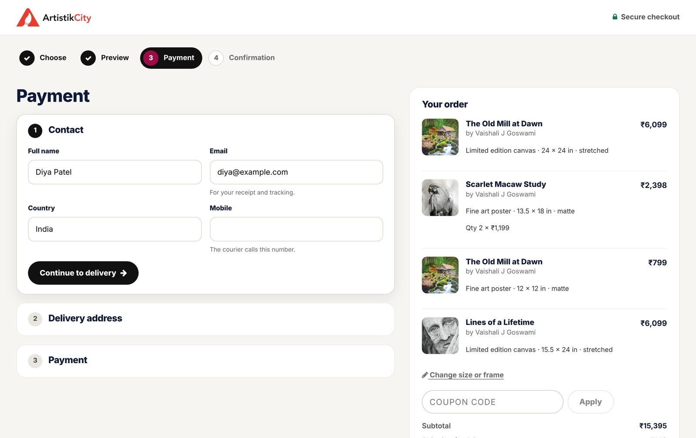<br><sub>Checkout: contact → delivery → payment, with the order summary</sub></td></tr></table>

---

## 9. Portfolio PDFs, preview page and marketplace images in S3

**When:** 5 Nov 2026, 10:47 · **Type:** Full prompt (attachment `48b1810b`) · **Commit:** `5a4ccf7` *added and modified marketplace screens and workflow*

<details>
<summary><b>Full prompt: Module 1 Portfolio PDF + S3, Module 2 preview UI, Module 3 marketplace assets to S3</b> (4,634 characters, click to open)</summary>

````text
Act as a Senior Full-Stack Developer specializing in Java, JavaScript, and MySQL. I need you to implement code updates across several modules of my existing web application, "ArtistikCity". 

Please write clean, production-ready code blocks and provide a step-by-step implementation guide to execute the following requirements. Ensure all front-end code is highly responsive and perfectly optimized for mobile devices (iOS, Android, etc.).

---

### MODULE 1: Portfolio PDF Engine Updates & AWS S3 Storage Migration
**Current State:** Students generate portfolios at `/how-it-works`. The generation engine renders a black theme, leaves the first page completely blank, and saves the output to the local filesystem.
**Goal:** Fix the layouts, update the branding palette, and move file storage to the cloud.

1. **Fix PDF Structural Bugs & Palette:** 
   - Fix the bug causing the first page of the PDF to render completely blank. Ensure metadata, student info, or introductory titles start immediately on page one.
   - Change the primary color theme from black to a highly professional, **light-colored palette**. Use dark gray/charcoal for legible text (e.g., `#2C3E50` or `#34495E`) and subtle light tones for accents or light borders (e.g., `#F8F9FA` or `#ECF0F1`).
2. **Implement AWS S3 Storage:**
   - Integrate the AWS SDK for Java into our project configuration.
   - Refactor the backend code to intercept the `ByteArrayOutputStream` or file stream generated by the PDF engine. Remove any local file writing logic.
   - Write a secure service to upload these generated portfolios and student certificates directly into an AWS S3 bucket.
3. **Database & Retrieval Pipeline:**
   - Update the Java persistence layer to save the resulting AWS S3 object URLs or unique keys into the existing MySQL database tables.
   - Update the front-end JavaScript code on `/how-it-works` to pull and render the PDF safely using these S3 object URLs.

---

### MODULE 2: Product Preview UI/UX Optimization (`/purchase/step-2`)
**Current State:** The mock preview page looks visually unbalanced. The background room graphic looks massive, the painting inside the room frame appears too small, and there are realistic sun shadows cast over everything.
**Goal:** Shift the entire visual hierarchy so the emphasis is squarely on the artwork rather than the room layout.

1. **Remove Shadows:**
   - Locate and strip out all sun shadow overlays, CSS drop-shadow filters, skewed gradient layers, or ambient shadow divs from all preview images on this page.
2. **Re-scale Visual Elements:**
   - Adjust the proportional relationship between the room backdrop and the painting. Downscale or soften the room layout visual footprint.
   - Upscale the painting element within its frame container significantly so it visually dominates the layout while the room acts strictly as a muted backdrop.
3. **Mobile Responsiveness:**
   - Write fluid CSS/JS media queries targeting devices under `768px` (iOS and Android). 
   - Ensure the re-scaled painting scales fluidly (`max-width: 100%`, `height: auto`) without breaking grid boundaries or shrinking to unreadable sizes on phone viewports.

---

### MODULE 3: Marketplace Asset Migration to AWS S3 (`/marketplace`)
**Current State:** Marketplace items and images are stored locally. The grid system needs better alignment to global styles and must render seamlessly across screen resolutions.
**Goal:** Centralize artwork asset hosting in the cloud and clean up the UI layout.

1. **Image Upload Pipeline:**
   - Modify the marketplace submission backend endpoint in Java to pipe all multi-part file image uploads directly to a targeted folder inside our AWS S3 bucket instead of saving locally.
   - Update the MySQL database schema mappings to hold long S3 asset URL text values.
2. **Unified UI & Responsive Mobile Grid:**
   - Update the HTML, CSS, or framework JavaScript code for `/marketplace` to pull artwork images via S3 URLs.
   - Ensure the marketplace design system components (buttons, text hierarchy, cards) are explicitly aligned with the global ArtistikCity style rules.
   - Refactor the layouts using a fluid CSS Grid or Flexbox wrapper. It must support a clean 4-column layout on desktop, a 2-column layout on tablets, and drop to a highly legible 1-column layout on mobile viewports (iOS, Android).
   - Implement native image lazy loading (`loading="lazy"`) to optimize bandwidth usage on mobile data networks.

---

Please provide the necessary Java backend file updates, updated JavaScript/CSS code snippets, and database script queries required to execute this end-to-end upgrade.
````

</details>

**Reusable prompt (for other projects):**

```text
Three fixes, in order:
1. Generated PDFs ({{DOCS e.g. portfolio reports, certificates}}): render in memory, fix layout bugs (no blank first page,
   cover is page 1), apply the brand palette {{COLOURS}}, store them privately in S3 with one database row each, and give
   the owner a short-lived (10 min) presigned download link. Never link to private keys any other way.
2. {{PAGE}} preview: the product is the hero (large, no heavy shadows, real proportions with dimension lines); context
   images are secondary and one click away; perfect on phones.
3. Uploaded {{ASSETS}} images: move to S3 through the storage layer (dated folders, random names, type/size checks) and
   make the grid consistent and responsive.
Also give me safe admin scripts to wipe and restore site data: confirmation word, full backup first, uploads moved not
deleted.
```

**What it produced**
- **Module 1, PDFs:**
  - Portfolio reports and course certificates are rendered in memory with OpenHTMLtoPDF.
  - The cover is now page 1 (the blank first page came from a named `@page`), and the black theme gave way to the light palette (ink #2C3E50, panels #F8F9FA).
  - The files are stored privately (`documents/StudentDocuments`, `private/documents/...`, one `student_documents` row each).
  - Students open them through a **10-minute presigned S3 link**, or an owner-checked local URL.
- **Module 2, preview:**
  - The artwork is now the big picture, on a lit wall with framer's dimension lines. Shadows are gone.
  - The rooms are one click away, and the layout works on phones.
- **Module 3, marketplace images:** uploads go through `MarketplaceImages` → `uploads/marketplace/yyyy/MM/<uuid>.jpg` in S3. The marketplace grid was unified and made responsive.
- **Data tools:** `WIPE-SITE-DATA.bat` / `RESTORE-SITE-DATA.bat` clear and restore site data with a full backup first; uploads are moved, not deleted.

<table><tr><td width="50%" valign="top">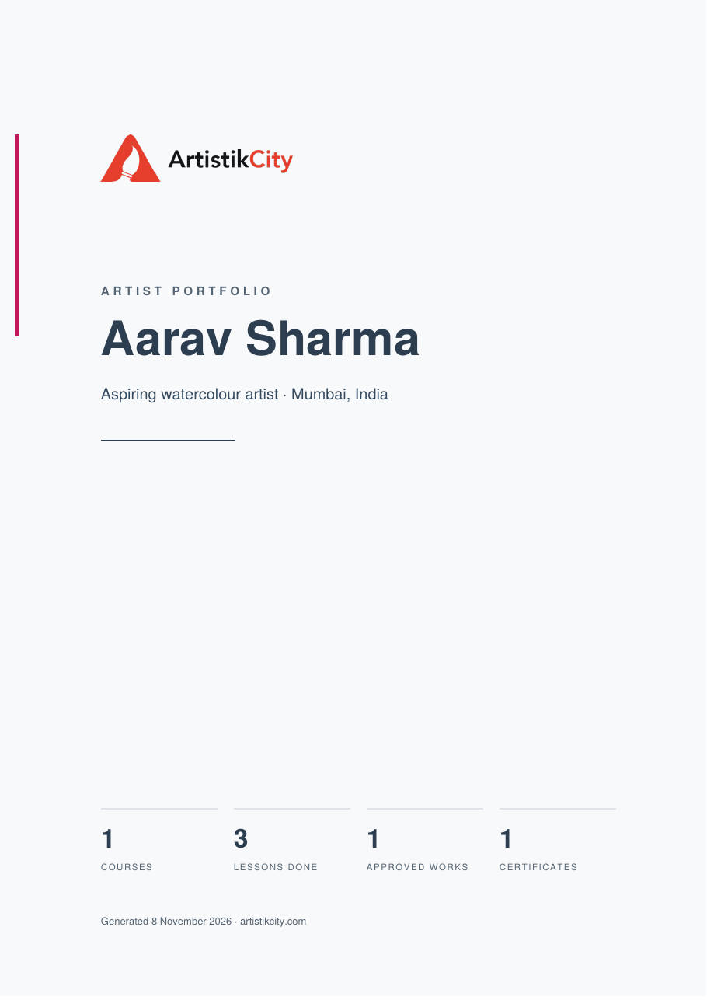<br><sub>Portfolio PDF, page 1 (cover)</sub></td><td width="50%" valign="top">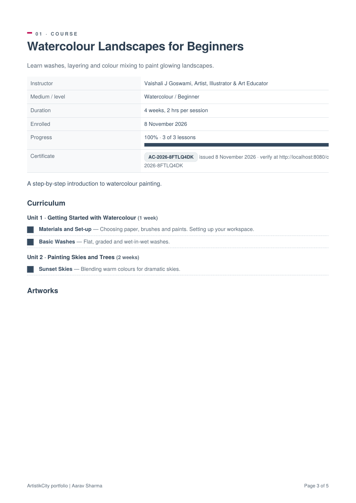<br><sub>Portfolio PDF, course page</sub></td></tr></table>
<table><tr><td width="50%" valign="top">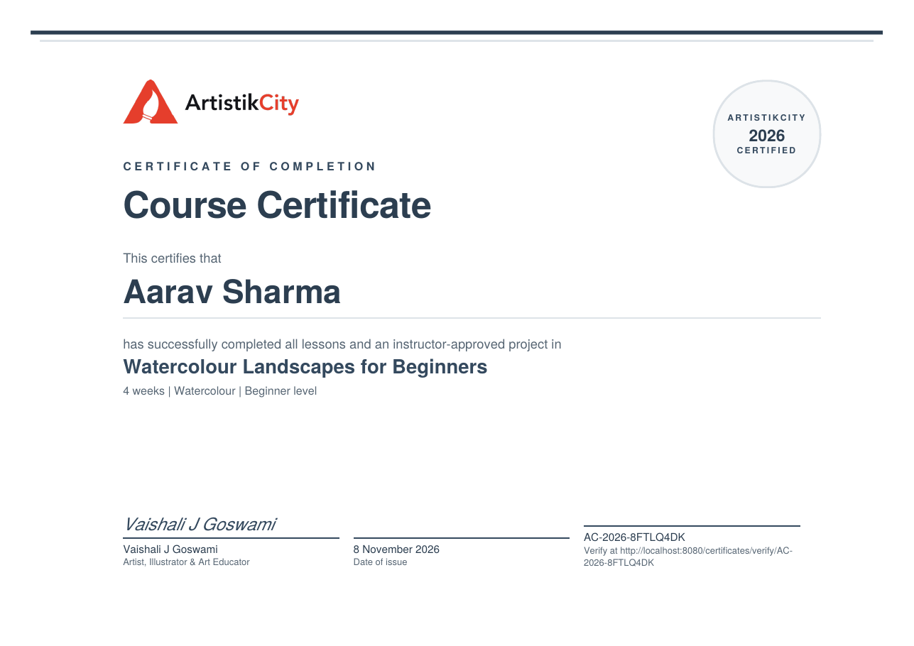<br><sub>Course certificate PDF</sub></td><td width="50%" valign="top">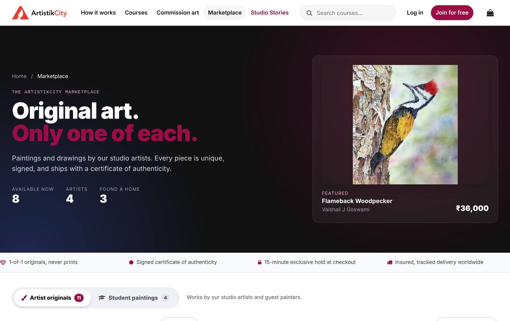<br><sub>Marketplace grid</sub></td></tr></table>

---

## 10. GitHub deploy refused by AWS (troubleshooting)

**When:** 5 Nov 2026, 13:28 · **Type:** Pasted log (attachment `57f58e95`) · **Result:** OIDC trust policy fixed in `infra/artistikcity.yml`

**Prompt:** the CloudTrail events for the failed GitHub Actions sign-in. Excerpt (account number masked):

```text
C:\Storage\AmitGoswami\NewArtistikcity\NewArtistikcityWebsite>aws cloudtrail lookup-events --region ap-south-1 --lookup-attributes AttributeKey=EventName,AttributeValue=AssumeRoleWithWebIdentity --max-results 3 --query "Events[].CloudTrailEvent" --output text
{"eventVersion":"1.11","userIdentity":{"type":"WebIdentityUser","principalId":"arn:aws:iam::<account-id>:oidc-provider/token.actions.githubusercontent.com:sts.amazonaws.com:repo:amitgoswami1027@13011167/NewArtistikcityWebsite@1390148564:ref:refs/heads/main","userName":"repo:amitgoswami1027@13011167/NewArtistikcityWebsite@1390148564:ref:refs/heads/main","identityProvider":"arn:aws:iam::<account-id>:oidc-provider/token.actions.githubusercontent.com"},"eventTime":"2026-11-05T07:35:39Z","eventSource":"sts.amazonaws.com","eventName":"AssumeRoleWithWebIdentity","awsRegion":"ap-south-1","sourceIPAddress":"<ip>","userAgent":"aws-sdk-js/3.859.0 ua/2.1 os/linux#7.0.0-1017-azure lang/js md/n …
```

**Reusable prompt (for other projects):**

```text
My GitHub Actions deploy can't assume the AWS role. CloudTrail shows: {{PASTE AssumeRoleWithWebIdentity EVENT}}.
Compare the token's subject claim with the role's trust policy, explain the mismatch, and fix the trust policy in the
infrastructure template so it accepts the exact subject GitHub sends (keep it limited to this repo and branch /
environment). Give me the one command to update the stack and how to re-run the workflow.
```

**What it produced:** GitHub now sends the newer subject format `repo:<owner>@<owner id>/<repo>@<repo id>:ref:refs/heads/main`, which the role's trust policy didn't accept. Claude added both forms to the `GitHubDeployRole` trust policy (new parameters `GitHubOwnerId` / `GitHubRepoId`):

```yaml
token.actions.githubusercontent.com:sub:
  - !Sub 'repo:${GitHubOwner}/${GitHubRepo}:ref:refs/heads/${GitHubBranch}'
  # newer GitHub token format: repo:<owner>@<owner id>/<repo>@<repo id>:...
  - !Sub 'repo:${GitHubOwner}@${GitHubOwnerId}/${GitHubRepo}@${GitHubRepoId}:ref:refs/heads/${GitHubBranch}'
```

---

## 11. Site-wide password lock and trimming the live data

**When:** 5 Nov 2026, 14:34 – 15:09 · **Type:** Reconstructed · **Commits:** `d1a8873` *sitewide password lock implemented*, `c6fd43b` *'trim'*

**Prompt (reconstructed):** put the whole site behind a password while it is being tested; and give me a safe way to cut the live AWS database down to a small starter set.

**Reusable prompt (for other projects):**

```text
1. Put the whole site behind a temporary password while we test: a server-side filter (no page flash), signed HttpOnly
   cookie for 30 days, noindex headers and robots.txt disallow, rate-limited wrong tries. Always open: /healthz, payment
   webhooks, static files and the admin area. Configurable by an environment variable.
2. Give me a safe way to trim the LIVE database to a small starter set ({{KEEP e.g. 2 users, 2 products}}): snapshot first,
   private tunnel, a SQL script with editable keep-lists that deletes dependants correctly, show the counts before and
   after, require typing a confirmation word.
```

**What it produced**
- **`http/PreviewLockFilter`:** when `SITE_PREVIEW_PASSWORD` is set, every page needs the password.
  - It keeps a signed `ac_preview` cookie for 30 days and sends `noindex`.
  - The health check, webhooks and static files stay open.
  - Covered by `PreviewLockFilterTest`. This became admin-controlled in §19.
- **`CLEAN-AWS-DATA.bat` / `.ps1` + `database/maintenance/trim-to-starter.sql`:**
  1. take an RDS snapshot first (the undo point);
  2. open a Session Manager tunnel;
  3. keep 2 students, 2 courses, 2 paintings, 2 posts and 3 staff logins;
  4. show what is left.

  You must type TRIM to confirm.

---

## 12. Age groups as a managed list

**When:** 5 Nov 2026, 15:52 · **Type:** Reconstructed · **Commit:** `605d835` *adding the age group*

**Prompt (reconstructed):** let admins manage the age groups and use them in the course filters and menus.

**Reusable prompt (for other projects):**

```text
Turn {{FIELD e.g. age groups}} from hard-coded values into a managed list: an admin screen to add, rename, reorder and
delete entries; a migration that creates the table from the values already in use; renaming updates every record that
uses it; an entry in use can't be deleted (explain why). Feed the list to the public filters and navigation menus through
one cached site setting, invalidated on save.
```

**What it produced**
- Table `age_groups` (`2026-11-05_age_groups.sql`), edited in Admin > Catalog > Age groups.
- A course stores the group's **name**: renaming a group renames it on its courses, and a group in use can't be deleted.
- The list reaches React as `site.ageGroups`. It feeds the /courses Age filter and the header / footer "By age" menus.

<table><tr><td width="100%" valign="top">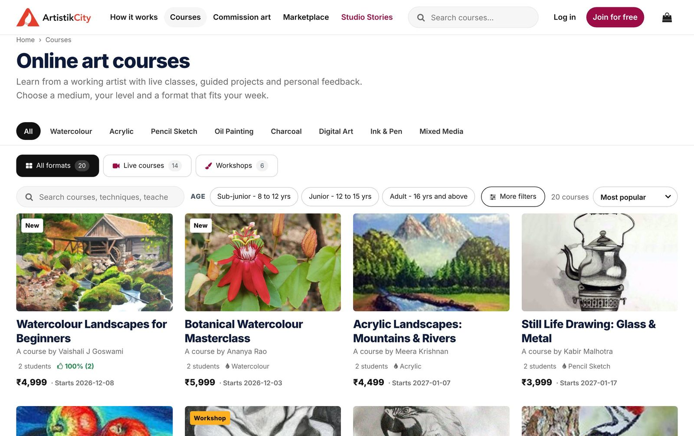<br><sub>Courses: medium tabs, Format buttons, Age pills, "More filters"</sub></td></tr></table>

---

## 13. Production-readiness audit (QA, RBAC, UX)

**When:** 5 Nov 2026, 15:51 · **Type:** Full prompt (attachment `aebe88e1`) · **Commits:** `2ddb68a` *correcting some defects and issues*, `d8eb647` *audit log, security changes, courses module restructure* (229 files) · **Reports:** [Production-Readiness Audit](https://claude.ai/artifact/XiZKtx8HNpyoUppEMbfKms), [Catalog & Audit Prototype](https://claude.ai/artifact/XJ1z8DBMt2T7QQHnARbFWL)

<details>
<summary><b>Full prompt: "definitive, end-to-end virtual regression, integration, unit, and access control audit"</b> (5,573 characters, click to open)</summary>

````text
# ROLE AND ARCHITECTURAL OBJECTIVE
You are an Elite Principal QA Automation Engineer, Full-Stack Unit/Integration Tester, and Lead UX/UI Solutions Architect specializing in secure, transactional e-commerce and live educational booking ecosystems. 

Your objective is to conduct a definitive, end-to-end virtual regression, integration, unit, and access control audit of the "ArtistikCity" platform. You will analyze system mechanics, identify unhandled failure vectors, write production-ready test code, and specify structural UI updates to make the application production-ready.

---

## CONTEXT & ENVIRONMENT ARCHITECTURE
The system operates with four distinct roles: Guest, Registered Student, Registered Artist, and Platform Super-Admin. The technical ecosystem utilizes a modern stack consisting of a relational data layer (PostgreSQL), high-concurrency event loops (Node.js/Express or Next.js), and a responsive user interface engine (React/Tailwind CSS).

---

## SPECIFIC INSTRUCTIONS FOR AUTOMATED REGRESSION AUDIT

### 1. END-TO-END TRANSACTIONAL & INTEGRATION REGRESSION MATRIX
For each module below, uncover hidden architectural failure states, identify race conditions, and define precise verification protocols:
*   **Authentication & State Management:** Analyze token transitions during heavy checkout pipelines. Investigate edge cases where an expired JWT refresh cycle interrupts an open transaction, causing silent cart drops or unhandled server promises. Ensure multi-role session parsing prevents cross-tenant data leakage.
*   **Inventory, Catalog, and Search Sync:** Audit dynamic multi-tiered filtering operations. Detect synchronization failures between relational tables and distributed search engines (e.g., Elasticsearch/Algolia) when an artist rapidly modifies, updates, or deletes a listing variant. Address layout shifts (CLS) on high-resolution image rendering grids.
*   **E-Commerce Checkout & Webhook Resiliency:** Analyze double-selling vectors for unique, single-edition physical artwork. Evaluate concurrent transaction isolation levels when multiple buyers access the payment stage simultaneously. Diagnose webhook vulnerability points, such as where a transaction completes on a payment gateway (e.g., Stripe/Razorpay) but network loss prevents the confirmation callback from updating the system state.
*   **Art Education Booking Engine:** Audit live class scheduling (e.g., Live Durga Painting Workshop). Detect capacity constraint leaks when concurrent users fill the final available slot simultaneously. Address automated partial/full refund reconciliation failures if a course is cancelled or adjusted.

### 2. ADMIN PERSONA AUDIT & ROLE-BASED ACCESS CONTROL (RBAC)
Specify back-office controls required to maintain platform operations and safety, defining exact requirements for:
*   **Content Moderation Workspace:** Tools allowing administrators to soft-ban problematic actors, moderate submitted portfolios, and scrub malicious embedded data (e.g., XSS payloads hidden inside image EXIF fields or text inputs).
*   **Inventory & Enrollment Overrides:** Administrative controls to adjust capacity caps, issue priority access bypass tokens, or trigger real-time student notification alerts.
*   **Escrow & Settlement Ledger:** Financial interfaces that track exact commission breakdowns and provide manual override features to halt automatic artist payouts if a customer dispute occurs.
*   **Strict Middleware Isolation Layer:** A security spec validating that unauthorized roles attempting to query `/api/admin/*` are immediately blocked, their session tokens invalidated, and their actions logged to an immutable security ledger.

### 3. UX/UI BLUEPRINT AND SPECIFICATION UPGRADES
For every gap identified, provide a structural UX/UI redesign following accessibility (a11y) and performance best practices:
*   **State Machine Enhancements:** Incorporate robust skeletal loaders, inline error boundaries, and optimistic UI transitions to eliminate user hesitation during high-latency operations.
*   **Responsive Multi-Viewport Layouts:** A smooth layout framework ensuring complex search grids and multi-step checkout sequences transition cleanly from widescreen monitors down to standard mobile screens without breaking state.
*   **Accessibility Standards:** Ensure strict ARIA compliance, clear keyboard focus ring configurations, and contrast metrics meeting WCAG AAA requirements.

### 4. PRODUCTION-READY CODE SEEDING (TEST SUITE GENERATION)
Generate complete, production-ready, copy-pasteable test blocks containing zero placeholders. Include:
*   **A Complete Backend Integration Test Suite (Node.js/Jest/Supertest):** Fully mock a multi-threaded checkout sequence to demonstrate successful row-locking mechanisms (`SELECT ... FOR UPDATE` or optimistic transaction control) that cleanly rejects secondary buyers with a `409 Conflict` state.
*   **A Complete Frontend Component Unit Test Suite (React Testing Library/Jest):** Verify that filtering choices modify the UI correctly and preserve the browser's active URL state string seamlessly.

---

## OUTPUT FORMAT PROTOCOL
Provide a structured, deep-dive architectural brief grouped into these four clear sections:
1.  **Critical Architectural & Functional Flaws Identified**
2.  **Admin Panel Missing Controls Spec Matrix**
3.  **The UX/UI Redesign Blueprint**
4.  **Ready-to-Execute Test Scripts**

Do not summarize, shorten the code snippets, or use structural text placeholders. Write all scripts completely and proceed directly into the comprehensive analysis.
````

</details>

**Reusable prompt (for other projects):**

```text
Act as a principal QA engineer and solutions architect. Audit {{PROJECT_NAME}} end to end for production readiness:
1. Transaction flows ({{FLOWS e.g. checkout, enrolment, refunds}}): races (two buyers, last seat), double payments,
   webhook vs redirect ordering, expired sessions mid-checkout, reconciliation of payments still pending.
2. Role-based access: every admin API refuses other roles server-side; log every refusal; sign out a session after
   repeated refusals.
3. Admin gaps: which controls staff need and don't have (capacity, waitlists, refunds queue, payouts ledger,
   moderation, notices to customers).
4. UX: filters, empty states, error pages with a reference code, accessibility (focus, contrast).
Output: a report doc (flaws ranked by severity, admin controls matrix, UX blueprint), then implement the fixes in
priority order with tests: concurrency integration tests against a real database, unit tests, front-end tests and
end-to-end tests. Add an append-only, hash-chained audit log with a viewer that shows before/after diffs.
```

**What it produced**
- **The audit doc:** critical flaws, admin missing-controls matrix, UX blueprint and test scripts, plus an interactive prototype of the new course filters, the tag manager and the audit viewer.
- **Transaction safety:**
  - `support/DbErrors` decides lost races (MySQL's own `CJException` for deadlocks and duplicate keys);
  - `MarketplaceConcurrencyIT`: many buyers, one original, exactly one wins;
  - `SeatRaceIT`: 20 students for 5 seats, exactly 5 get one.
- **Payments:**
  - `PaymentReconciler` asks Razorpay / PayPal every 5 minutes about orders still waiting;
  - refunds are queued for staff (`RefundQueue`), never automatic;
  - test buyers can simulate payments on the live site, and their orders are flagged `is_test`.
- **Seats & waitlist:** `SeatService` holds a seat for 15 minutes; waitlist and priority links are `access_grants`, stored as SHA-256 only.
- **Course notices:** message enrolled students, move the start date, or cancel the run with refunds queued.
- **Ledger:** an append-only `ledger_entries` table splits each sale into commission and the artist's share, with weekly payout batches and dispute holds.
- **Moderation:** bans and posting / selling restrictions, plus a Report button and a review queue.
- **Security log:**
  - append-only, hash-chained `audit_logs` with actor, action type, IP and CloudFront country / city;
  - "Verify integrity" re-hashes the chain;
  - `SecurityWatch` signs a staff session out after 5 refusals in 10 minutes.
- **Course filters:**
  - fuzzy search (accents, small typos), removable chips, a "one change brings courses back" suggestion;
  - nested and archivable filter lists, and the filters are mirrored in the address bar.
- **Error pages:** branded 404 / 409 / 500 pages with a reference code that can be found in the log.
- React tests (Jest + Testing Library, `tests/frontend`) and Playwright `course-filters.spec.js`.

<table><tr><td width="50%" valign="top">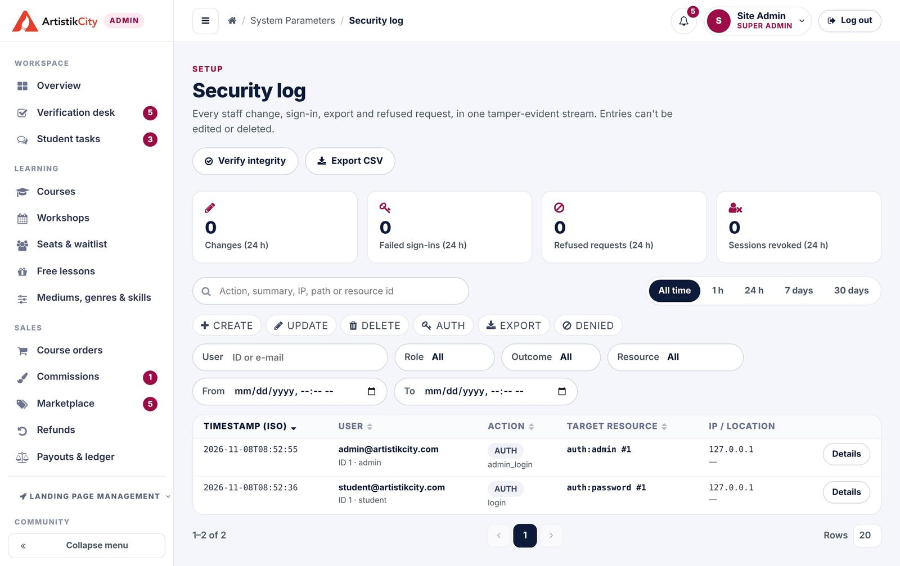<br><sub>Security log (hash-chained, with a diff drawer)</sub></td><td width="50%" valign="top">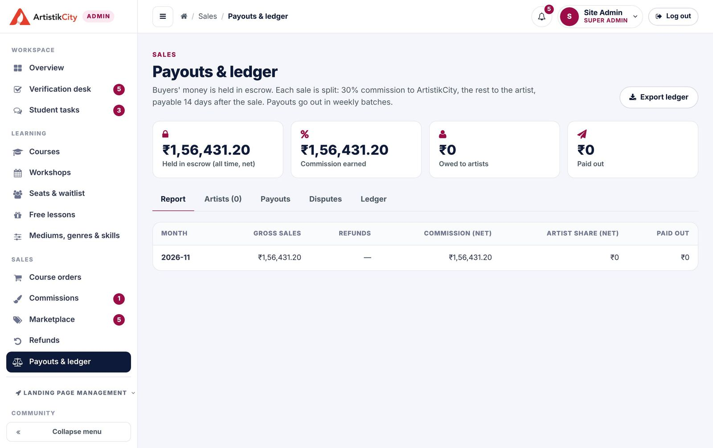<br><sub>Payouts & ledger</sub></td></tr></table>
<table><tr><td width="50%" valign="top">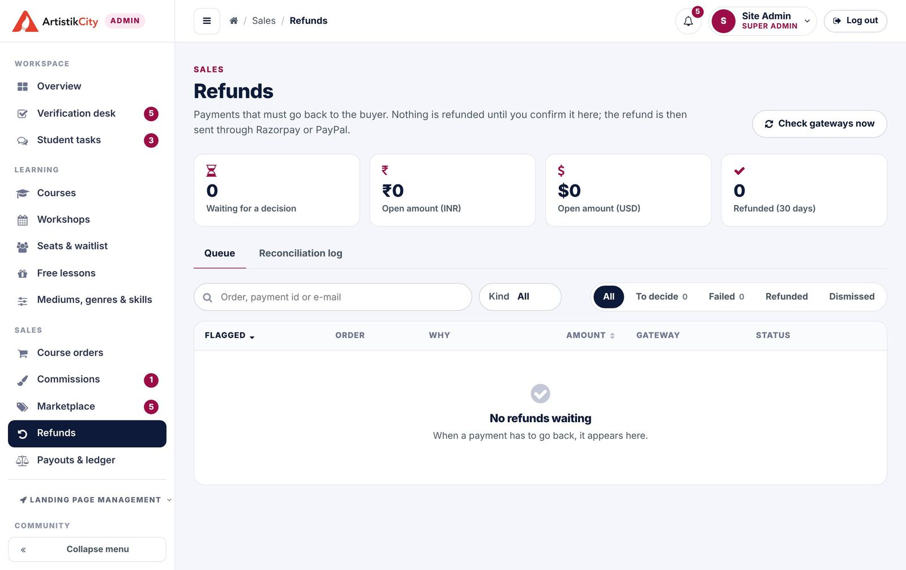<br><sub>Refunds: staff confirm each one</sub></td><td width="50%" valign="top">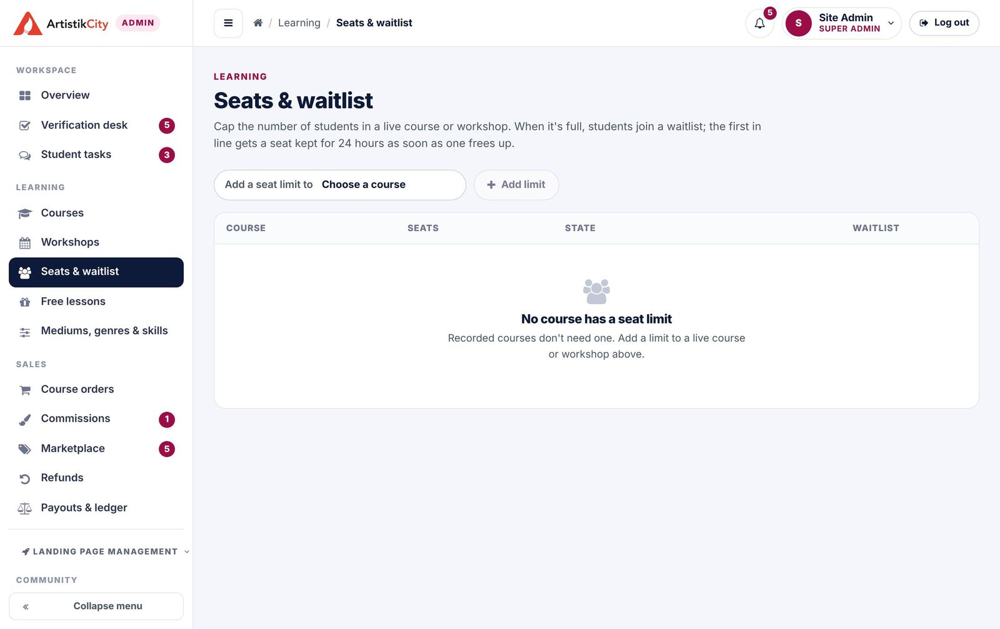<br><sub>Seats & waitlist</sub></td></tr></table>
<table><tr><td width="100%" valign="top">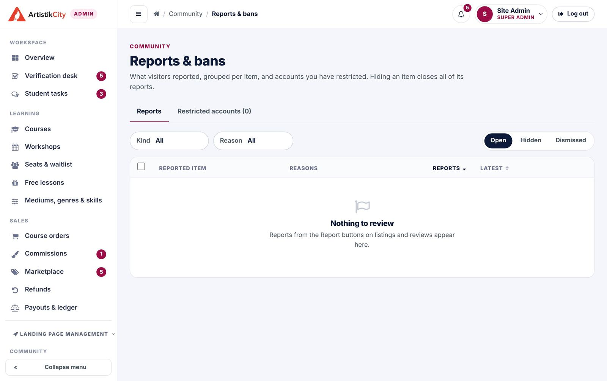<br><sub>Reports & bans</sub></td></tr></table>

### 13a. Two React tests failing (follow-up)

**When:** 5 Nov 2026, 22:46 · **Type:** Pasted log (attachment `702689db`)

**Prompt:** the output of `npm test` in `tests/frontend`:

```text
C:\Storage\AmitGoswami\NewArtistikcity\NewArtistikcityWebsite\tests\frontend>npm test   

> test
> jest

 PASS  specs/catalogQuery.test.js (17.503 s)
 FAIL  specs/Courses.filters.test.js (25.381 s)
  ● Courses page filters › a medium tab and the Format filter combine, and the URL holds both

    TestingLibraryElementError: Unable to find a label with the text of: Workshops

    Ignored nodes: comments, script, style
```

**Reusable prompt (for other projects):**

```text
These tests fail after the last change: {{PASTE TEST OUTPUT}}. Decide for each failure whether the code or the test is
wrong (the UI may have changed on purpose). Fix the right one, run the whole suite, and tell me which it was and why.
```

**What it produced:** the two failing specs in `Courses.filters.test.js` still looked for the Format filter inside the "More filters" drawer. The course-filter restructure had moved Format onto the page as buttons. The specs were updated to the new layout.

---

## 14. Courses menu, painting preview and Buy now

**When:** 6 Nov 2026, 09:26 · **Type:** Reconstructed · **Commit:** `549f6c0` *Courses menu changes, prview paininting code change*

**Prompt (reconstructed):** simplify the Courses menu, improve the painting preview, and require an account before buying.

**Reusable prompt (for other projects):**

```text
1. Simplify the {{MENU}} menu: one link to the full catalogue, with the main facet ({{FACET}}) shown as buttons with counts.
2. Buying needs an account: every Buy / Enrol button and checkout sends a guest to log-in with a return address and an
   intent ("Log in to finish buying {{ITEM}}"); JSON endpoints answer 401 {code: SIGN_IN, redirect}; the guest's choice
   survives the log-in. Don't hold scarce stock for guests; take the hold after sign-in.
3. Make the product preview images manageable by admins (upload, order, hide).
```

**What it produced**
- **Courses menu:** the header "Courses" became one link to `/courses?type=all`; Format shows as buttons (All formats / Live courses / Workshops with counts) above the Age pills.
- **Buying needs an account:**
  - "Enroll", "Buy now" and the checkouts send a guest to `/login?return_to=…&intent=buy`, and the log-in page names what they are buying;
  - JSON endpoints answer 401 `SIGN_IN`;
  - a guest's choice of an original is held only after sign-in.
- **Rooms:** room photos for the preview came from `room_scenes` (Admin > Room Preview Setup).

---

## 15. Admin persona: configuration panel, site settings and Studio Stories CMS

**When:** 6 Nov 2026, 17:44 · **Type:** Full prompt (attachment `6fc0b55f`) · **Commits:** `2302de0` *Admin site settings, config*, `b9bf3db` *studio stories blog development*

<details>
<summary><b>Full prompt: Admin persona refactoring: config setup dashboard, sidebar, Studio Stories CMS, site settings simulator, tests</b> (6,089 characters, click to open)</summary>

````text
You are an expert Senior Full-Stack Engineer, UI/UX Architect, and QA Automation Engineer. I need you to implement a comprehensive refactoring, feature enhancement, and test suite for the Admin Persona portal of our platform ("Artistikcity"). 

Please generate clean, production-ready, modular code following the exact architecture, backend logic, frontend UI specs, and testing protocols detailed below.

### 📁 ARCHITECTURAL PATH MAP
Ensure all code conforms to the following directory layout:
- config/artistikcity.yml -> Source configuration file framework.
- server/routes/admin.routes.js -> Admin API routing registry wrapped in strict admin authorization middleware.
- server/controllers/config.controller.js -> Reads/writes to config/artistikcity.yml dynamically with strict credential masking.
- server/controllers/content.controller.js -> Advanced CMS data handling logic for blog narratives.
- client/src/components/admin/AdminSidebar.jsx -> Refactored navigation tree layout.
- client/src/pages/admin/setup/ConfigSetup.jsx -> Tabbed setup module for environment parameters.
- client/src/pages/admin/setup/RoomPreview.jsx -> Migrated 3D canvas/view component.
- client/src/pages/admin/setup/SiteSettings.jsx -> Landing page text content layout engine + real-time UI Simulator.
- client/src/pages/admin/content/StudioStories.jsx -> Split-pane analytics + text workspace dashboard.
- tests/admin.test.js -> Integration testing suite for verifying the system setup endpoints and validation layers.

---

### 🛠️ BACKEND LOGIC REQUIREMENTS

1. API Routing Configuration (`server/routes/admin.routes.js`)
   - Establish secure, authenticated routes for:
     * GET/POST /api/admin/setup/config (System parameters & site settings updates)
     * GET/POST/PUT /api/admin/content/stories (CMS engine operations)

2. Dynamic Configuration Controller (`server/controllers/config.controller.js`)
   - Read directly from `config/artistikcity.yml` to extract operational specifications.
   - Before returning configurations to the client, mask sensitive production vectors (`stripe.secret_key`, `twilio.auth_token`, `google_auth.client_secret`) with '••••••••'.
   - On updates, validate formats on the server side and write back out to the YAML file cleanly, preserving existing secrets if the client submits the masked sequence.

---

### 🎨 FRONTEND WORKSPACE & UI SPECIFICATIONS
(Use standard React with Tailwind CSS for layout styling)

1. Dynamic Setup Dashboard (`client/src/pages/admin/setup/ConfigSetup.jsx`)
   - Requirement 01: Create a unified page to manage environment variables without editing raw files.
   - Implement a professional tabbed view mapping sections for:
     * Payments (Stripe/PayPal/Razorpay integration switches, API keys, webhook secrets, currency selectors)
     * SMS Providers (Twilio, AWS SNS, or Infobip routing parameters, tokens, and Sender IDs)
     * Google Identity Client Auth (OAuth2 Client ID, Client Secret, Redirect URIs, Scopes)

2. Sidebar Hierarchy Adjustments (`client/src/components/admin/AdminSidebar.jsx`)
   - Requirement 02: Relocate the existing 'Room Preview' view into the setup hierarchy.
   - Restructure navigation to include an intuitive, collapsible dropdown list grouped under "⚙️ System Parameters":
     * Configuration Panel (`/admin/setup`)
     * Room Preview Setup (`/admin/setup/room-preview`)
     * SEO & Layout Controls (`/admin/setup/site-settings`)

3. Content Management System Workspace (`client/src/pages/admin/content/StudioStories.jsx`)
   - Requirement 03: Re-engineer the legacy "Studio Stories" template into a highly effective, modern CMS block workspace.
   - Include a primary Dashboard State showing essential content analytics boxes (Views, Read Time engagement velocity), and a filterable, searchable data table layout containing explicit post records with quick action badges (Draft, Publish, Archive).
   - Include an advanced Editor View state featuring a clean, column-balanced narrative composing sheet (Markdown/Block styled editor) alongside an interactive right-hand sidebar for managing authors, tags, clean URL route paths, and deployment workflow phases.

4. Site Configuration & Visual Simulator Engine (`client/src/pages/admin/setup/SiteSettings.jsx`)
   - Requirement 04: Empower the user to manage primary public landing elements, global variables, and SEO settings from this dashboard panel.
   - Construct a modern, split-screen dual-pane workspace:
     * Left Column (Controls Form): Interactive inputs targeting the main page landing elements—including top-level Hero Headings, subtext blocks, Call-To-Action (CTA) button links, and explicit SEO title/description metadata.
     * Research-Driven Additions: Include dynamic administrative control panels for a Drag-and-Drop Navigation/Menu Builder, a Cookie Banner & Privacy Consent text controller, and an official Social Links Matrix.
     * Right Column (Live Preview Simulator): A sandboxed presentation frame simulation (supporting desktop/mobile toggles) that automatically renders structural visual content variations instantly as the operator types changes into the form fields.

---

### 🧪 AUTOMATED APPLICATION TESTING REQUIREMENTS (`tests/admin.test.js`)
To verify the stability, security, and integration metrics of the newly implemented administration features, generate an automated integration testing suite using Jest and Supertest that:
- Verifies unauthorized/non-admin persona requests are strictly rejected with a `401/403 Forbidden` response code across all new setup paths.
- Tests the `GET /api/admin/setup/config` payload engine to ensure sensitive fields are correctly redacted and sent as masked characters ('••••••••') to the client.
- Tests the `POST /api/admin/setup/config` validation sequence, verifying that valid fields correctly parse and commit back into the `config/artistikcity.yml` file layout, while bad inputs trigger graceful, descriptive server error models.

Please output the complete, non-placeholdered implementations across all affected files to fulfill these requirements completely.
````

</details>

**Reusable prompt (for other projects):**

```text
Add a "System parameters" area to the admin console (super admin only):
1. Configuration panel for third-party settings ({{SERVICES e.g. payments, SMS, Google sign-in}}): values saved in the
   database override the config file at runtime without a restart; only allow-listed keys with format checks; secrets
   AES-GCM encrypted, sent to the browser only as a mask, and sending the mask back keeps them; "test" buttons;
   every change audited (never the secret).
2. SEO & layout controls: site title/description, contact, social links, home hero, header menu, cookie banner, with a
   live desktop/mobile preview. The public site reads them through one helper whose defaults are today's texts, so
   empty settings change nothing.
3. A blog/CMS ("{{BLOG_NAME}}"): editor, workflow draft → review → scheduled → published → archived, scheduled
   publishing job, categories/tags, a public journal (featured post, topics, search) and post pages (reading time,
   author, related posts, share links). Drafts 404 for visitors; admins can preview.
Tests: every new admin API returns 401/403 for non-admins; secrets are masked; validation errors come back as 422.
```

**What it produced**

The prompt's Node / Express paths were mapped onto the real Java + React structure.

- **Configuration Panel** (`/admin/setup`, super admin only):
  - payment, SMS and Google sign-in settings live in `config_overrides`, and `PanelConfig` makes them the first property source, so they win;
  - only keys in the `ConfigCatalog` allow-list can be set;
  - secrets are AES-256-GCM encrypted and shown as a mask, and sending the mask back keeps the secret;
  - "SMS test" sends a test message, and every change is audited.
- **SEO & Layout Controls** (`/admin/setup/site-settings`): SEO, contact, social links, landing hero, header menu and cookie banner, with a **live desktop / mobile preview**. The public site reads them through `siteContent.js`, so empty settings change nothing.
- **Sidebar:** a collapsible **System Parameters** group that remembers its state.
- **Studio Stories CMS** (`/admin/content/stories`): dashboard, editor and workflow (draft, review, scheduled, published, archived), with scheduled publishing every minute. Plus the public journal `/studio-stories` (featured story, topics, tags, search) and the story page (progress bar, author box, related stories).
- **Tests:** `ConfigPanelTest`, `StudioAndLayoutTest`, and `tests/system/test_admin_setup.py`, which proves 401 / 403 on every new admin API, secret masking and validation.

<table><tr><td width="50%" valign="top">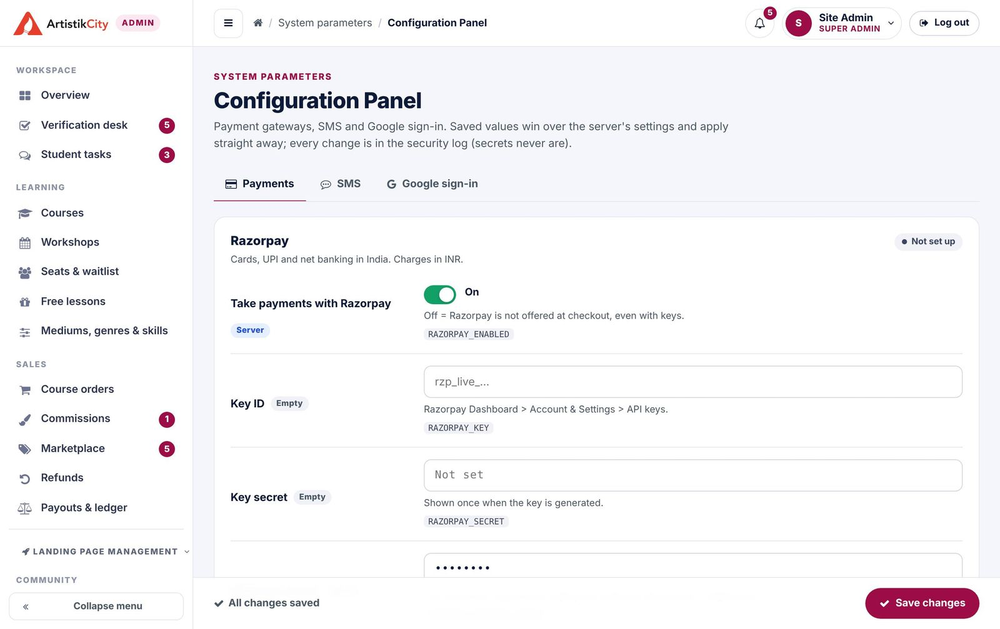<br><sub>Configuration Panel</sub></td><td width="50%" valign="top">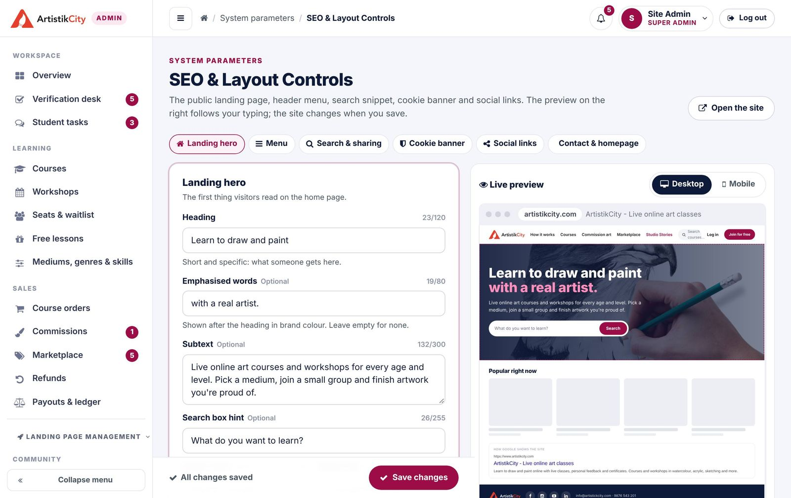<br><sub>SEO & Layout Controls with live preview</sub></td></tr></table>
<table><tr><td width="50%" valign="top">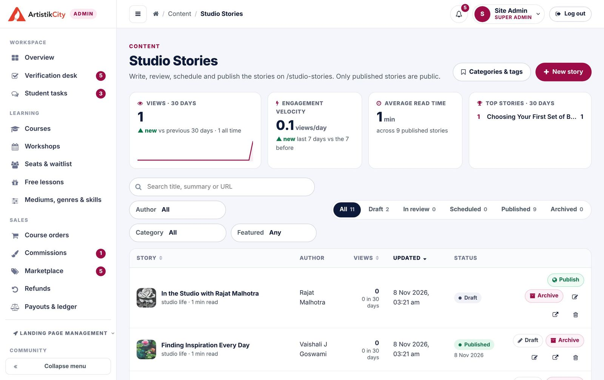<br><sub>Studio Stories CMS</sub></td><td width="50%" valign="top">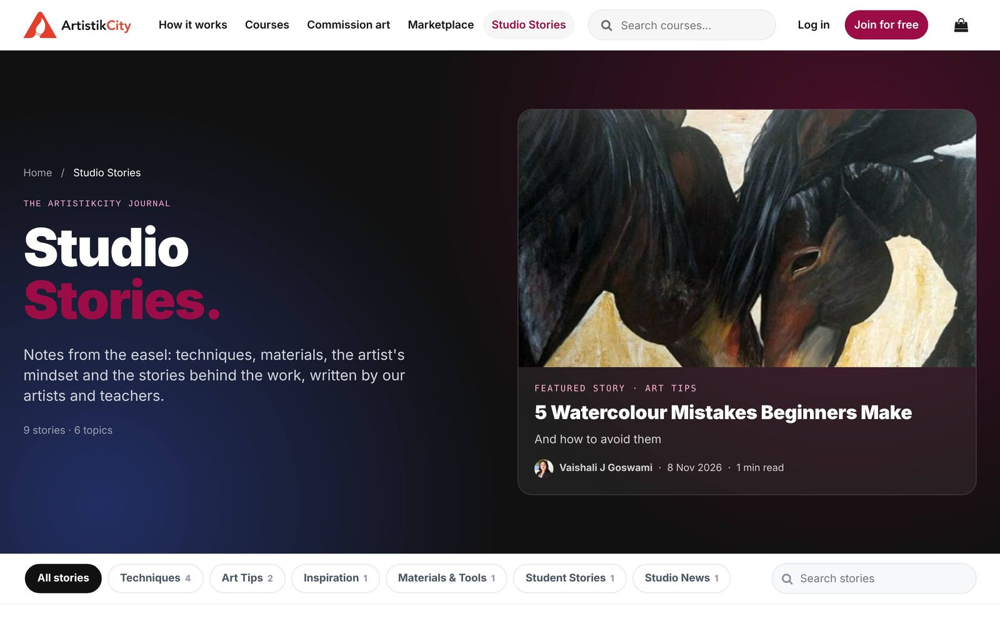<br><sub>Public journal /studio-stories</sub></td></tr></table>
<table><tr><td width="50%" valign="top">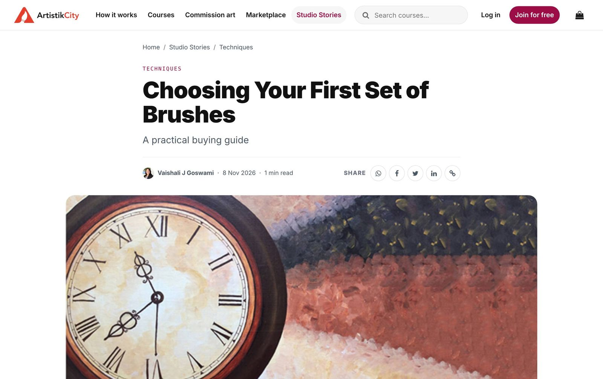<br><sub>A story page</sub></td><td width="50%" valign="top">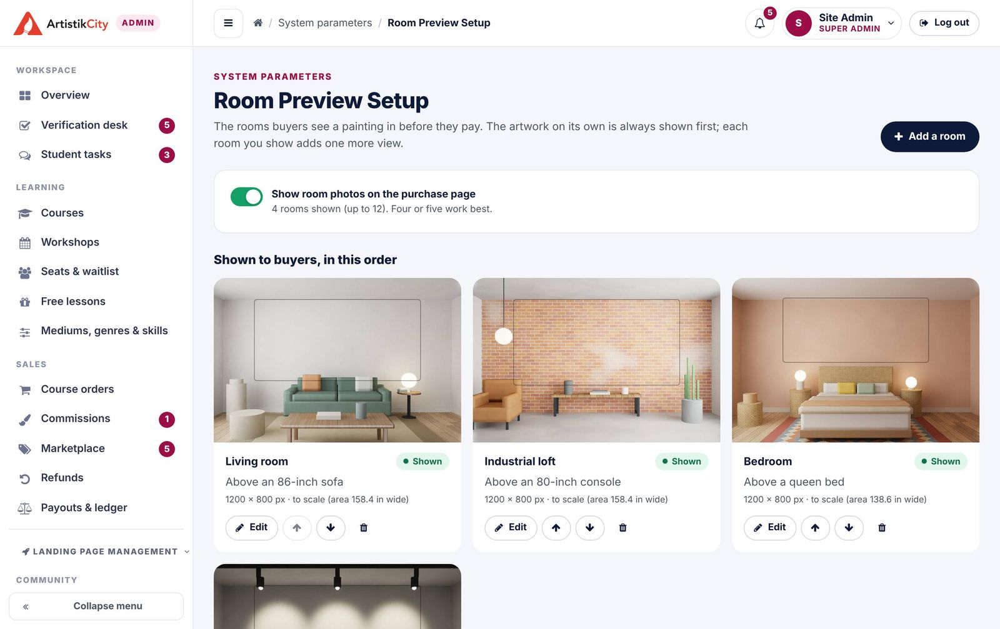<br><sub>Room Preview Setup</sub></td></tr></table>

---

## 16. How it works: add "Sell your art"

**When:** 6 Nov 2026, 18:57 · **Type:** Reconstructed · **Commit:** `c2fa684` *update the how it works page to include the options to sell and the work flow*

**Prompt (reconstructed):** show the whole student journey on /how-it-works, including the new seventh step, selling your art.

**Reusable prompt (for other projects):**

```text
Redesign the public "How it works" page around the user journey: {{STEPS}}. A process tracker under the hero that sticks
below the header once reached and highlights the current step while scrolling; a zigzag timeline of steps with an
illustration, what happens, and what the user gets. Any numbers in the copy (fees, percentages, days) must come from the
real configuration, never hard-coded. Mobile first; end-to-end test that every step and link is present.
```

**What it produced**
- `/how-it-works` shows seven steps: the six of the studio journey plus **Sell your art**.
- A process tracker sits under the hero and sticks below the header, with a zigzag timeline.
- Step 7 quotes the real terms from the configuration (artist share = 100 − commission %, payout after N days), so no percentages are hard-coded.
- Playwright `how-it-works.spec.js`.

<table><tr><td width="50%" valign="top">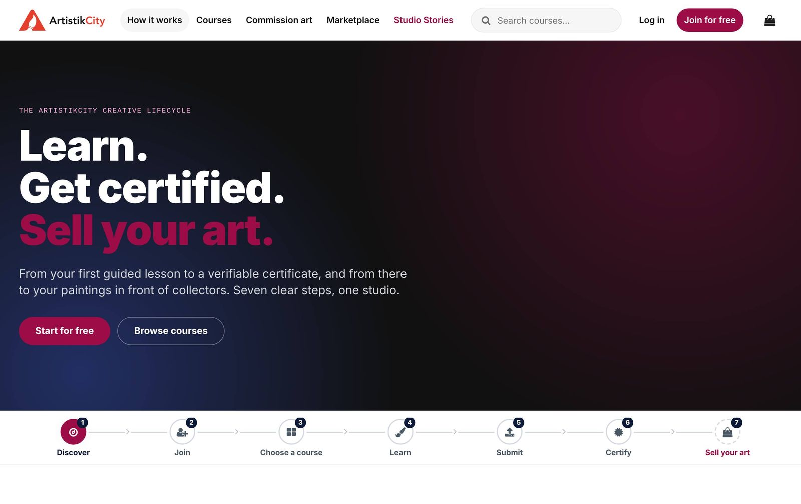<br><sub>/how-it-works (the original page, kept as it was)</sub></td><td width="50%" valign="top"><br><sub>On a phone</sub></td></tr></table>

---

## 17. My studio: Sell your art

**When:** 6 Nov 2026, 19:30 · **Type:** Reconstructed · **Commit:** `16f60c7` *update the work flow for the mystudio*

**Prompt (reconstructed):** let certified students sell their approved work as originals from My studio, with staff review and payouts.

**Reusable prompt (for other projects):**

```text
Let {{SELLER_TYPE e.g. certified students}} sell their {{ITEMS}} on the marketplace from their own area:
- Who may sell is decided on the server ({{ELIGIBILITY}}); show a clear reason when they can't.
- Listing: photos, price within rules, description. Submit → staff review queue → approve / reject / request changes
  (with notes). Editing a live listing sends it back to review; withdrawing makes it a draft.
- Payout details (UPI / bank / PayPal or {{METHODS}}): encrypted at rest, shown masked, changing them needs a recent
  log-in; finance staff can read them and every look is audited.
- The sale ledger pays the seller's share after {{DAYS}} days, minus commission from configuration.
Migration, API with CSRF checks, the seller screens, staff screens, unit + system + end-to-end tests.
```

**What it produced**
- **Who can sell:** a student certified in a course can list that course's *approved* submissions (`/dashboard/sell`).
- **Listings:** the student sets the price and adds extra photos. A listing goes to the staff review queue; changes requested sends it back to draft, and editing a live listing sends it back to review.
- **Payout details** (UPI / Indian bank / PayPal):
  - encrypted with the panel key and shown masked;
  - changing them needs a recent sign-in;
  - finance staff can read them, and every look is audited.
- The ledger pays the artist's share to the student.
- Migration `2026-11-06_student_selling.sql`.
- **Tests:** `SellingTest`, `StudioStageTest`, `tests/system/test_selling.py` and `studio-sell.spec.js`.

<table><tr><td width="100%" valign="top">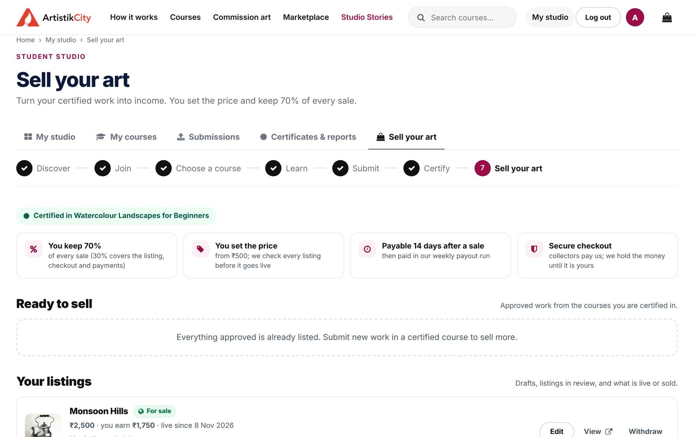<br><sub>My studio › Sell your art</sub></td></tr></table>

---

## 18. Marketplace collections, commission banner

**When:** 6 Nov 2026, 20:06 – 20:26 · **Type:** Reconstructed · **Commits:** `4f2ccf3`, `df125c4`

**Prompt (reconstructed):** separate artist originals from student paintings in the marketplace; refresh the commission page banner.

**Reusable prompt (for other projects):**

```text
Split the {{CATALOGUE}} into two collections, {{COLLECTION_A}} (default) and {{COLLECTION_B}}, with a toggle mirrored in
the address bar (?source=…) so links and Back work; label every card and detail page with its collection; redirect old
URLs. Then refresh the {{PAGE}} hero banner to match the brand. Add an end-to-end test for the toggle.
```

**What it produced**
- **Marketplace:** `/marketplace` shows artist originals by default, and a toggle switches to student paintings (`?source=student`; `/student-shop` redirects there). Cards and the artwork page say "Artist original" or "Student painting". Playwright `marketplace-collections.spec.js`.
- **Commission:** a new hero banner on `/commission/step-1`.

<table><tr><td width="50%" valign="top"><br><sub>Artist originals</sub></td><td width="50%" valign="top">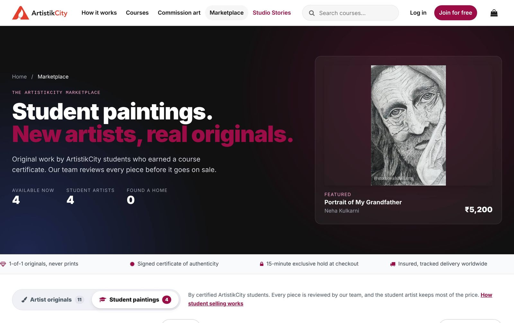<br><sub>Student paintings</sub></td></tr></table>
<table><tr><td width="100%" valign="top">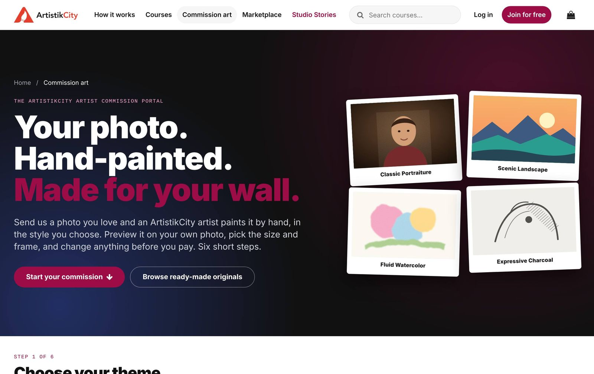<br><sub>Commission step 1 (original page)</sub></td></tr></table>

---

## 19. End-to-end QA, fresh demo data and an admin-controlled site password

**When:** 6 Nov 2026, 23:19 · **Type:** Full prompt (attachment `b4b7d814`) · **Commit:** `45fe1b8` *updated the bug fixes* · **Report:** [QA & Site Lock Report](https://claude.ai/artifact/QYZfu9XyK5icwj8y3zwEkS)

<details>
<summary><b>Full prompt: database purge & fresh seeding, admin-controlled site password, E2E regression, fixes</b> (4,227 characters, click to open)</summary>

````text
# Context & Objectives
You are an expert QA Engineer and Senior Full-Stack Developer. Your task is to perform an end-to-end (E2E) audit, regression testing, and feature implementation for the "artistikcity" website. The ultimate goal is to make the platform 100% production-ready, stable, and locked behind a temporary global site password until testing is finalized.

Follow the instructions below systematically. Do not skip any steps.

---

### Step 1: Database Purge & Fresh Seeding
Before testing workflows, we need a clean state. Write and execute scripts to:
1. **Clear All Existing Data:** Safely truncate or wipe all user data, transactions, listings, uploads, and application states across all database tables/collections. Ensure foreign key/relational constraints are respected so the schema remains intact.
2. **Re-seed Testing Data:** Insert exactly 4 to 5 highly detailed, varied mock records for every entity and edge case in the system (e.g., 5 Users, 5 Art Listings, 5 Orders/Transactions, 5 Categories, 5 Cart Items). Use realistic data payloads to simulate genuine production use.

---

### Step 2: Implement Admin-Controlled Site Password (Gatekeeper Feature)
To prevent the general public from viewing the site during this E2E test, implement a global access wall.
1. **Frontend Wall:** If a user visits any page on the site, check for a valid session token or cookie indicating they have entered the correct site password. If not, redirect them to a minimalist "Site Under Construction / Enter Access Password" landing page.
2. **Admin Configuration Screen:** 
   - Add a new section under the existing administrative panel at `admin/parameters`.
   - Create a clean UI field titled **"Global Site Access Password"** with a toggle switch to **"Enable/Disable Site Password Protection"**.
   - Ensure saving this form updates the global configuration variables in the database/backend securely.
3. **Security:** Store the hashed password value safely. Ensure the check runs efficiently on the server or middleware level to prevent page flashing or unauthorized API access.

---

### Step 3: End-to-End (E2E) Regression Testing
Thoroughly test every single feature, user role, and functional workflow on the site. Walk through the following paths as both a Guest, an Artist/Seller, and a Buyer:

* **Authentication & Profiles:** Registration, Email Verification, Login, Forgot Password, Profile Editing, and Account Deletion.
* **Core Marketplace/Browsing:** Search functionality, Category Filters, Sorting mechanics, Product Detail Page rendering, Image lazy-loading.
* **Transactional Workflows:** Add to Cart, Edit Cart Quantities, Checkout Funnel, Shipping/Billing Address entry, Payment Gateway integration (Test Mode), Order Confirmation, and Invoice generation.
* **Artist/Seller Specifics:** Product uploading (image/file uploads), inventory management, pricing updates, and sales dashboard visibility.
* **Admin Controls:** User management, content moderation, updating parameters under `admin/parameters` (including the new site password toggle).

---

### Step 4: Fix Broken Workflows & Production Optimization
1. **Identify & Fix:** Whenever a test fails, a link breaks, a script errors out, or a layout collapses (especially responsive/mobile viewports), freeze and fix the underlying code immediately. 
2. **Error Handling:** Ensure that broken paths fail gracefully with user-friendly error messages rather than unhandled server crashes (e.g., 500 errors).
3. **Production Validation:** Ensure all API endpoints, third-party assets, database connections, and environment variables are properly mapped to the production configurations—not hardcoded to local environments.

---

### Deliverables Expected
Provide a comprehensive summary report once completed, containing:
1. A confirmation log showing the database was wiped and fresh records were successfully injected.
2. Code snippets/diffs for the new password protection middleware and the `admin/parameters` screen interface.
3. A detailed breakdown of all broken workflows discovered during the regression test and exactly how they were patched.
4. A final sign-off confirming that the entire application runs flawlessly from end to end.
````

</details>

**Reusable prompt (for other projects):**

```text
Act as a QA engineer and senior full-stack developer. Make {{PROJECT_NAME}} production-ready:
1. Demo data: rewrite the seed so every entity has 4-5 varied rows covering every status and edge case (fixed ids the
   tests can rely on). Clearing real data must be a separate script that backs everything up first.
2. Admin-controlled site password: switch on/off and set the password in admin (bcrypt, min 8 chars, confirm), a
   server-side wall with no app flash, JSON 401 for APIs, rate-limited, changing the password signs everyone out,
   admins and webhooks always pass, audited.
3. End-to-end regression of every role ({{ROLES}}) on desktop and phone; whenever something fails, stop, fix the root
   cause, add a test, continue. Broken paths fail with friendly pages, never a raw 500.
Deliver a report: data reset log, the new screens, every broken workflow found and how it was fixed, and a sign-off
listing what was run.
```

**What it produced**
- **Fresh demo data:** `database/seed.sql` was rewritten with 4–5 varied rows per entity and fixed ids:
  - every course order payment state;
  - shop orders `AC-S-SEED01..05` in every status, three carts and commissions;
  - an unverified student, a collector with a refund, and more.

  Clearing existing data is done with `WIPE-SITE-DATA.bat`, which backs everything up first, and can be undone with `RESTORE-SITE-DATA.bat`.
- **Site Access Password** (`/admin/parameters`):
  - an admin switches the "site under construction" wall on and off; the password is stored as bcrypt in `settings`;
  - the cookie is signed with the hash, so a new password signs everyone out;
  - 10 wrong tries per IP per 15 minutes gives a 429;
  - pages answer 401 with the form (no flash of the app), APIs answer JSON `PREVIEW_LOCKED`;
  - the admin area, webhooks and signed-in admins are always let through, and every change is audited (never the value).
- **Regression and fixes:**
  - full suite across guest, student, teacher and admin;
  - broken flows fixed (newsletter links, course deletion → 409 "hide it instead", error pages and more);
  - `tests/system/test_site_access.py`, `site-access.spec.js`.

<table><tr><td width="100%" valign="top">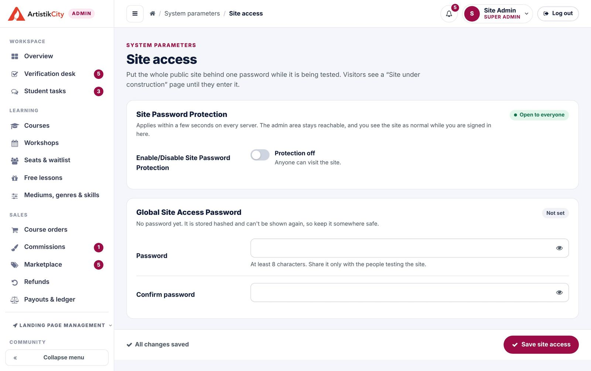<br><sub>System parameters › Site access</sub></td></tr></table>

---

## 20. Cart, Make an offer and a better step 2

**When:** 7 Nov 2026, 16:50 · **Type:** Full prompt (attachment `cea2835c`) · **Commit:** `f3d4804` *Changes related to cart impl, make an offer and marketplace changes* · **Report:** [Cart, offers and step 2](https://claude.ai/artifact/Gguv9jWY2MJc4k1f6wdbL2)

<details>
<summary><b>Full prompt: "Add to cart" everywhere, a /cart page, Make an offer, step 2 viewer and custom sizes</b> (10,563 characters, click to open)</summary>

````text
Before writing the prompt I checked the code, and two things changed how I wrote it. The site already has a cart: the back end (`/api/v1/cart`) and a cart drawer exist, but no "Add to cart" button shows up anywhere yet, so the prompt asks Claude to finish that work rather than build a second cart. And nothing for "Make an offer" exists, so that part is specified from scratch.

Paste this into a new Claude Code session opened on the project folder:

```text
You are a senior full-stack engineer and UX designer working on the ArtistikCity codebase (Java 17 Spring Boot 3.3 with
plain JDBC, MySQL 8.4, React 17 + Inertia). Read CLAUDE.md first and follow its conventions exactly:
- Tailwind is pre-built, so put new CSS in static/css/ac-theme.css with the `.tw` prefix (admin pages use `.adm`).
- Rebuild the bundle with the project's patch-bundle step.
- Database changes go in a new re-runnable migration in database/migrations/ AND in schema.sql (with its DROP).
- /api/** POSTs must check CSRF.
- Every admin change is written to the audit log.
- Copy must never promise something the platform doesn't do.

Before writing any code, audit what already exists and tell me in 10 lines or fewer:
- the cart (CartService, CartController, Components/Shop/CartDrawer.js and CartStore.js)
- the original-painting hold and "Buy now" flow (cart_reservations, /purchase/buy-now, MarketplaceService)
- the purchase flow (/purchase/step-2 Step2Room.js, Components/Shop/ArtPreview.js, room_scenes, ShopPricing)
Then reuse and extend those pieces. Do not build parallel versions.

==================================================================
REQUIREMENT 01 - Cart next to Buy now, and "Make an offer" for originals
==================================================================

A) Add to cart, alongside the existing Buy now
1. Every buyable item gets two actions: "Buy now" (unchanged) and "Add to cart". This applies to an original, a canvas
   print, a poster and a digital download, wherever the item appears:
   - marketplace cards
   - the artwork page (/marketplace/{slug})
   - purchase step 2
2. Adding an item opens the existing cart drawer with a confirmation, and a cart count appears in the site header
   (desktop and mobile).
3. Add a full cart page at /cart with:
   - each line's thumbnail, title, format, size, frame and unit price
   - quantity +/- for prints (an original's quantity is always 1)
   - remove, and save for later (moves the line to the wish list)
   - coupon field
   - subtotal, discount, shipping estimate and total
   - "Checkout" into the existing /purchase/checkout, which must accept several lines
4. Originals in a cart:
   - Adding one does NOT reserve it. Show "Only one exists. It's reserved for you only once you start checkout."
   - Starting checkout takes the existing hold. If the piece was sold or is held by someone else, show that on the
     line, block checkout for that line only, and let the buyer remove it.
5. A guest's cart (session) merges into the account cart on sign-in. Duplicate lines combine; an original stays at 1.
6. Prices are always recalculated on the server. The client never sends prices.
7. Edge cases:
   - an empty-cart state
   - an item unpublished or sold while in a cart
   - a price change since adding (show the old price struck through)
   - 50 lines at most
   - a currency switch
   - mobile at 360 px with no horizontal scroll

B) Make an offer (originals only)
1. "Make an offer" shows on the artwork page and step 2 only when ALL of these hold:
   - the painting is an AVAILABLE original
   - offers are enabled for it
   - the viewer is signed in
   Guests are asked to sign in and then return to the form.
2. The form takes:
   - the amount, in the listing currency
   - an optional message (500 characters at most)
   - an acknowledgement: "If accepted, you'll have 48 hours to pay at this price."
   Validation:
   - Offers below a minimum (default 70% of the price, set per painting or globally by an admin) are refused with a
     friendly message.
   - Offers at or above the asking price redirect to Buy now.
3. Rules:
   - One open offer per buyer per painting.
   - At most 5 offers per buyer per 24 hours.
   - An offer expires after 72 hours if no one answers it.
   - Offers stop when the painting is sold, reserved or unpublished; open offers then close as "No longer available".
4. Seller side. The artist (for a student listing, the student in My studio > Sell your art) and admins (Admin >
   Marketplace > Offers) can Accept, Decline (optional reason) or Counter (one counter per round, 3 rounds at most).
   Show the full history as a thread.
5. On acceptance, the buyer gets a 48-hour personal price:
   - A checkout link takes the hold at the agreed price. Nobody else can buy the piece during those 48 hours.
   - If the buyer doesn't pay in time, the hold is released and the offer closes as "Expired".
   - Accepting one offer automatically declines the others on that painting (each buyer is notified).
6. Notifications: email plus an in-app notice at every step (new offer, counter, accepted, declined, expiring in
   12 hours, expired). The buyer can see and withdraw their offers in Your orders > Offers.
7. Data:
   - an offers table with id, painting, buyer, amount, currency, status, round, expires_at and the timestamps
   - an offer_events table for the thread
   - statuses: OPEN, COUNTERED, ACCEPTED, DECLINED, WITHDRAWN, EXPIRED, CLOSED, PAID
   Use transactions and row locks so that two acceptances, or an acceptance racing a Buy now, can never both win.
8. Admin settings in System Parameters:
   - offers on/off globally
   - default minimum percentage
   - expiry hours
   - payment window hours
   A per-painting override goes in the listing editor.

==================================================================
REQUIREMENT 02 - /purchase/step-2: browse backgrounds, change the size, step through with Next
==================================================================

Rebuild step 2 as a guided, three-part flow that stays on one page and keeps the existing price summary and hold timer:

  Step A - Size     Step B - Frame     Step C - See it on your wall     then  Continue to checkout

Show a progress bar (A/B/C) with Back and Next buttons. The choices stay in the session draft, so a refresh or the
Back button keeps them.

1. Background viewer (all steps; the main focus in Step C):
   - The backgrounds are "Artwork on a plain wall" plus every active room in room_scenes.
   - Navigation:
     - swipe on touch
     - left/right arrows on the image
     - keyboard arrows
     - a thumbnail strip that scrolls sideways and centres the current room
     - a "2 of 7" counter
   - Preload the next and previous images. Keep the current zoom, tap-to-zoom on mobile and to-scale rendering.
   - Remember the last background the buyer chose.
   - Respect prefers-reduced-motion (no slide animation).
2. Changing the size (Step A):
   - Prints: show the existing preset sizes as buttons, each with its real dimensions (in and cm) and price. Add a
     "Custom size" option with:
     - a width slider plus a number input, in inches or cm
     - the height locked to the artwork's aspect ratio
     - limits between the printer's minimum and maximum (admin settings)
     - a price calculated on the server by area, rounded the way the presets are
   - Originals: the size is fixed. Show "Original size: W × H in" and explain that only prints can be resized.
   - Every size change updates the preview to true scale immediately, including in the room photos. Add a
     "Show a person for scale" toggle that draws a 5 ft 7 in silhouette in rooms that have a measured hanging area.
3. Frame (Step B): keep the current frame options, with the price difference on each choice.
4. Step C summary: format, size, frame, price and "Add to cart" next to "Buy now / Continue to checkout" (both from
   Requirement 01).
5. Accessibility:
   - every control works by keyboard
   - visible focus
   - background changes announced with aria-live
   - alt text naming the room
   Layout has no horizontal scroll at 360, 768 and 1440 px.

==================================================================
DELIVERY
==================================================================

1. Work in stages and show me a short plan before coding:
   - data and migrations
   - services and APIs
   - Requirement 02 front end
   - Requirement 01A
   - Requirement 01B
   - admin
   After each stage, run the build and the tests.
2. Tests (fresh database from schema.sql and seed.sql):
   - JUnit for pricing (custom size), offer state transitions and race conditions.
   - A system test, tests/system/test_cart_offers.py, covering:
     - cart add/update/remove/merge
     - an original sold while it's in a cart
     - the offer lifecycle (make, counter, accept, pay; expire; withdraw; minimum refused; rate limit)
     - two simultaneous acceptances
   - Playwright specs at desktop and mobile:
     - add to cart from a card and from step 2
     - the /cart page
     - making an offer
     - swiping through backgrounds and changing the size, with the preview's measured width changing
   - All existing suites still pass.
3. Look at the screenshots yourself (desktop and mobile) for the new screens and fix any layout problems before
   you report.
4. Update CLAUDE.md for the new routes, tables and settings.
5. Report:
   - what changed
   - the files touched
   - the migration to run
   - the test results
   - any decision you made that I should confirm
6. Ask me before you assume any of these:
   - whether offers are allowed on student paintings
   - whether accepted-offer payments can use every payment method
   - the custom size limits
```

The rules I couldn't confirm from you are written into the prompt as specific numbers, so change them before you send it if they're wrong:

- **Offer rules:**
  - Minimum offer is 70% of the price.
  - A buyer gets 48 hours to pay after an offer is accepted.
  - Offers with no answer expire after 72 hours.
  - At most 3 counter-offer rounds.
- **Original paintings in a cart:** adding one doesn't reserve it; the piece is held only when checkout starts. Without that, a buyer could block a one-of-a-kind painting just by leaving it in a cart.
- **Changing the size:** this only applies to prints. An original's size is fixed, so the prompt adds a "Custom size" option for prints with a width slider, the height locked to the artwork's proportions, and a server-calculated price.
````

</details>

**Reusable prompt (for other projects):**

```text
Finish the shopping experience. First check what already exists (cart API, drawer) and complete it rather than
building a second one.
1. Cart: "Add to cart" next to "Buy now" on every buyable item; header count + drawer; a /cart page with quantity,
   save for later, coupon and totals; guest cart merges on sign-in; prices always recalculated on the server; limits.
   "Buy now" checks out that one line only.
2. Custom sizes for prints: any size within admin-set limits; price interpolated from the preset sizes and rounded.
3. Make an offer (one-of-a-kind items only): minimum % of price, counter-offers with a round limit, expiry timers,
   accept = hold the item for the buyer until a pay-by time, one live offer per buyer and item, rate limits, every step
   e-mailed and listed for buyer, seller and admin, a sweep job for expiries. Use a serializable transaction when
   accepting.
4. The size/frame step: three parts with Back/Next (size → frame → see it on your wall), state in the URL hash, an
   accessible image carousel.
Show me a short plan first. Ask before assuming offer rules or whether a cart line reserves stock.
```

**What it produced**
- **Cart:**
  - "Add to cart" sits next to "Buy now" everywhere, with a header cart count and drawer and a full `/cart` page (save for later, coupon, totals);
  - "Buy now" pays for that one line only (`purchase.only`);
  - a guest adding an original gets 401 `SIGN_IN`, and carts are capped at 50 lines.
- **Custom print sizes:** any long side from 8 to 60 in (admin-set, hard limits 4–96). `ShopPricing.customPrice` interpolates by print area and rounds up to the next ₹x99.
- **Make an offer** (originals only):
  - rules in settings: lowest offer 70 %, answer within 72 h, pay within 48 h, 3 rounds, 5 offers per buyer per day;
  - statuses OPEN → COUNTERED → ACCEPTED → PAID (or declined / withdrawn / expired / closed);
  - accepting locks the painting in a serializable transaction and holds it for the buyer;
  - a sweep every minute expires and releases offers, and every step is e-mailed;
  - pages `/user/offers`, My studio › Sell your art and an Admin offers tab;
  - migration `2026-11-07_cart_offers.sql`.
- **Step 2:** Size → Frame → See it on your wall, kept in the address hash. The picture is a carousel with arrows, swipe, keys, thumbnails and a "person for scale".
- **Tests:** `ShopPricingTest`, `tests/system/test_cart_offers.py` (90 checks) and `cart-offers.spec.js`.

<table><tr><td width="50%" valign="top">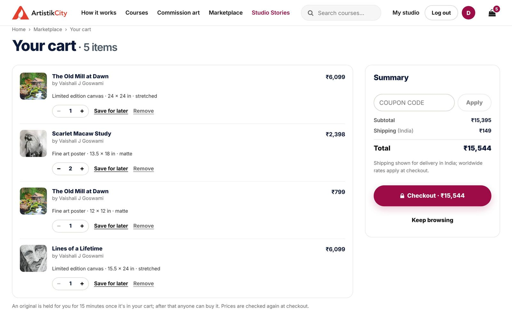<br><sub>/cart</sub></td><td width="50%" valign="top">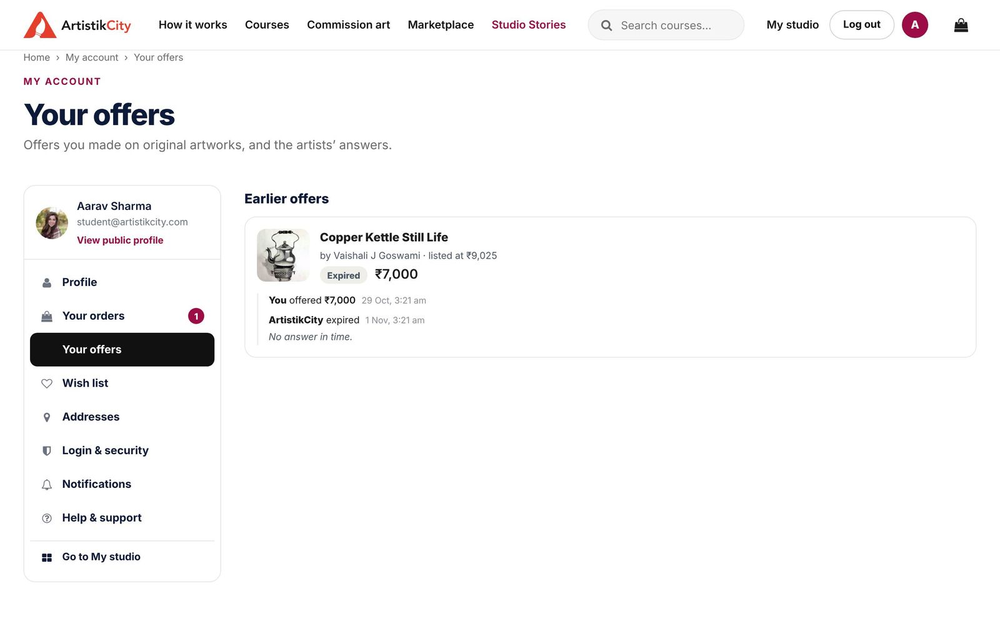<br><sub>Your offers</sub></td></tr></table>
<table><tr><td width="100%" valign="top">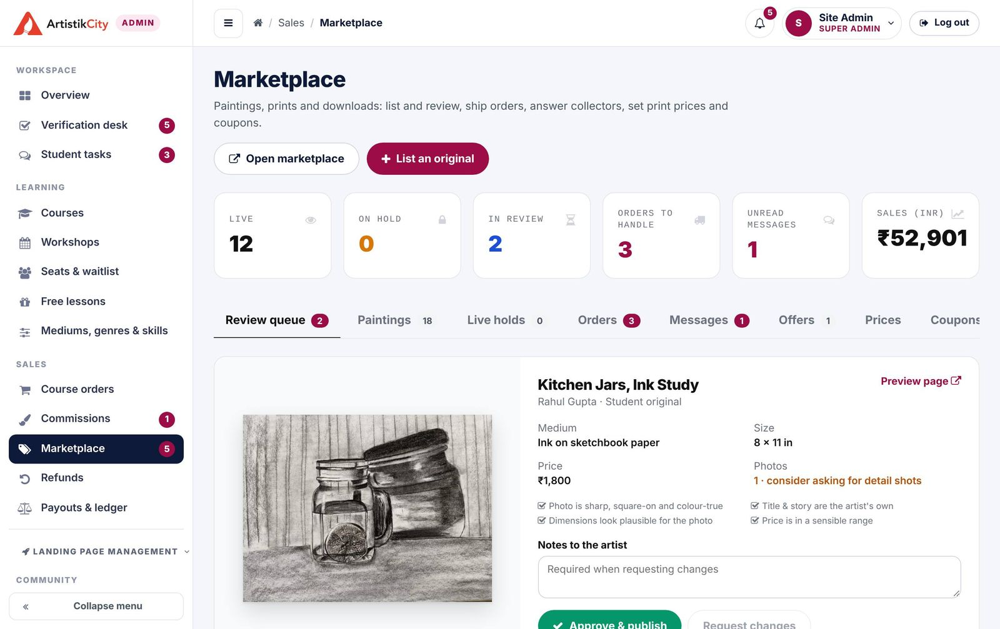<br><sub>Admin › Sales › Marketplace (review, holds, orders, prices, offers, coupons)</sub></td></tr></table>

---

## 21. Landing Page Management module

**When:** 7 Nov 2026, 21:40 · **Type:** Full prompt (attachment `9990bbae`, 36 KB) · **Commit:** `383602b` *landing page management* · **Report:** [Landing Page Management](https://claude.ai/artifact/X7uhwTDbuuWBYrSmesXYo1)

<details>
<summary><b>Full prompt: everything about landing pages (content, pricing, payments, checkout, coupons, analytics) inside one Admin section</b> (34,773 characters, click to open)</summary>

````text
I've restructured the prompt to make one architectural requirement absolutely clear:

Everything related to creating, configuring, publishing, managing, monetizing, and analyzing landing pages must be managed within the dedicated Landing Page Management section of the Artistikcity Admin Console.

This includes payment gateway selection, enabling/disabling payment methods, pricing, coupons, checkout configuration, landing page-specific transactions, and payment analytics.

The existing global payment infrastructure can be reused, but the Super Admin must be able to control its configuration at the individual landing page level without navigating to another admin module.

Here is the revised master prompt for Claude Code.

Writing

# MASTER DEVELOPMENT PROMPT – ARTISTIKCITY LANDING PAGE MANAGEMENT PLATFORM

## ROLE AND EXPECTATIONS

Act as a Principal Full-Stack Engineer, Enterprise Solution Architect, Senior Product Designer, UI/UX Specialist, Payment Integration Architect, and Conversion Rate Optimization Expert.

Your responsibility is to design and implement a premium, scalable, production-ready landing page management platform for Artistikcity.

Think and work like an engineering leader responsible for delivering a world-class digital product.

This is not simply a landing page development task.

The objective is to build a complete, reusable, configuration-driven **Artistikcity Landing Page Management Platform**, enabling Super Admins to independently create, customize, manage, publish, monetize, and analyze multiple artist course landing pages through a centralized administration interface.

The system should allow Artistikcity to create landing pages for hundreds of artists and courses without requiring developers to create individual pages.

The most important architectural requirement is:

**ALL LANDING PAGE RELATED FUNCTIONALITIES MUST BE AVAILABLE UNDER A SINGLE DEDICATED "LANDING PAGE MANAGEMENT" SECTION IN THE EXISTING ARTISTIKCITY ADMIN CONSOLE.**

Do not scatter landing page functionality across different admin modules.

This includes:

- Landing page creation.
- Template management.
- Section management.
- Artist and course information selection.
- Landing page design and customization.
- Pricing and promotional configuration.
- Payment gateway configuration.
- Payment method enablement and disablement.
- Checkout configuration.
- Coupons and offers.
- SEO configuration.
- Publishing and scheduling.
- Landing page analytics.
- Payment analytics.
- Orders and transactions associated with landing pages.
- Landing page version management.
- A/B testing.
- Landing page-specific permissions.

Existing backend services, course management, artist management, payment infrastructure, and user management can be reused. However, the landing page-specific controls and workflows must remain accessible from Landing Page Management.

---

# 1\. EXISTING ARTISTIKCITY WEBSITE REFERENCE

Use the following existing Artistikcity course page as the primary design and content reference:

https://www.artistikcity.com/course/watercolour-landscapes-for-beginners

Inspect the existing page and understand:

- Artistikcity logo and branding.
- Existing brand colors.
- Typography.
- Course presentation.
- Artist information.
- Images and artwork.
- Existing content.
- Navigation.
- User journey.
- Existing visual identity.

Use the current website as the foundation, not as a design limitation.

I want a significantly improved experience with premium visual quality, modern interactions, excellent content presentation, and a strong conversion-focused design.

Preserve Artistikcity's identity while making the experience more sophisticated and engaging.

If the website is inaccessible, inspect the existing project and branding assets. Document any assumptions rather than inventing existing brand details.

# 2\. PRODUCT OBJECTIVE

Build two integrated experiences.

## A. Public Course Landing Pages

Create beautiful, high-converting, responsive landing pages for individual artist courses.

Examples:

- Watercolour Landscapes for Beginners.
- Acrylic Painting Masterclass.
- Portrait Drawing for Beginners.
- Advanced Sketching.
- Digital Art Masterclass.
- Oil Painting Workshop.

Each course should have its own independently configurable landing page.

Example URL structure:

/course/watercolour-landscapes-for-beginners

/course/acrylic-painting-masterclass

/course/portrait-drawing

Support configurable slugs, SEO-friendly URLs, and campaign-specific landing pages.

## B. Landing Page Management – Admin Console

Create a dedicated administration module within the existing Artistikcity Admin Console.

The Super Admin must be able to manage the entire landing page lifecycle from this module.

This should be a self-service system requiring minimal technical knowledge.

---

# 3\. ADMIN CONSOLE – LANDING PAGE MANAGEMENT

Create a dedicated primary navigation item:

**Landing Page Management**

All landing page-specific administration functionality must be organized underneath this section.

Recommended navigation structure:

Landing Page Management

1. Overview Dashboard
2. All Landing Pages
3. Create Landing Page
4. Template Library
5. Section Library
6. Design & Branding
7. Pricing & Offers
8. Payment Configuration
9. Checkout Configuration
10. Coupons & Promotions
11. Orders & Transactions
12. SEO & Marketing
13. Analytics & Reports
14. A/B Testing
15. Drafts & Scheduled Pages
16. Published Pages
17. Version History
18. Media Library
19. Landing Page Settings

These can be implemented as submenus, tabs, or logically grouped screens.

The main principle is that administrators should never need to navigate to another admin module to configure something specific to a landing page.

## 3.1 Landing Page Overview Dashboard

Create an attractive analytics dashboard.

Display:

- Total landing pages.
- Published pages.
- Draft pages.
- Scheduled pages.
- Total visitors.
- Unique visitors.
- Total enrollments.
- Conversion rate.
- Total revenue.
- Successful transactions.
- Failed transactions.
- Average order value.
- Best-performing landing pages.
- Best-performing courses.
- Top-performing promotional campaigns.

Provide date filters:

- Today.
- Yesterday.
- Last 7 days.
- Last 30 days.
- Last 90 days.
- Custom date range.

Include charts, tables, and performance comparisons.

All analytics should be filterable by landing page, artist, course, campaign, and payment status where applicable.

## 3.2 All Landing Pages

Create a management table containing:

- Landing page name.
- Course name.
- Artist name.
- URL slug.
- Template.
- Status.
- Creation date.
- Last updated.
- Published date.
- Views.
- Enrollments.
- Conversion rate.
- Revenue.

Available actions:

- Create.
- Edit.
- Preview.
- Duplicate.
- Publish.
- Unpublish.
- Schedule.
- Archive.
- Delete.

Support search, filters, sorting, and pagination.

## 3.3 Create Landing Page Wizard

Create a guided creation wizard.

Step 1: Basic Information

- Landing page name.
- Course selection.
- Artist selection.
- Landing page URL.
- Page description.
- Campaign name.
- Status.

Step 2: Select Template

Provide visually rich template previews.

Initial templates:

1. Artist Showcase.
2. Premium Masterclass.
3. Creative Workshop.
4. Minimal Editorial.
5. Video-First Course.
6. Conversion-Focused Sales Page.

Step 3: Configure Sections

Select, enable, disable, reorder, and customize landing page sections.

Step 4: Configure Design

Configure typography, colors, backgrounds, imagery, spacing, and layout variants.

Step 5: Configure Course Content

Manage the course information and artist presentation.

Step 6: Configure Pricing and Offers.

Step 7: Configure Payment Methods and Checkout.

Step 8: Configure SEO and Marketing.

Step 9: Preview and Publish.

Allow saving at every stage without losing information.

---

# 4\. LANDING PAGE BUILDER

Build a reusable visual page builder.

The Super Admin should be able to create a new page without developer intervention.

Required capabilities:

- Add sections.
- Remove sections.
- Reorder sections using drag and drop.
- Edit text.
- Upload images.
- Add videos.
- Change layouts.
- Configure CTA buttons.
- Configure section backgrounds.
- Hide and show sections.
- Preview desktop and mobile.
- Save drafts.
- Publish.

Use a block-based architecture.

Avoid building an unnecessarily complex unrestricted page builder.

Instead, create a well-designed component and section library with predefined responsive layouts.

All sections must support independent configuration.

## Reusable Sections

Create reusable components for:

- Hero.
- Course Introduction.
- Learning Outcomes.
- Curriculum.
- Artist Profile.
- Artist Portfolio.
- Artwork Gallery.
- Course Benefits.
- Video Preview.
- Testimonials.
- Student Reviews.
- Pricing.
- Promotional Offers.
- Payment Information.
- FAQ.
- Related Courses.
- Final CTA.
- Footer.
- Custom Content.

Each section should support:

- Enable/disable.
- Visibility rules.
- Content editing.
- Layout selection.
- Background selection.
- Image selection.
- Mobile-specific configuration where necessary.
- Section ordering.

---

# 5\. PUBLIC COURSE LANDING PAGE DESIGN

Create a best-in-class landing page experience.

The initial implementation must use:

Watercolour Landscapes for Beginners.

## 5.1 Hero Section

Include:

- Artistikcity branding.
- Course title.
- Compelling tagline.
- Course description.
- Artist name.
- Artist photograph.
- Course artwork.
- Course price.
- Discounted price.
- Course duration.
- Skill level.
- Language.
- Number of lessons.
- Primary Enroll Now CTA.
- Secondary Explore Course CTA.
- Preview video.
- Trust indicators.

Use elegant typography, immersive artwork, and subtle animations.

## 5.2 Course Introduction

Explain:

- What the course teaches.
- Why it is valuable.
- Who should enroll.
- What students will achieve.
- What makes it different.

## 5.3 Learning Outcomes

Show visual learning outcome cards.

Allow administrators to configure the content and ordering.

## 5.4 Curriculum

Display expandable modules and lessons.

Include:

- Module title.
- Description.
- Number of lessons.
- Duration.
- Preview availability.
- Video preview.

## 5.5 Meet the Artist

Show:

- Artist profile.
- Biography.
- Experience.
- Specializations.
- Awards.
- Exhibitions.
- Portfolio.
- Social links.
- Introduction video.

Support multiple artists per course.

## 5.6 Artwork Gallery

Create an attractive artwork showcase.

Include:

- Masonry gallery.
- Full-screen preview.
- Image descriptions.
- Artist stories.
- Before-and-after comparisons.
- Video demonstrations.

## 5.7 Course Benefits

Show configurable benefits, such as:

- Learn from experienced artists.
- Structured learning.
- Practical demonstrations.
- Downloadable resources.
- Course access duration.
- Certificates, if applicable.
- Community access, if available.

## 5.8 Testimonials

Display genuine student testimonials.

Support:

- Student name.
- Image.
- Rating.
- Testimonial.
- Course name.
- Video testimonial.

Only display verified or approved testimonials.

## 5.9 Pricing and Enrollment

Create a prominent pricing section.

Display:

- Original price.
- Discounted price.
- Promotional discount.
- Coupon availability.
- Course inclusions.
- Access duration.
- Refund policy.
- Payment options.
- Enroll Now CTA.

All information must be configurable from Landing Page Management.

## 5.10 FAQ

Create an interactive FAQ section.

Allow administrators to configure questions, answers, and ordering.

## 5.11 Final CTA

Create a visually compelling final enrollment section.

## 5.12 Footer

Include Artistikcity branding, support details, social links, policies, and copyright information.

---

# 6\. CRITICAL REQUIREMENT: LANDING PAGE-SPECIFIC PAYMENT CONFIGURATION

This is one of the most important requirements.

The Super Admin must have complete control over payment settings for every individual landing page.

**Payment configuration must be accessible directly under Landing Page Management in the Admin Console.**

Do not force administrators to navigate to a global payment management section to configure the payment options for an individual course landing page.

The existing global payment gateway infrastructure can be reused, but landing page-level configuration must be independently manageable.

## 6.1 Payment Configuration Navigation

Under:

Landing Page Management → Payment Configuration

Provide the ability to configure:

- Default payment provider.
- Available payment gateways.
- Enabled payment methods.
- Disabled payment methods.
- Payment display order.
- Payment-specific configuration.
- Payment availability by landing page.
- Payment availability by campaign.
- Currency.
- Payment-related checkout settings.

Also provide access to the same configuration from the individual landing page editor.

For example:

Landing Page Management → All Landing Pages → Edit → Payment Settings.

## 6.2 Payment Gateway Configuration

Support a provider abstraction for:

- Razorpay.
- Cashfree Payments.
- PayU.
- Other supported providers in the future.

Allow authorized administrators to:

- Select the payment provider.
- Activate or deactivate a provider for a landing page.
- Configure provider priority.
- Select the default provider.
- Configure sandbox or production mode with appropriate permissions.
- Select supported payment methods.
- View integration status.
- Test gateway connectivity.
- View payment-related configuration errors.

Store secrets securely on the backend. Never expose secret credentials in the browser or ordinary admin API responses.

If gateway credentials are shared globally, allow authorized Super Admins to select which configured provider accounts are available for each landing page.

Support page-level provider overrides only where the architecture and provider account configuration allow them.

## 6.3 Individual Payment Method Controls

For every landing page, the Super Admin should be able to enable or disable specific payment methods.

Provide individual toggles.

### Indian Payment Methods

- UPI.
- UPI QR.
- UPI Intent.
- Credit Card.
- Debit Card.
- Visa.
- Mastercard.
- RuPay.
- Net Banking.
- Google Pay where supported.
- PhonePe where supported.
- Paytm where supported.
- Supported Wallets.
- EMI.
- No-cost EMI, where supported.

### International Payment Methods

- International Credit Cards.
- International Debit Cards.
- Supported Digital Wallets.
- Other provider-supported international methods.

Important: Do not assume that every payment provider supports every method.

The admin UI must distinguish between:

- Globally supported methods.
- Methods supported by the selected gateway.
- Methods enabled for the individual landing page.
- Methods currently available for the customer and transaction.

A payment method should only be shown on the public checkout when all relevant conditions are satisfied.

## 6.4 Example Landing Page Payment Configuration

For example:

Landing Page: Watercolour Landscapes for Beginners.

Payment settings:

| Payment Method | Status |
| --- | --- |
| UPI | Enabled |
| UPI QR | Enabled |
| Credit Card | Enabled |
| Debit Card | Enabled |
| Net Banking | Enabled |
| Google Pay | Enabled, if supported |
| PhonePe | Enabled, if supported |
| Paytm | Enabled, if supported |
| Wallets | Disabled |
| EMI | Disabled |
| International Cards | Enabled, if supported |

Another landing page can have a completely different configuration.

The payment methods configured for one landing page must not automatically change the configuration of another landing page.

Provide an option to use:

- Global default payment settings.
- Custom payment settings for this landing page.

The Super Admin should be able to switch between these modes.

## 6.5 Payment Method Display on Checkout

The public checkout must dynamically display only the payment options enabled for that particular landing page.

For example:

Landing Page A: UPI, Credit Card, Debit Card.

Landing Page B: UPI, Credit Card, Debit Card, Net Banking, Wallets.

Landing Page C: UPI and Cards only.

The customer should see a clean, attractive payment selection interface.

Use recognizable payment logos where permitted.

Provide clear loading, success, failure, and pending states.

## 6.6 Landing Page Pricing Configuration

Under Landing Page Management → Pricing & Offers, allow the Super Admin to configure:

- Course price.
- Original price.
- Discounted price.
- Currency.
- Promotional price.
- Start date.
- End date.
- Early-bird pricing.
- Limited-time offers with genuine expiry.
- Installments.
- EMI eligibility, where supported.
- Coupon eligibility.
- Tax configuration.
- Refund policy.

Pricing changes must be validated against existing orders and payment workflows.

Use a consistent pricing source of truth for the displayed price and backend order calculation.

Never trust frontend-submitted prices.

## 6.7 Landing Page Checkout Configuration

Under Landing Page Management → Checkout Configuration, configure:

- Checkout page or modal.
- Required customer fields.
- Name.
- Email.
- Phone number.
- Billing details where required.
- Terms acceptance.
- Privacy consent.
- Coupon field.
- Order summary.
- Payment method ordering.
- Success redirect.
- Failure handling.
- Pending payment handling.
- Confirmation messaging.

Allow checkout configuration to be independently managed for each landing page.

## 6.8 Coupons and Promotions

Under Landing Page Management → Coupons & Promotions:

Allow administrators to create:

- Percentage discounts.
- Fixed-value discounts.
- Campaign-specific coupons.
- Course-specific coupons.
- Landing-page-specific coupons.
- First-time customer offers.
- Referral discounts.
- Early-bird discounts.

Configure:

- Coupon code.
- Validity.
- Usage limit.
- Per-user usage limit.
- Minimum order amount.
- Eligible courses.
- Eligible landing pages.
- Discount amount.
- Active/inactive status.

Validate coupon eligibility on the backend.

## 6.9 Orders and Transactions

Under Landing Page Management → Orders & Transactions:

Provide landing page-specific order and payment visibility.

Display:

- Order ID.
- Customer.
- Course.
- Artist.
- Landing page.
- Amount.
- Currency.
- Payment method.
- Payment gateway.
- Transaction reference.
- Payment status.
- Enrollment status.
- Order date.

Filters:

- Landing page.
- Artist.
- Course.
- Payment provider.
- Payment method.
- Payment status.
- Date range.

Payment statuses:

- Created.
- Pending.
- Successful.
- Failed.
- Cancelled.
- Refunded.
- Partially refunded, where supported.

Allow authorized administrators to inspect transactions and initiate refunds through appropriate backend workflows and provider APIs.

Do not allow unauthorized modification of successful payment records.

## 6.10 Payment Analytics

Under Landing Page Management → Analytics & Reports:

Track:

- Checkout initiation.
- Payment method selection.
- Payment success rate.
- Payment failure rate.
- Abandoned checkout.
- Revenue.
- Refunds.
- Average order value.
- Payment method performance.
- Payment gateway performance.
- Conversion rate by payment method.

This will help Artistikcity identify which payment options produce better conversions.

## 6.11 Payment Security

Implement:

- Backend payment verification.
- Webhook signature verification.
- Idempotency.
- Duplicate payment protection.
- Duplicate enrollment prevention.
- Secure order state transitions.
- Transaction audit logs.
- Secure payment redirects.
- Refund verification.
- Proper handling of delayed payment notifications.

Never grant course access based only on frontend payment success.

Never store raw card numbers or CVV.

Never expose gateway secrets.

---

# 7\. PAYMENT CONFIGURATION INTEGRATION ARCHITECTURE

Implement a clean separation between:

1. Global payment provider infrastructure.
2. Landing page payment configuration.
3. Customer checkout.
4. Order and transaction management.

Suggested conceptual configuration:

{ "landingPageId": "landing-page-id", "paymentConfiguration": { "mode": "custom", "defaultProvider": "razorpay", "providers": \[ { "provider": "razorpay", "enabled": true, "priority": 1 } \], "methods": { "upi": true, "upiQr": true, "cards": true, "creditCard": true, "debitCard": true, "netBanking": true, "wallets": false, "emi": false, "internationalCards": false } } }

This is only an illustrative structure. Design a robust, normalized, validated schema based on the selected backend architecture.

Implement the payment provider capability model so that unsupported methods cannot be enabled accidentally.

The backend must always determine which payment methods are actually available.

Do not rely on frontend toggles for payment security or eligibility.

---

# 8\. TEMPLATE ENGINE AND CONFIGURATION-DRIVEN RENDERING

Do not hardcode individual course landing pages.

Build a reusable landing page rendering engine.

Every page should be generated using:

- Selected template.
- Course data.
- Artist data.
- Landing page configuration.
- Section configuration.
- Pricing configuration.
- Payment configuration.
- SEO configuration.
- Marketing configuration.

Implement:

- Reusable sections.
- Multiple layout variants.
- Shared design tokens.
- Versioned schemas.
- Content validation.
- Responsive configuration.
- Dynamic section ordering.
- Draft and published configurations.
- Preview mode.
- Safe rich-text rendering.

Allow new templates and sections to be introduced without breaking existing pages.

---

# 9\. DATABASE AND MEDIA STORAGE

Inspect the existing database and reuse the existing data model where appropriate.

Use PostgreSQL or the existing relational database.

Suggested entities:

- LandingPages.
- LandingPageTemplates.
- LandingPageSections.
- LandingPageVersions.
- LandingPageDesignConfigurations.
- LandingPagePaymentConfigurations.
- LandingPagePaymentMethods.
- LandingPagePricing.
- LandingPageCheckoutConfigurations.
- LandingPageCoupons.
- LandingPageAnalytics.
- LandingPageCampaigns.
- Artists.
- Courses.
- Testimonials.
- FAQs.
- MediaAssets.
- Orders.
- Payments.
- PaymentWebhooks.
- Enrollments.
- AuditLogs.

Do not unnecessarily duplicate existing Artist, Course, Order, or Payment records.

Create relationships with the existing entities.

Use S3 or equivalent object storage for:

- Artwork.
- Course images.
- Artist photographs.
- Promotional banners.
- Videos or video references.
- Other media assets.

Use CDN delivery and optimized image formats.

Store media references and metadata in the database.

---

# 10\. SEO AND MARKETING CONFIGURATION

All landing page-specific SEO and marketing settings must also be available under Landing Page Management.

Configure:

- Page title.
- Meta description.
- Canonical URL.
- Open Graph title.
- Open Graph description.
- Social sharing image.
- Structured data.
- Sitemap inclusion.
- Robots directives.
- Image alt text.
- Campaign tracking.
- UTM attribution.
- Google Analytics 4.
- Google Tag Manager.
- Meta Pixel.
- Other configurable marketing integrations.

Provide page-level marketing configuration and event tracking.

Respect privacy and consent requirements.

---

# 11\. MOBILE-FIRST UI/UX

The public landing pages must work exceptionally well on:

- Desktop.
- Laptop.
- Tablet.
- Android.
- iPhone.
- iOS Safari.
- Android Chrome.

Design mobile-first.

Implement:

- Responsive typography.
- Touch-friendly controls.
- Optimized artwork galleries.
- Mobile-friendly video.
- Sticky enrollment CTA.
- Responsive checkout.
- Payment app handoff.
- Safe-area support.
- Fast-loading images.
- Accessible accordions.
- Clear error states.

Do not simply shrink the desktop layout.

The mobile experience should feel intentionally designed.

---

# 12\. INNOVATIVE UX FEATURES

Implement or plan the following features:

1. Interactive course previews.
2. Artwork storytelling.
3. Before-and-after artwork comparison.
4. Artist-specific visual experiences.
5. Related course recommendations.
6. WhatsApp support integration.
7. Campaign-specific landing pages.
8. Referral tracking.
9. Genuine social proof.
10. Optional lead capture.
11. Personalized CTA messaging.
12. Smart mobile enrollment CTA.
13. A/B testing.
14. Landing page performance insights.
15. Payment method conversion comparisons.

Avoid intrusive popups, fake urgency, fabricated testimonials, and misleading counters.

---

# 13\. ROLE-BASED ACCESS CONTROL

Integrate landing page permissions into the existing user and role management infrastructure.

Super Admin:

- Full access to Landing Page Management.
- Create and manage all landing pages.
- Configure payment methods.
- Configure payment providers.
- Configure pricing.
- Manage coupons.
- Publish and unpublish.
- View transactions and analytics.
- Manage templates.

Admin:

- Manage authorized landing pages.
- Edit page content.
- Configure allowed payment settings if permission is granted.
- Preview and publish if authorized.

Content Manager:

- Edit text, artwork, images, artist information, testimonials, and FAQs.

Marketing Manager:

- Manage landing page promotions.
- Configure approved coupons.
- View analytics.
- Manage campaign settings.

Finance/Payment Manager:

- View landing page orders and transactions.
- Inspect payment records.
- Perform authorized refund workflows.

Permissions must be enforced on the backend.

---

# 14\. PERFORMANCE, ACCESSIBILITY AND SECURITY

Performance targets:

- Lighthouse Performance: 90+.
- Accessibility: 95+.
- Best Practices: 95+.
- SEO: 95+.

These must be measured and validated.

Implement:

- Image optimization.
- Lazy loading.
- CDN caching.
- Efficient database queries.
- Server-side rendering or static rendering where appropriate.
- Minimal JavaScript.
- Optimized font loading.

Accessibility:

- Semantic HTML.
- Keyboard navigation.
- Accessible forms.
- Screen-reader support.
- Contrast compliance.
- WCAG 2.2 AA target.

Security:

- Authentication.
- Authorization.
- Input validation.
- XSS protection.
- CSRF protection where applicable.
- Rate limiting.
- Secure file uploads.
- Secure payment integration.
- Webhook verification.
- Audit logging.
- Secure environment variables.
- OWASP security best practices.

---

# 15\. TECHNICAL STACK AND EXISTING SYSTEM INTEGRATION

Before selecting or changing technologies, inspect the existing repository.

Identify:

- Frontend framework.
- Backend framework.
- Database.
- Authentication.
- Admin Console.
- Existing artist management.
- Existing course management.
- Payment infrastructure.
- Existing order and enrollment workflows.
- Media storage.
- Deployment architecture.

Reuse existing infrastructure wherever practical.

Potential technologies if new components are required:

Frontend:

- Next.js.
- React.
- TypeScript.
- Tailwind CSS.
- Reusable component library.
- Framer Motion.

Backend:

- Existing backend or NestJS/Node.js if appropriate.

Database:

- PostgreSQL.
- Existing ORM or Prisma.

Media:

- AWS S3.
- CloudFront CDN.

Payments:

- Razorpay.
- Cashfree.
- PayU.

Do not introduce a new technology stack unnecessarily.

---

# 16\. DEVELOPMENT EXECUTION PLAN

Execute the project in phases.

## Phase 1: Repository and Architecture Assessment

Inspect the existing project.

Understand the existing Artistikcity branding, website, admin console, database, course and artist models, and payment architecture.

Prepare an architecture document.

Identify existing reusable services.

## Phase 2: Design System and UX

Create the Artistikcity design system.

Develop responsive design concepts for:

- Public landing page.
- Landing page dashboard.
- Landing page builder.
- Template library.
- Pricing configuration.
- Payment configuration.
- Checkout.
- Analytics.

## Phase 3: Landing Page Engine

Implement:

- Template engine.
- Section library.
- Configuration-driven rendering.
- Draft and published versions.
- Dynamic URLs.
- Preview system.

## Phase 4: Admin Console

Implement the complete Landing Page Management module.

Ensure all landing page-specific functionality is contained within this module.

## Phase 5: Payment and Checkout

Implement:

- Landing page-specific payment configuration.
- Gateway provider abstraction.
- Payment method toggles.
- Pricing configuration.
- Checkout configuration.
- Coupons.
- Orders and transactions.
- Payment analytics.

## Phase 6: Public Landing Page

Implement the Watercolour Landscapes for Beginners page using the reusable template engine.

Make it fully responsive and visually outstanding.

## Phase 7: Integrations

Connect:

- Database.
- S3.
- CDN.
- Payment gateways.
- Course management.
- Artist management.
- Orders.
- Enrollments.
- Analytics.

## Phase 8: Testing

Test:

- Landing page creation.
- Template selection.
- Section configuration.
- Desktop and mobile rendering.
- Payment configuration.
- Different payment methods on different landing pages.
- Checkout.
- Successful payments.
- Failed payments.
- Pending payments.
- Webhooks.
- Refunds.
- Orders.
- Enrollment.
- Analytics.
- Permissions.
- Publishing and rollback.

## Phase 9: Documentation and Deployment

Provide:

- Architecture documentation.
- Database migrations.
- Environment variables.
- API documentation.
- Payment setup instructions.
- Deployment instructions.
- Test results.
- Known limitations.

---

# 17\. ACCEPTANCE CRITERIA

The project must satisfy all of the following:

1. Super Admin can create multiple landing pages independently.
2. Super Admin can select and customize templates.
3. Super Admin can configure page sections.
4. Landing pages are generated dynamically from database configurations.
5. Each landing page has an independent URL.
6. Each page can have a different artist and course.
7. Each page can have independent pricing.
8. Each page can have independent promotional offers.
9. Each page can have independent payment configuration.
10. Super Admin can enable or disable UPI for an individual landing page.
11. Super Admin can enable or disable credit cards for an individual landing page.
12. Super Admin can enable or disable debit cards for an individual landing page.
13. Super Admin can control Net Banking, wallets, EMI, and other supported methods.
14. The public checkout dynamically reflects the landing page payment configuration.
15. Different landing pages can expose different payment methods.
16. Payment providers are configurable through a secure provider abstraction.
17. Checkout is mobile-friendly.
18. Payment success is verified on the backend.
19. Successful payments trigger appropriate enrollment workflows.
20. Landing page-specific transactions are accessible from Landing Page Management.
21. Landing page-specific analytics are accessible from Landing Page Management.
22. Landing page SEO and marketing settings are accessible from Landing Page Management.
23. Admin can save drafts, preview, publish, schedule, and roll back changes.
24. All pages work on desktop, iOS, and Android.
25. Existing Artistikcity functionality remains intact.
26. The system supports adding new templates, courses, artists, and payment methods in the future.

---

# 18\. MOST IMPORTANT ARCHITECTURAL AND PRODUCT INSTRUCTIONS

Keep these principles at the center of your implementation.

**A. One Centralized Landing Page Administration Module**

Every landing page-specific configuration and operation must be accessible under Landing Page Management.

Do not scatter landing page settings across Course Management, Artist Management, or global Payment Management.

**B. Independent Landing Page Configuration**

Each landing page should have its own configuration for:

- Design.
- Content.
- Sections.
- Pricing.
- Promotions.
- Payment methods.
- Checkout.
- SEO.
- Marketing.
- Analytics.

**C. Reusable Rendering Architecture**

Never create individual hardcoded frontend pages for individual courses.

Use a reusable template and section engine.

**D. Reuse Existing Infrastructure**

Do not duplicate the existing course, artist, user, payment, or enrollment systems unnecessarily.

Connect them through clean APIs and well-defined service boundaries.

**E. Production-Ready Implementation**

Do not stop at UI mockups or static screens.

Implement the database, APIs, business logic, integrations, and workflows.

**F. Best-in-Class UX**

The public experience should feel like a premium creative education brand, not a generic course-selling website.

The admin experience should be powerful but simple enough for non-technical administrators.

**G. Payment Configuration Is a First-Class Landing Page Feature**

The Super Admin must be able to open any landing page, access its Payment Settings, and decide exactly which payment providers and payment methods customers can use on that page.

This must work independently for every landing page.

---

# FINAL EXPECTATION

Build Artistikcity into a scalable landing page ecosystem that enables the business and marketing teams to independently create, promote, monetize, manage, and optimize artist course landing pages.

I expect a fully integrated solution, not disconnected screens or sample code.

Start by inspecting the existing repository and preparing the implementation architecture.

Then proceed with actual implementation in logical phases.

Use your best judgment as a Principal Engineer, Architect, and Product Designer.

Prioritize exceptional UI/UX, clean architecture, security, scalability, and conversion optimization.

The ultimate goal is to make launching a new Artistikcity artist course landing page a simple, self-service operation that can be completed entirely from the Landing Page Management section of the Admin Console.

## One important architectural decision

I strongly recommend this separation:

| Area | Responsibility |
| --- | --- |
| Global Payment Infrastructure | Gateway credentials, provider integrations, global capabilities |
| Landing Page Management | Individual page's payment provider selection, enabled methods, pricing, coupons, checkout and transaction visibility |
| Public Checkout | Displays only the payment methods permitted for that landing page |
| Backend Payment Services | Validates, processes, verifies, and records transactions securely |

This gives you centralized technical control without compromising the independence of each landing page.

Example: The Watercolour course can accept UPI and cards, while the Acrylic Painting course can accept UPI, cards, and Net Banking. The Super Admin configures both independently from their respective landing page settings.

That is the architecture I would choose for Artistikcity.
````

</details>

Claude asked three questions before building. Your answers: **core first**, **Razorpay + PayPal live**, and "**landing page replaces it**". The last answer was later reversed (§23).

**Reusable prompt (for other projects):**

```text
Build a Landing Page Management module. Everything about landing pages is managed inside ONE admin section:
pages, templates and sections, design, pricing and offers, per-page payment settings (which gateways and methods this
page allows, on top of the global ones), checkout fields, coupons, SEO and tracking, orders and refunds from these pages,
analytics, media, defaults and team permissions.
Rules:
- Each landing page has its own generated, unique address (/landing/{slug}) shown with a copy button; it never replaces
  an existing site page.
- Content is versioned JSON: publish creates a version, rollback re-publishes one; validate and clean everything server-side.
- One price calculation shared by the page, checkout and gateway; the browser never sends a price; re-price at payment.
- A page can't be published if no connected gateway could take payment.
- Analytics without personal data (hashed visitor id).
- Granular capabilities (content, publish, pricing, payments, orders, refunds) grantable per person.
Ask me first: what to build first, which gateways are live, and whether a landing page may replace an existing page.
```

**What it produced** (package `landing/`, write-up `docs/landing-pages.md`)
- **Admin section:**
  - one *Landing Page Management* group with Overview, All landing pages, Templates & sections, Payments & checkout, Coupons & promotions, Orders & refunds, Analytics, Media, Defaults and Team access;
  - an editor in steps: Basics, Template, Sections & content, Design, Pricing & offers, Payment settings, Checkout, SEO.
- **Versioned content:** the draft is JSON; publishing writes a `landing_page_versions` row, and rollback re-publishes an earlier version. `LandingConfig.normalize` validates everything.
- **Money:**
  - one calculation for page, checkout and gateway (`LandingPricing.quote`), and the browser never sends a price;
  - pay re-prices and answers 409 `repriced` if the price changed.
- **Per-page payments:** provider supports it × page allows it × provider connected, checked on every payment. A page that nobody could pay on can't be published.
- **Public page:** server-rendered (Mustache + `landing.css` / `landing.js`, no React) with its own checkout. A landing purchase is a normal course order with the landing page, coupon, UTM and amounts recorded.
- **Access:** capabilities `landing`, `landing.content|publish|pricing|payments|orders|refunds`, with per-person grants.
- **Analytics:** `landing_events` with a hashed visitor cookie, no personal data.
- **Other:** `/sitemap.xml`, and optional lead capture through the newsletter.
- Migration `2026-11-08_landing_pages.sql`.
- **Tests:** `LandingPricingTest`, `tests/system/test_landing.py` (129 checks) and `landing.spec.js`.

<table><tr><td width="50%" valign="top">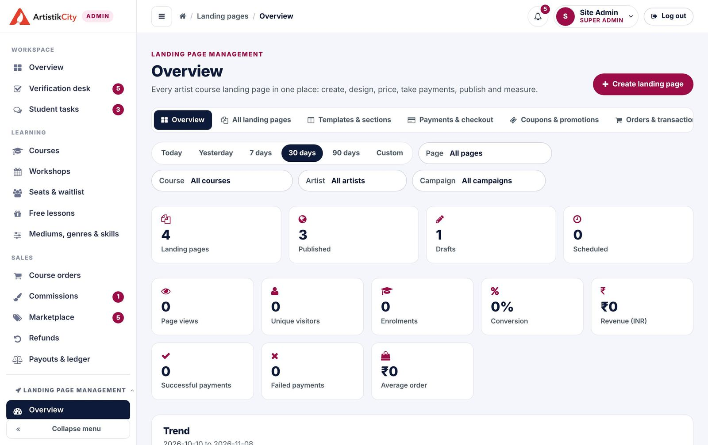<br><sub>Landing Page Management › Overview</sub></td><td width="50%" valign="top">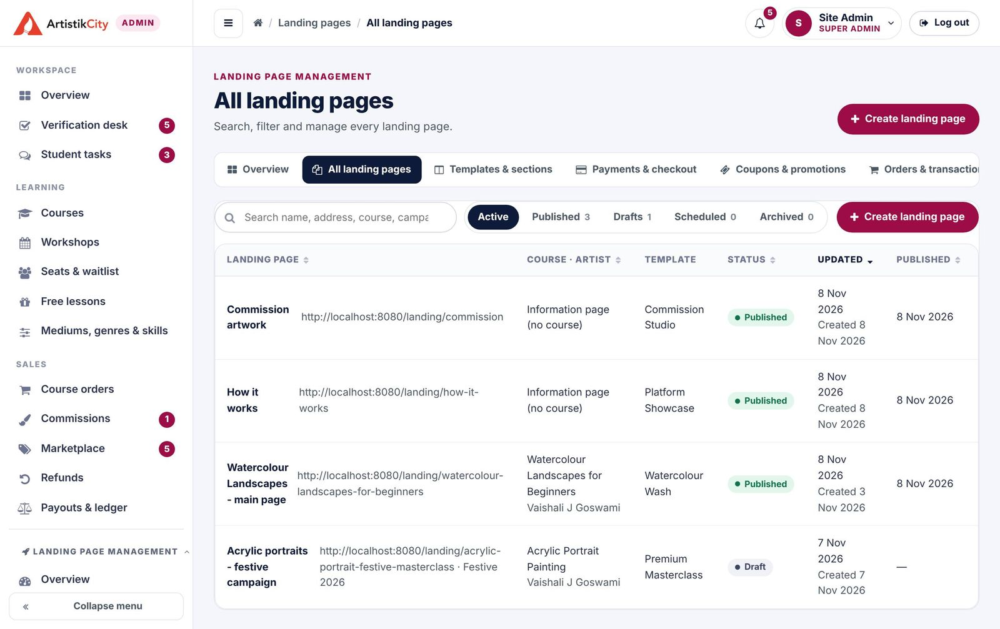<br><sub>All landing pages, with each page's full address</sub></td></tr></table>
<table><tr><td width="50%" valign="top">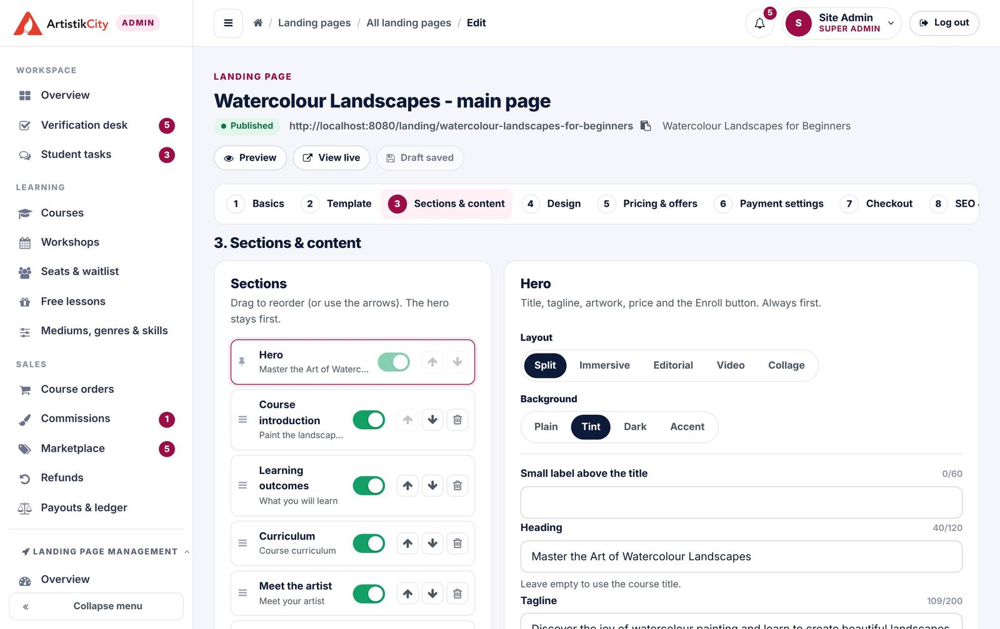<br><sub>Editor: sections & content</sub></td><td width="50%" valign="top">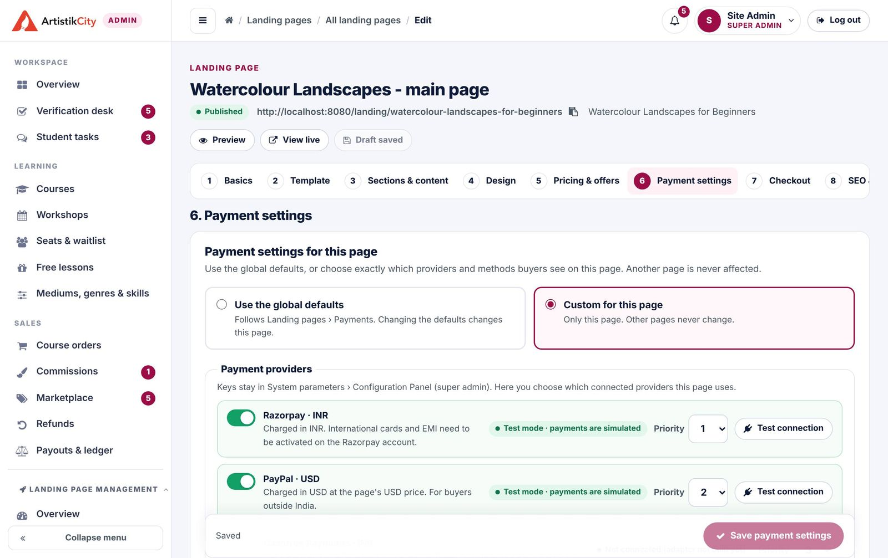<br><sub>Editor: per-page payment settings</sub></td></tr></table>
<table><tr><td width="50%" valign="top">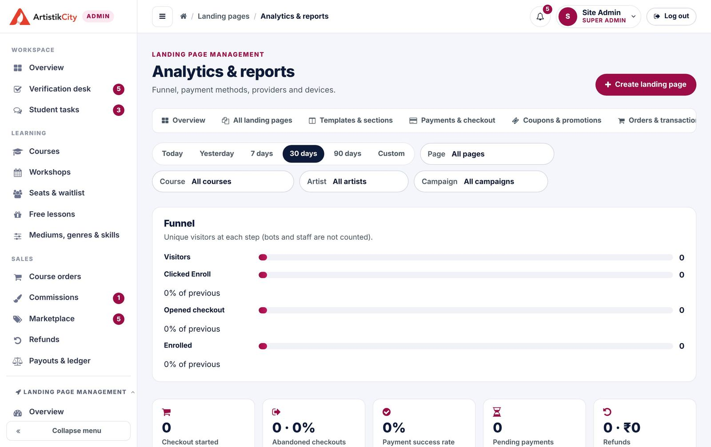<br><sub>Analytics & reports</sub></td><td width="50%" valign="top">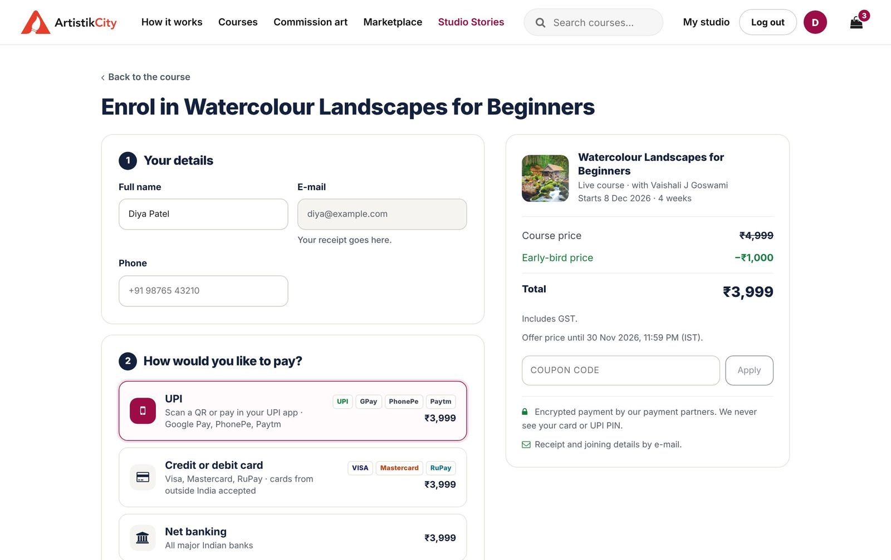<br><sub>Landing checkout (UPI, cards, net banking, PayPal)</sub></td></tr></table>

---

## 22. Three showcase landing pages

**When:** 7 Nov 2026, 23:34 · **Type:** Full prompt (attachment `4d1cf6e8`, 30 KB) · **Commits:** `5c6e51e` *landing page generation* · **Report:** [Three showcase landing pages](https://claude.ai/artifact/Gxa9bf9rM7jtxWsCDXPFZT)

<details>
<summary><b>Full prompt: create, populate, preview and publish three premium landing pages through the module</b> (28,946 characters, click to open)</summary>

````text
PROJECT: ARTISTIKCITY – CREATE AND POPULATE THREE PREMIUM LANDING PAGES USING THE EXISTING LANDING PAGE MANAGEMENT PLATFORM
1. YOUR ROLE

Act as a Principal Full-Stack Engineer, Product Designer, UI/UX Architect, Digital Marketing Strategist, Conversion Rate Optimization Expert, and Content Strategist.

Your task is to use the already developed Artistikcity Landing Page Management functionality to create, configure, populate, preview, and publish three complete, premium-quality landing pages.

This is an implementation task, not a design-only exercise.

You must work with the existing application, existing MySQL database, existing Admin Console, and the newly developed Landing Page Management module.

Do not create three independent hardcoded webpages.

Use the reusable landing page templates, section library, configuration engine, payment configuration, media library, and publishing functionality already implemented.

The objective is to demonstrate the full capabilities of the Landing Page Management system by creating three real, fully functional landing pages.

2. THREE LANDING PAGES TO CREATE

Use the following existing Artistikcity URLs as the reference for content, functionality, and business context.

LANDING PAGE 1: HOW IT WORKS

Reference URL: https://www.artistikcity.com/how-it-works

Purpose:

Explain how Artistikcity works, communicate its value proposition, build customer confidence, and guide visitors towards discovering courses, learning from artists, and exploring available services.

This page should function as a premium platform introduction and customer acquisition landing page.

Suggested page title:

"Discover, Learn and Create with Artistikcity"

Suggested tagline:

"Your creative journey starts here. Learn from talented artists, explore your creativity, and bring your artistic ideas to life."

Primary CTA: "Explore Courses"

Secondary CTA: "Discover How It Works"

LANDING PAGE 2: WATERCOLOUR LANDSCAPES FOR BEGINNERS

Reference URL: https://www.artistikcity.com/course/watercolour-landscapes-for-beginners

Purpose:

Create a high-converting course sales landing page.

This page should convince aspiring artists and beginners to enroll in the Watercolour Landscapes for Beginners course.

Suggested page title:

"Master the Art of Watercolour Landscapes"

Suggested tagline:

"Discover the joy of watercolour painting and learn to create beautiful landscapes, one brushstroke at a time."

Primary CTA: "Enroll Now"

Secondary CTA: "Watch Course Preview"

The page must highlight the artist, course value, learning outcomes, curriculum, artwork, pricing, testimonials, and payment options.

LANDING PAGE 3: ART COMMISSION – STEP 1

Reference URL: https://www.artistikcity.com/commission/step-1

Purpose:

Create a premium lead-generation and conversion experience for customers interested in commissioning personalized artwork.

This page should make it easy for visitors to start a personalized artwork request.

Suggested page title:

"Turn Your Memories Into Timeless Art"

Suggested tagline:

"Commission a unique piece of artwork, created by talented artists and inspired by your story."

Primary CTA: "Start Your Art Commission"

Secondary CTA: "Explore Artwork"

This page should explain the commission process, available artwork options, personalization possibilities, and the steps involved in submitting a commission request.

Preserve the existing commission business workflow and its underlying functionality.

3. FIRST: INSPECT THE EXISTING APPLICATION

Before making any changes, inspect the entire existing project.

Project directory:

C:\Storage\AmitGoswami\NewArtistikcity\NewArtistikcityWebsite

Inspect:

Existing frontend architecture.
Backend architecture.
MySQL database connection.
Existing database tables.
Landing Page Management module.
Template management.
Section management.
Landing page builder.
Existing landing page rendering engine.
Existing media library.
Artist management.
Course management.
Commission management.
Payment integration.
Checkout functionality.
Order and enrollment workflows.
Authentication and authorization.
Existing URL routing.
Existing design system.

The local database is already running through the existing portable MySQL setup.

Database: artistikcity

Host: 127.0.0.1

Port: 3306

Use the existing database connection.

IMPORTANT:

Do not create another database.
Do not reset the database.
Do not delete existing records.
Do not unnecessarily recreate existing tables.
Do not break existing application functionality.
Do not replace the existing architecture without a compelling reason.

First understand the newly implemented Landing Page Management functionality and use it.

4. CRITICAL REQUIREMENT: USE THE EXISTING LANDING PAGE MANAGEMENT MODULE

All three landing pages must be created using the Landing Page Management module.

Navigate logically through the existing functionality:

Admin Console → Landing Page Management → All Landing Pages → Create Landing Page.

Use the existing:

Template Library.
Section Library.
Landing Page Builder.
Content Management.
Design Configuration.
Pricing Configuration.
Payment Configuration.
Checkout Configuration.
SEO Configuration.
Media Library.
Preview.
Publishing.
Analytics.

If the application exposes APIs or backend services for creating and managing landing pages, use those existing services.

If the module is not fully functional, identify the missing functionality and implement the required fixes before creating the pages.

Do not bypass the Landing Page Management module by inserting static pages directly into frontend routing.

Do not create hardcoded JSX/HTML pages for the three URLs.

The database-backed landing page configuration must drive the public page rendering.

5. CREATE THE THREE LANDING PAGES AS THREE DIFFERENT EXPERIENCES

Do not force all three pages into the same visual template.

They have different purposes and should have different visual identities within the Artistikcity brand.

PAGE 1: HOW IT WORKS

Choose the most suitable existing template, preferably:

Platform Showcase.
Creative Experience.
Artistikcity Brand Experience.

If no suitable template exists, create a reusable template using the existing template architecture.

Required sections
Premium Hero Section

Include:

Artistikcity logo.
Compelling headline.
Platform introduction.
Beautiful artistic background imagery.
Primary CTA: Explore Courses.
Secondary CTA: Discover How It Works.
What Is Artistikcity?

Explain the platform and its purpose.

Create engaging copy explaining how Artistikcity connects people with art, artists, learning, and creative experiences.

Discover What You Can Do

Create visually attractive service cards.

Include:

Learn from Artists.
Explore Art Courses.
Discover Creative Workshops.
Commission Personalized Artwork.
Connect with Creative Professionals.

Only present services that are actually supported by the platform.

How Artistikcity Works – Step-by-Step Journey

Create a visually engaging four- or five-step process.

For example:

Discover your creative interest.
Explore artists, courses, or artwork.
Select your preferred experience.
Connect, enroll, or submit your request.
Begin your creative journey.

Adapt the steps to the actual workflows available in Artistikcity.

Explore Courses

Display available courses dynamically.

Include:

Course artwork.
Course title.
Artist name.
Course description.
Price where available.
Course CTA.

Link the Watercolour Landscapes course to the actual course landing page.

Meet Our Artists

Showcase available artists using actual Artistikcity artist records.

Include:

Artist image.
Name.
Biography.
Artistic specialization.
Portfolio.
View profile CTA.
Why Choose Artistikcity?

Highlight genuine platform benefits.

Examples:

Discover talented artists.
Learn creative techniques.
Explore different art forms.
Access structured learning experiences.
Commission personalized artwork.
Artwork Showcase

Create an immersive visual gallery.

Use real artwork from the existing media library or artist portfolios.

How We Help You Grow Creatively

Explain the creative learning journey and benefits of engaging with the platform.

Testimonials

Display existing genuine testimonials if available.

Frequently Asked Questions

Create relevant questions and answers about:

Artistikcity.
Courses.
Artist discovery.
Artwork commissions.
Payments.
Customer support.
Final CTA

Headline: "Your Creative Journey Starts Today"

Buttons:

Explore Courses.
Discover Artists.
Commission Artwork.
Footer

Use the existing Artistikcity footer and brand information.

Page 1 design direction

The design should feel like a premium creative marketplace.

Use:

Large editorial typography.
Beautiful artwork.
Immersive imagery.
Elegant section transitions.
Subtle animations.
Generous whitespace.
Strong visual hierarchy.

This page should communicate the overall Artistikcity experience rather than feel like a conventional corporate website.

PAGE 2: WATERCOLOUR LANDSCAPES FOR BEGINNERS

Choose the most suitable template:

Premium Artist Masterclass / Course Sales Page.

This page should prioritize enrollment conversion.

Required sections
Premium Course Hero

Include:

Course title.
Artist name.
Compelling tagline.
Course artwork.
Course price.
Discounted price, if configured.
Course duration, if verified.
Skill level.
Language.
Number of lessons, if available.
Enroll Now CTA.
Course preview CTA.
Genuine trust indicators.
Course Introduction

Explain the learning experience and what makes the course valuable.

What You Will Learn

Create attractive learning outcome cards.

Suggested topics, subject to actual course content:

Introduction to watercolour painting.
Understanding watercolour materials.
Colour mixing.
Brush control.
Composition.
Creating natural landscapes.
Light and shadows.
Creating finished paintings.
Course Curriculum

Display the actual available modules and lessons.

Use expandable accordions.

Include:

Module title.
Lesson title.
Description.
Duration.
Free preview availability.

Do not invent lesson durations or claim unavailable videos exist.

Meet the Artist

Use the actual artist associated with the course.

Include:

Profile photograph.
Biography.
Artistic experience.
Specializations.
Achievements.
Artwork portfolio.
Artist introduction video if available.
Artwork Gallery

Create a premium gallery showcasing actual watercolour landscapes.

Use:

Masonry layouts.
Large artwork images.
Image captions.
Full-screen previews.
Before-and-after comparisons if actual assets exist.
Who Should Join?

Include:

Beginners.
Hobby artists.
Creative enthusiasts.
People interested in learning watercolour painting.
What You Need to Get Started

Explain required materials.

Use actual course instructions where available.

Course Benefits

Highlight verified benefits:

Structured lessons.
Practical demonstrations.
Learn at your own pace.
Access duration.
Downloadable resources if available.
Certificate if offered.
Student Testimonials

Display real testimonials from existing database records.

Do not fabricate student names, photos, ratings, or reviews.

Course Pricing

Display:

Original price.
Current price.
Discount.
Course inclusions.
Access information.
Refund policy.
Payment Options

Integrate the existing Landing Page Management → Payment Configuration functionality.

Configure this specific course landing page independently.

Support payment options based on the configured gateway capabilities:

UPI.
UPI QR.
UPI Intent.
Credit Card.
Debit Card.
Visa.
Mastercard.
RuPay.
Net Banking.
Supported wallets.
Google Pay, PhonePe, and Paytm where supported.
EMI where supported.
International cards where supported.

Enable or disable payment methods through the landing page admin settings.

The public checkout must dynamically reflect the actual payment configuration.

Do not hardcode payment methods into the frontend.

FAQ

Include questions about:

Beginner suitability.
Materials required.
Course access.
Lesson availability.
Payment.
Refunds.
Certificates.
Technical support.
Final Enrollment CTA

Create a powerful final conversion section.

Footer

Use Artistikcity branding.

Page 2 design direction

This should feel like a premium online art masterclass.

Use:

Watercolour-inspired backgrounds.
Artistic compositions.
Large course artwork.
Elegant typography.
Warm neutral colors.
Subtle brushstroke-inspired design elements.
Premium editorial layouts.
Clear pricing.
Strong enrollment CTAs.

The artwork must be the visual hero.

Avoid generic SaaS or standard e-commerce layouts.

PAGE 3: COMMISSION – STEP 1

Choose the most suitable template:

Premium Custom Art Commission / Lead Generation.

This page has a different conversion goal from the course page.

The primary objective is to encourage customers to submit a commission request.

Preserve the existing commission step-by-step process and backend business logic.

Do not replace the existing commission functionality with a static marketing form.

Required sections
Hero Section

Headline:

"Turn Your Memories Into Timeless Art"

Subheading:

"Bring your ideas to life through personalized artwork, created with care by talented artists."

CTA: "Start Your Art Commission"

Use beautiful artwork as the hero visual.

What Is a Custom Art Commission?

Explain how customers can request personalized artwork.

Examples:

Family portraits.
Pet portraits.
Personalized gifts.
Landscape artwork.
Special occasion artwork.
Custom creative concepts.

Only show categories supported by the actual commission system or clearly identify additional categories as proposed options.

Why Commission Artwork?

Explain:

Personalization.
Unique creations.
Artistic craftsmanship.
Meaningful gifts.
Collaboration with artists.
Artwork Gallery

Show real commissioned artwork or approved portfolio images.

Include:

Portraits.
Landscapes.
Custom artwork.
Other supported categories.
How the Commission Process Works

Create a visual step-by-step journey.

Example:

Step 1: Tell Us What You Want

Customer shares their artwork requirements.

Step 2: Select Your Preferences

Choose available artwork category, style, size, and other supported options.

Step 3: Artist Review

The request is reviewed according to the actual business workflow.

Step 4: Quotation and Confirmation

The customer receives the applicable pricing or quotation.

Step 5: Artwork Creation

The selected artist works on the commission.

Step 6: Final Delivery

Artwork is delivered according to the agreed arrangement.

Important:

Verify the existing commission workflow before presenting these steps as actual business commitments.

Available Artwork Categories

Display categories supported by the existing commission system.

Personalization Options

Display available options, such as:

Artwork style.
Size.
Medium.
Subject.
Reference images.
Personal messages.

Only enable options that are supported by the backend.

Meet Our Artists

Show relevant artists and their portfolios.

Customer Testimonials

Use genuine commission customer reviews if available.

Commission Request Form

This is the most important functional section.

Integrate the existing commission Step 1 workflow.

Preserve:

Existing field definitions.
Existing validation.
Existing API calls.
Existing file upload functionality.
Existing database relationships.
Existing multi-step workflow.

Improve the UI without breaking the business logic.

Make the form visually attractive, easy to understand, and mobile-friendly.

Show a clear progress indicator if the commission process contains multiple steps.

Pricing Information

Explain how pricing works.

If commissions require custom quotations, explain that clearly.

Do not invent fixed prices.

FAQ

Include:

How commissions work.
Available artwork styles.
How pricing is calculated.
How long artwork takes.
How to upload reference images.
How artists are selected.
Payment process.
Delivery.
Revisions.

Only make commitments supported by existing business rules.

Final CTA

Headline: "Let's Create Something Meaningful Together"

CTA: "Start Your Art Commission"

Footer

Use the Artistikcity footer.

Page 3 design direction

Create an emotional, artistic, premium experience.

Use:

Editorial layouts.
Beautiful commissioned artwork.
Warm color palettes.
Large imagery.
Elegant typography.
Personal storytelling.
A clear multi-step request journey.

The customer should feel they are beginning a personalized creative experience, not filling out a generic business enquiry form.

6. CONTENT CREATION REQUIREMENTS

This is a critical requirement.

I want all three landing pages to be complete and populated.

Do not leave empty sections, placeholder text, or unfinished content.

Inspect the existing database and website to retrieve:

Course information.
Artist profiles.
Artist biographies.
Artist photographs.
Course curriculum.
Course images.
Pricing.
Testimonials.
Artwork.
Commission categories.
Commission workflow.
Existing FAQs.
Existing policies.
Contact details.

Use existing information wherever available.

Where information is missing:

Create professionally written, relevant marketing content based on the purpose of the section.

For example:

Hero descriptions.
Platform introduction.
Value propositions.
Learning outcomes.
General explanations.
Section headings.
CTA messaging.
FAQs.
Commission process explanations.

However, follow these rules:

Never invent artist credentials.
Never invent awards or exhibitions.
Never fabricate testimonials.
Never invent student ratings.
Never invent enrollment counts.
Never invent course prices.
Never invent course durations.
Never claim lifetime access unless verified.
Never invent refund policies.
Never promise delivery timelines or commission guarantees without confirmation.

For missing factual information, use appropriate neutral marketing language or create clearly identified content requiring administrator approval.

All missing content should be recorded in an implementation report.

The final landing pages should not visibly contain developer placeholders or fake business information.

7. IMAGE AND MEDIA REQUIREMENTS

Visual quality is a major priority.

Use actual Artistikcity artwork and media wherever available.

Inspect:

Existing S3 assets.
Existing media library.
Course images.
Artist portfolio images.
Commission artwork.
Existing website image assets.

If suitable images are missing:

Use high-quality, legally usable artistic imagery that matches the content.

Prefer:

Realistic watercolour landscapes.
Artist painting processes.
Premium artwork galleries.
Creative studio imagery.
Custom portrait artwork.
Art materials and tools.

Do not use:

Generic corporate stock images.
Unrelated illustrations.
Repeated images across every section.
Low-resolution images.
Broken image references.

Optimize images for responsive delivery.

Add appropriate alt text.

Do not overwrite original artist artwork or media assets.

8. TEMPLATE AND SECTION CONFIGURATION

Use the existing template and section architecture.

Choose templates independently for each page.

If a suitable template does not exist, create reusable templates and reusable sections through the existing Landing Page Management functionality.

Do not duplicate components unnecessarily.

Configure:

Section order.
Section visibility.
Section layout.
Section backgrounds.
Typography.
Image positioning.
CTA behavior.
Desktop presentation.
Mobile presentation.

Every landing page should have a distinct visual composition.

Maintain consistent Artistikcity brand identity across all three.

9. PAYMENT AND CHECKOUT CONFIGURATION

Payment settings must remain within:

Admin Console → Landing Page Management.

Configure payment settings independently for the three landing pages.

How It Works

This is an informational platform introduction.

Use CTAs to guide customers to courses, artists, or commissions.

Do not add an unnecessary payment checkout.

Watercolour Landscapes for Beginners

Configure the course's payment methods using:

Landing Page Management → Payment Configuration.

Use existing payment gateway integrations.

Enable only payment methods supported by the configured provider.

Configure:

Course pricing.
Discounts, if verified.
Available payment methods.
Checkout fields.
Coupon eligibility.
Success redirect.
Payment failure handling.
Commission – Step 1

Inspect the existing commission payment process.

If the existing workflow supports quotations or payments at a later stage, preserve that behavior.

Do not introduce a mandatory upfront payment or deposit unless the existing business rules explicitly require it.

The commission page should use the existing commission workflow.

10. SEO AND MARKETING CONFIGURATION

Configure SEO individually for each landing page.

How It Works

Suggested SEO title:

How Artistikcity Works | Discover Art, Artists and Creative Learning

Suggested description:

Discover how Artistikcity connects art lovers, aspiring artists, and creative enthusiasts with artists, courses, and personalized artistic experiences.

Watercolour Course

Suggested SEO title:

Watercolour Landscapes for Beginners | Artistikcity

Suggested description:

Learn watercolour landscape painting with Artistikcity. Explore the course, discover its learning experience, and begin your creative journey.

Commission

Suggested SEO title:

Custom Art Commissions | Personalized Artwork | Artistikcity

Suggested description:

Create something meaningful with personalized artwork from Artistikcity. Explore custom art options and start your commission request.

Also configure:

Canonical URLs.
Open Graph images.
Open Graph descriptions.
Social sharing metadata.
Structured data where applicable.
Sitemap inclusion.
Image alt text.
UTM tracking.
Analytics events.

Preserve the original public URLs.

11. RESPONSIVE DESIGN AND UI/UX

All three pages must look exceptional across:

Desktop.
Laptop.
Tablet.
Android phones.
iPhones.
iOS Safari.
Android Chrome.

Use a mobile-first design approach.

Important requirements:

Responsive hero sections.
Mobile-optimized artwork.
Clear typography.
Touch-friendly buttons.
Responsive galleries.
Mobile-friendly forms.
Sticky CTA where appropriate.
No horizontal overflow.
No overlapping elements.
No broken layouts.
Fast-loading images.
Accessible forms and navigation.

Each page should feel intentionally designed for mobile.

12. FUNCTIONALITY REQUIREMENTS

All CTAs must work.

Verify:

How It Works:

Explore Courses navigates to the correct course listing or discovery experience.
Discover Artists navigates to the actual artist experience.
Commission Artwork opens the correct commission journey.

Watercolour Course:

Enroll Now opens the correct checkout.
Course Preview opens the actual preview when available.
Curriculum accordions work.
Pricing is correct.
Payment methods match the landing page configuration.
Successful payment triggers the existing enrollment workflow.

Commission:

Start Your Art Commission opens the existing commission Step 1 workflow.
Form validation works.
Image uploads work.
Next-step navigation works.
Data is saved correctly.

Do not leave decorative buttons without functionality.

13. DATABASE AND PUBLISHING REQUIREMENTS

Create the three pages through the existing Landing Page Management backend.

Create the necessary records in MySQL.

Each page must have:

Unique landing page ID.
Unique slug.
Selected template.
Section configurations.
Content configuration.
Design configuration.
SEO configuration.
Appropriate payment configuration.
Publication status.
Version history.

Reuse existing course and artist IDs.

Do not duplicate the existing course, artist, or commission records.

Preserve existing URL mappings and route behavior.

Before publishing, verify that the landing page rendering engine correctly resolves the database configuration.

The original URLs must continue to work:

/how-it-works

/course/watercolour-landscapes-for-beginners

/commission/step-1

If these URLs currently have hardcoded implementations, migrate them carefully to the new landing page rendering architecture while preserving their existing business functionality.

Do not break existing links, customer bookmarks, SEO rankings, or commission submissions.

14. PREVIEW AND PUBLISHING

For each landing page:

Create the page in Landing Page Management.
Select the template.
Configure all sections.
Populate the content.
Upload and select images.
Configure CTA links.
Configure SEO.
Configure payment settings where applicable.
Preview on desktop.
Preview on mobile.
Validate functionality.
Save the draft.
Publish through the existing publishing workflow.

If the publishing workflow requires approval, follow the existing approval process.

Do not claim that a page is published if the publishing operation fails.

15. FINAL QUALITY ASSURANCE

Test all three pages.

Visual testing
Desktop layout.
Mobile layout.
Typography.
Image quality.
Spacing.
Section alignment.
Color consistency.
CTA visibility.
Responsive galleries.
Functional testing
Landing page rendering.
URL routing.
Section configuration.
Course links.
Artist links.
Commission forms.
Image uploads.
Checkout.
Payment methods.
SEO metadata.
Database persistence.
Regression testing

Ensure:

Existing course pages still work.
Existing artist profiles still work.
Existing commission workflow still works.
Existing admin functionality is not broken.
Existing payment integration is not affected.
Performance

Target:

Lighthouse Performance 90+.
Accessibility 95+.
SEO 95+.

Measure the actual results.

16. FINAL DELIVERABLES

After implementation, provide a report containing:

A. Landing Pages Created

For each page provide:

Landing page ID.
Landing page title.
URL.
Selected template.
Number of configured sections.
Publication status.
B. Content Created

List:

Existing content reused.
New marketing content created.
Missing factual information.
Content requiring admin approval.
C. Design

Explain:

Template selected.
Visual direction.
Key UI/UX enhancements.
Desktop experience.
Mobile experience.
D. Payment Configuration

For the Watercolour course, report:

Selected payment provider.
Enabled payment methods.
Disabled payment methods.
Checkout configuration.

For the other pages, explain their payment behavior.

E. Technical Implementation

Report:

Database records created or updated.
APIs reused.
Components reused.
Templates created.
Sections created.
URL routing changes.
Any migration performed.
F. Testing Results

Report:

Desktop testing.
Mobile testing.
Functional testing.
Payment testing.
Commission form testing.
SEO testing.
Performance testing.
G. Outstanding Issues

List any missing credentials, unavailable assets, unverified business details, or issues that require administrator approval.

17. EXECUTION INSTRUCTIONS

Follow this sequence:

PHASE 1: Inspect the existing website and project.

PHASE 2: Understand the Landing Page Management functionality.

PHASE 3: Inspect existing database records and media assets.

PHASE 4: Map the three existing URLs to three different landing page experiences.

PHASE 5: Select or create appropriate reusable templates.

PHASE 6: Create all sections and populate content.

PHASE 7: Configure images, CTAs, SEO, pricing, and payment settings.

PHASE 8: Create the three landing page records through the existing management module.

PHASE 9: Preview and validate the three pages.

PHASE 10: Publish them through the existing publishing workflow.

PHASE 11: Perform regression testing.

PHASE 12: Provide the implementation report.

Do not stop after creating the architecture or suggesting designs.

I expect actual implementation in the existing repository and database.

If something is missing, investigate and implement the necessary functionality using the existing architecture.

If a factual detail is unavailable, use sensible non-factual marketing copy rather than inventing business facts.

Do not reset the database or destroy existing data.

FINAL DESIGN EXPECTATION

I want these three pages to represent the best of Artistikcity.

They should look like three professionally designed experiences from one premium creative brand.

The How It Works page should communicate trust and platform value.

The Watercolour course page should drive course enrollment.

The Commission page should inspire customers to request personalized artwork.

All three must use the existing Landing Page Management functionality and remain independently editable through the Admin Console.

The ultimate test is this: after implementation, I should be able to open Admin Console → Landing Page Management, edit any of these three pages, change sections, update images, modify content, control payment options where applicable, preview, and publish without requiring a developer to modify frontend code.

Build it to production-quality standards.
````

</details>

**Reusable prompt (for other projects):**

```text
Use the Landing Page Management module (don't hand-code pages) to create, populate, preview and publish {{N}} landing pages:
{{PAGES e.g. "How it works" (information page), "{{COURSE}}" (course sales page), "Commission" (information page)}}.
For each: goal and audience, section plan, copy written for conversion, real images from the site, SEO, mobile check.
Hard rules: do not create or reset databases or delete records; never invent testimonials, credentials, prices, ratings
or delivery promises; if real data is missing, leave the section out and tell me; don't claim a page is published unless
publishing succeeded. Make creation repeatable (runs once per database) and test it. Report each page's address.
```

**What it produced**
- **Information pages:** a second kind of landing page (`kind = 'SITE'`, migration `2026-11-09_landing_site_pages.sql`). It has no price, payments or checkout; course-only sections are refused and the main button needs a link.
- **The three pages**, created *through the module* (`LandingShowcase`, runs once per database):
  - **How it works**, an information page;
  - **Watercolour Landscapes for Beginners**, a course page using the course's real price, instructor and syllabus;
  - **Commission**, an information page whose request section opens the commission wizard with the theme pre-chosen.
- **Kept to the brief's rules:** no invented testimonials, credentials, prices or delivery promises. Where real data didn't exist, the section was left out rather than faked.
- **Tests:** `LandingSiteConfigTest`, `tests/system/test_landing_showcase.py` (90 checks) and `landing-showcase.spec.js`. Playwright passed 72/72.

<table><tr><td width="50%" valign="top">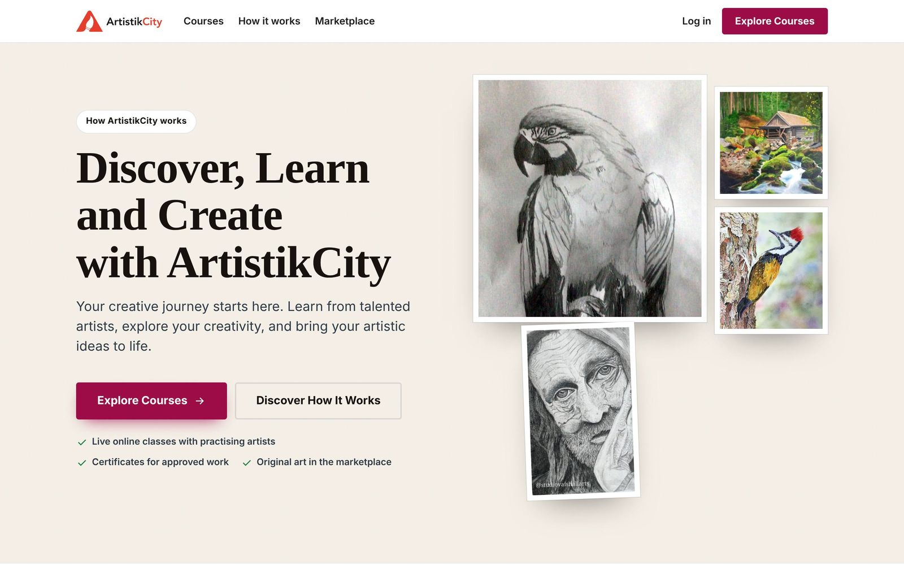<br><sub>/landing/how-it-works</sub></td><td width="50%" valign="top">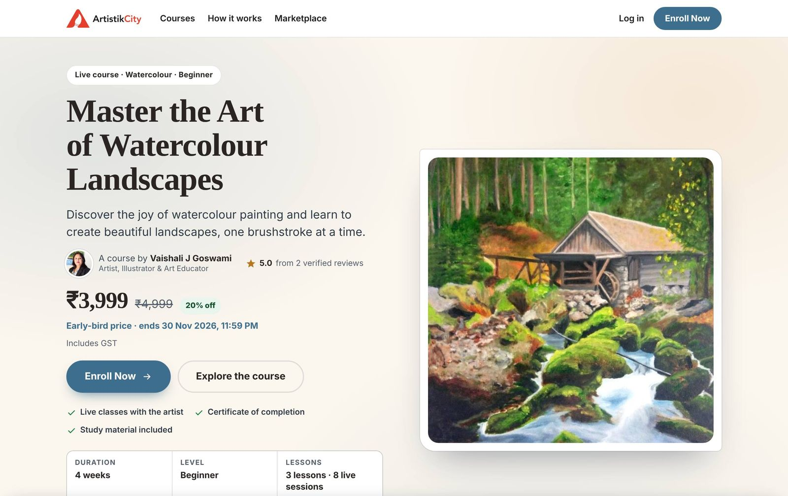<br><sub>/landing/watercolour-landscapes-for-beginners</sub></td></tr></table>
<table><tr><td width="50%" valign="top">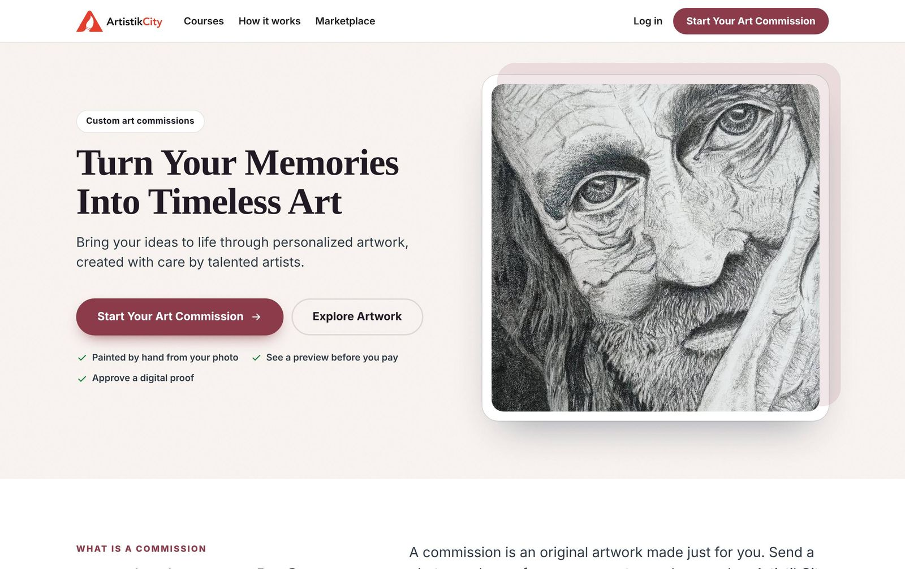<br><sub>/landing/commission</sub></td><td width="50%" valign="top">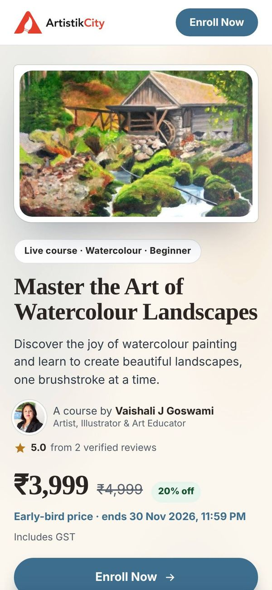<br><sub>Landing page on a phone</sub></td></tr></table>

### 22a. "Where are the landing pages published? What are the URLs?"

**When:** 7 Nov 2026, late evening · **Type:** Chat question

**Answer at the time:** each page's address, listed in the module. This question led straight to the next prompt.

---

## 23. Keep the original pages; give landing pages their own address; fix error QRCZ0J9

**When:** 8 Nov 2026, 00:02 · **Type:** Chat (verbatim) · **Commit:** `9c6b5b3` *landing page gen and restructure* (36 files)

> dont use https://www.artistikcity.com/how-it-works , https://www.artistikcity.com/course/watercolour-landscapes-for-beginners and https://www.artistikcity.com/commission/step-1 for launching the landging pages... revert these places for the previous functionality . what landing page URL to be generated dynamically and displayed int he landing page management and fix anythins that is not working... currrently i am getting error...Something went wrong / Something went wrong on our side. Please try again in a moment; if it keeps happening, contact us and quote reference QRCZ0J9.

**Reusable prompt (for other projects):**

```text
Don't use the existing pages {{URLS}} for landing pages: restore their previous behaviour exactly. Give every landing
page its own address generated from its name (unique slug, editable) and show the full link with a copy button in the
admin list and editor. Redirect any links that changed. Also find and fix this error: {{ERROR MESSAGE + REFERENCE}}.
If the log has no entry for the reference, harden the likely causes and tell me which you couldn't prove.
```

**What it produced**
- **Own address:** every landing page now lives at **`/landing/{slug}`**, with checkout at `/landing/{slug}/enroll`.
  - The slug is generated from the name when none is typed, and it is unique.
  - The full link, with a copy button, shows in the page list and in the editor.
- **Originals restored:** `/how-it-works`, `/course/{slug}` and `/commission/step-1` are always the original pages again. A landing page never replaces a site page, and old `/course/{slug}/enroll` links redirect.
- **Error QRCZ0J9:** there was no log entry for this reference on your PC, so Claude hardened the likely causes. Every section of a public landing page now renders on its own (one bad section can't break the page), and empty names are handled.
- **Showcase retry:** the job that re-creates the Watercolour page could miss it. It now finds the course by title, and its check also matches the first release's message.
- All suites re-run; Playwright 72/72.

<table><tr><td width="50%" valign="top">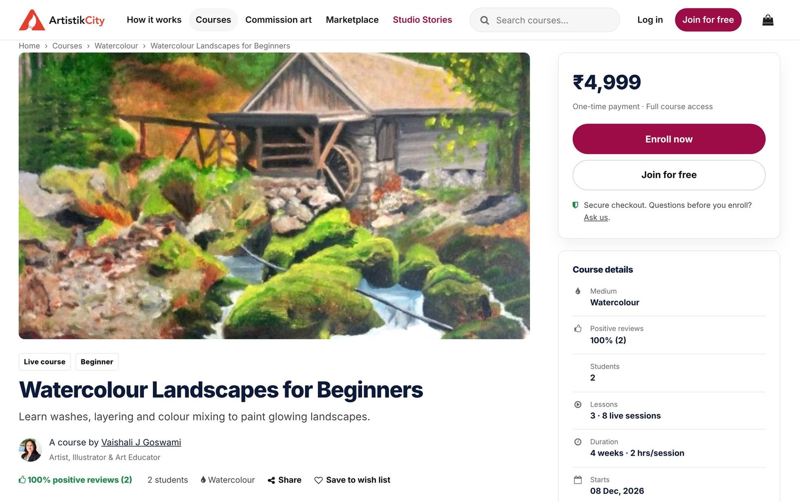<br><sub>/course/watercolour-landscapes-for-beginners: the original course page again</sub></td><td width="50%" valign="top"><br><sub>…and the landing page at its own address</sub></td></tr></table>

---

## 24. 500 error on /admin/landing after the AWS deploy

**When:** 8 Nov 2026, 00:28 → 08:27 · **Type:** Chat + screenshots + log · **Commit:** `6e3a188` *fix the defect 500 error on the landing page*

**The prompts, in order (verbatim):**
1. *00:28* "why landing page management/overview is not working on AWS after deployment.. do i need to do some db migration"
2. *00:31* a screenshot of the error page (reference NVFAHTN)
3. *08:10* "I am getting error after deploying using the deploy AWS script from github actions. here goes the error ...https://www.artistikcity.com/admin/landing ... please correct it find the root cause .... it working perfectly on the localhost...." (screenshot, reference N171VLA)
4. *08:26* "can you give me commands in one line so it runs on terminal"
5. *08:27* the CloudWatch log (attachment `1036f184`)

<table><tr><td width="50%" valign="top">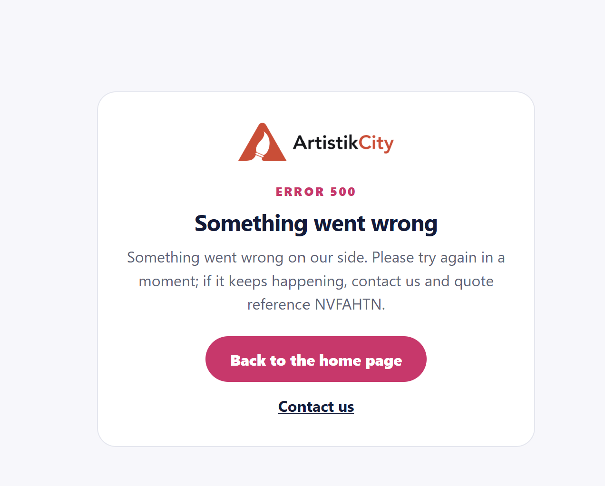<br><sub>Your screenshot, 00:31</sub></td><td width="50%" valign="top">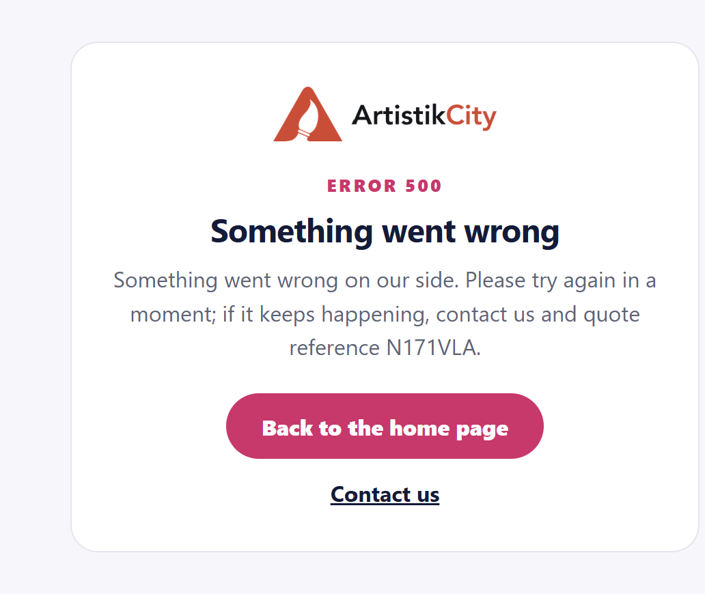<br><sub>Your screenshot, 08:10</sub></td></tr></table>

Claude gave a one-line PowerShell command that pulls the log lines for that second from CloudWatch:

```powershell
aws logs filter-log-events --log-group-name /artistikcity/app --region ap-south-1 --start-time ([DateTimeOffset]::Parse("2026-11-08T08:08:40+05:30").ToUnixTimeMilliseconds()) --end-time ([DateTimeOffset]::Parse("2026-11-08T08:08:43+05:30").ToUnixTimeMilliseconds()) --query "events[].message" --output text
```

The log it returned:

```text
2026-11-08T08:08:41.250+05:30 ERROR 1 --- [artistikcity] [nio-8080-exec-8] c.a.http.GlobalExceptionHandler          : Unhandled error on GET /admin/landing (ref N171VLA)       com.artistikcity.support.Db$DbException: Illegal mix of collations for operation 'UNION' [SQL: select distinct campaign from (select campaign from landing_pages where campaign is not null union select campaign from landing_coupons where campaign is not null union select utm_campaign as campaign from orders where utm_campaign is not null and landing_page_id is not null) x order by campaign limit 100]              at com.artistikcity.support.Db.select(Db.java:54) ~[!/:1.0.0]           at com.artistikcity.landing.LandingA …
```

**Root cause:** `Illegal mix of collations for operation 'UNION'`.
- The RDS database was loaded from a PC dump, so the original tables kept the PC's collation (`utf8mb4_0900_ai_ci`).
- The landing tables were created later by the migrations on RDS and got the server default (`utf8mb4_unicode_ci`).
- MySQL refuses to compare or UNION text across the two. Locally every table had the same collation, which is why it worked there.

**Reusable prompt (for other projects):**

```text
{{PAGE URL}} returns 500 on the deployed site but works locally. The error reference is {{REF}}.
1. Give me one-line commands (for {{SHELL e.g. PowerShell}}) to pull the exact log lines for that request from
   {{LOGGING_SERVICE e.g. CloudWatch log group /app}}.
2. From the stack trace, find the root cause, and explain why it differs from my local setup.
3. Fix it with a re-runnable migration that changes nothing where everything is already correct, reproduce the server's
   condition locally to prove the fix, and make the page explain missing database updates instead of a 500.
4. Tell me how the deploy applies it and how to apply it by hand.
```

**What it produced**
- **The fix:** migration `2026-11-10_landing_collation.sql`.
  - It converts the `landing_*` tables to the collation of `orders` and sets that as the database default.
  - Tables that already match are skipped, nothing is dropped, and it is safe to run twice.
  - The deploy workflow applies it automatically; `docs/AWS-DEPLOY.md` also shows how to apply it by hand through the RDS tunnel.
- **`LandingSchema`:** if a landing migration is ever missing, the admin page shows "Database update needed" with the file name, instead of a 500, and recovers within a minute once applied.
- **Proof:** Claude recreated your AWS mismatch locally. Before the fix, `/admin/landing`, analytics and the overview API gave 500; after it, all gave 200 with the data intact. All suites passed (test_security 22, admin_setup 78, selling 44, site_access 61, cart_offers 90, landing 129, landing_showcase 90, platform 57, buying 68), and JUnit 117.

<table><tr><td width="100%" valign="top"><br><sub>Landing Page Management › Overview after the fix</sub></td></tr></table>

---

## 25. This document

**When:** 8 Nov 2026, 08:47 · **Type:** Chat (verbatim)

> collect all the prompts used so far in this project and create the myprompts.md file with perfect documents and screen shots and outputs from those prompts in details.

**Reusable prompt (for other projects):**

```text
Collect every prompt used in this project and create docs/myprompts.md: for each one the date, the prompt (verbatim
where the text exists, clearly marked as reconstructed otherwise), what it produced (features, files, migrations, tests,
reports) and screenshots of the result taken from the current code on a fresh demo database (desktop and phone).
Mask account numbers, IPs and anything secret. Add a reusable, project-agnostic version of each prompt.
```

**What it produced:** this file, plus 50+ screenshots and PDF renders in `docs/myprompts/`. They were captured from a fresh run of the current code.

### More screens on a phone

<table><tr><td width="33%" valign="top"><br><sub>Home</sub></td><td width="33%" valign="top"><br><sub>Courses</sub></td><td width="33%" valign="top"><br><sub>Marketplace</sub></td></tr></table>

### More screens

<table><tr><td width="50%" valign="top"><br><sub>Home page</sub></td><td width="50%" valign="top"><br><sub>Admin › People & roles</sub></td></tr></table>
<table><tr><td width="100%" valign="top"><br><sub>Admin › Course orders</sub></td></tr></table>


---

## Appendix A: the long-prompt attachments

| Attachment | Sent (IST) | Size | Section |
|---|---|---|---|
| `4ddbaf4d-attachment.txt` | 25 Oct 13:33 | 4.3 KB | §8 |
| `a6ddfdd5-attachment.txt` | 25 Oct 12:48 | 92.2 KB | §7 (log) |
| `48b1810b-attachment.txt` | 5 Nov 10:47 | 4.5 KB | §9 |
| `57f58e95-attachment.txt` | 5 Nov 13:28 | 5.0 KB | §10 (log) |
| `aebe88e1-attachment.txt` | 5 Nov 15:51 | 5.4 KB | §13 |
| `702689db-attachment.txt` | 5 Nov 22:46 | 10.2 KB | §13a (log) |
| `6fc0b55f-attachment.txt` | 6 Nov 17:44 | 6.0 KB | §15 |
| `b4b7d814-attachment.txt` | 6 Nov 23:19 | 4.1 KB | §19 |
| `cea2835c-attachment.txt` | 7 Nov 16:50 | 10.5 KB | §20 |
| `9990bbae-attachment.txt` | 7 Nov 21:40 | 35.3 KB | §21 |
| `4d1cf6e8-attachment.txt` | 7 Nov 23:34 | 29.5 KB | §22 |
| `1036f184-attachment.txt` | 8 Nov 08:27 | 11.4 KB | §24 (log) |

## Appendix B: published reports

These are Claude's write-ups for the larger prompts. They are private to your account until you share them.

| Report | For prompt |
|---|---|
| [ArtistikCity Production-Readiness Audit](https://claude.ai/artifact/XiZKtx8HNpyoUppEMbfKms) | QA / RBAC audit (5 Nov) |
| [ArtistikCity Catalog & Audit Prototype](https://claude.ai/artifact/XJ1z8DBMt2T7QQHnARbFWL) | Course filters, tag manager and security-log viewer (5 Nov) |
| [ArtistikCity QA & Site Lock Report](https://claude.ai/artifact/QYZfu9XyK5icwj8y3zwEkS) | E2E audit + site password (6–7 Nov) |
| [Cart, offers and step 2: implementation report](https://claude.ai/artifact/Gguv9jWY2MJc4k1f6wdbL2) | Cart + Make an offer (7 Nov) |
| [Landing Page Management: implementation report](https://claude.ai/artifact/X7uhwTDbuuWBYrSmesXYo1) | Landing Page Management (7 Nov) |
| [Three showcase landing pages: implementation report](https://claude.ai/artifact/Gxa9bf9rM7jtxWsCDXPFZT) | Three landing pages (7 Nov) |

## Appendix C: how to reproduce the screenshots

```bash
# fresh database with demo data, dev profile (test payments, no template cache)
START-ArtistikCity.bat -ResetDatabase      # then LOAD-DEMO-DATA.bat for the optional demo pack
# or: mvn spring-boot:run -Dspring-boot.run.profiles=dev
```

Demo logins (password `password`): student `student@artistikcity.com` (Aarav: certified, selling), buyer `diya@example.com`,
admin `admin@artistikcity.com` at `/admin/login`. The screenshots are in `docs/myprompts/`.

### Prompting patterns that worked well on this project

- **Give the role, the current state and the goal**, then numbered requirements (as in the marketplace, audit and landing-page prompts). Claude follows numbered lists closely and reports against them.
- **State the guard rails explicitly.** For example: "Do not create another database… Do not reset the database… Never invent course prices…". Claude repeated these back and kept to them, such as refusing to fake testimonials on the landing pages.
- **Paste the exact error and log line.** The 500 on `/admin/landing` was only solved once the CloudWatch stack trace (`Illegal mix of collations`) arrived; the error page reference alone (`N171VLA`) wasn't enough.
- **Name existing code when you know it.** The cart prompt said the back end already existed, which avoided a second cart.
- **Ask for a report.** Long prompts ended with a report doc (Appendix B), which is easier to review than a long chat reply.
